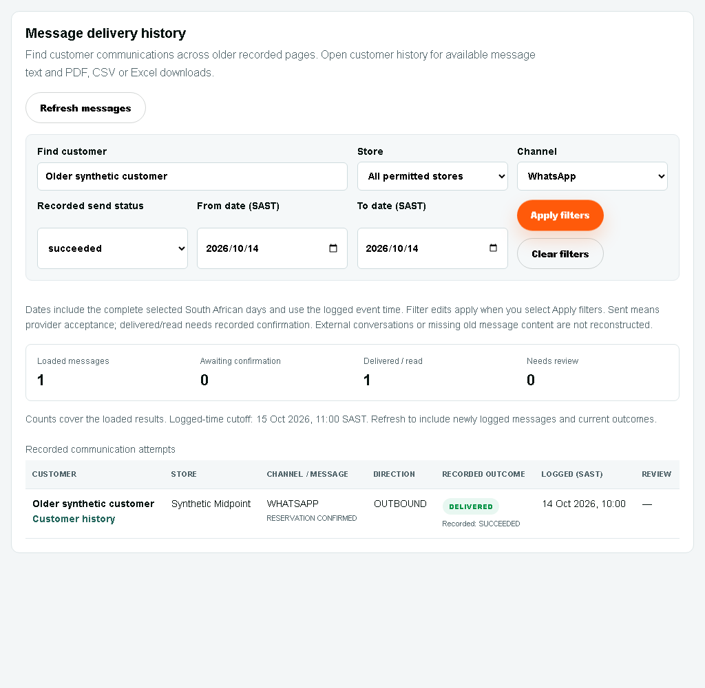

# STOR24
Store operations handbook

For Faeez, covering staff and the incoming store manager

15 October 2026 · Staff edition

Find the customer. Read the history. Confirm the next action.

This booklet covers customer history and downloads, follow-ups and arrivals, payment review, governed receipt corrections and booking quotes, enquiry origin and Counter workflows. Use the live system's current permission and readiness checks. Printed pages never override a hold or approval.

Portal: https://portal.stor24.co.za

Keep the acceptance pages at the back. Record actual results one item at a time; a printed guide or automated check is not staff acceptance.

## 01 · Your role and daily routine

**Faeez / store operator:** work only in the stores shown in your own account. Find customers, maintain authorised details, add dated notes, prepare bookings and review the source workflows available to your role.

Faeez's Midpoint role now includes booking-price viewing and proposals. Sign in again after the access update; independent price approval remains separate.

**Covering colleague:** use your own account. Read the customer's full history and current instructions, then acknowledge only work assigned to you. A handover note does not itself assign responsibility.

**Manager / administrator:** confirm the real covering colleague and the exact store access needed. The incoming covering manager starts on 1 November; account identification, onboarding and their own acceptance remain pending. Do not share another person's login.

**Finance approver:** financial viewing, receipt corrections, allocations, fees, rate approvals and bank/provider actions keep their separate permissions and independent approvals. A staff note or Excel download never approves a financial change.

1. Sign in with your own credentials and complete the required verification. Never give a password or one-time code to another person.
2. Confirm the selected store and review Operations reminders and the store event inbox.
3. Review today's agreed follow-ups and expected arrivals, including undated bookings that still need a date.
4. Check customer history before calling, changing a booking or taking over a colleague's work.
5. Record the outcome as a dated note; update the actual appointment or handover separately.
6. Before leaving, nominate eligible cover, record clear instructions and confirm that the named person has acknowledged the current plan.

If Midpoint or an expected action is missing, record the screen and error and ask the administrator to review access. Do not work around the restriction with a shared account.

## 02 · Find the customer and record a note

Open **Customers & tenants**. Search the name, contact or ID, choose the correct record and confirm the contact details before continuing. Similar names and repeated contact details are not proof that records should be merged.

**History & notes** opens first. Contact details, Bookings & units and Documents remain separate sections. The history brings together permitted notes, communications, bookings, tenancy/document records, appointments and retained move-in or move-out milestones. Account entries require additional financial viewing access.

1. Read the newest history and load older history when needed. All dates are shown in South African time.
2. Select **Add note**, choose the correct store and category, and write the interaction, agreed action and useful details for the next staff member.
3. Save once. The system records your author name and the server date. Add a new correction if something was wrong; saved notes are not rewritten.
4. If the result is uncertain, keep the details and use **Retry same note**. Do not compose a second copy while the first save is unresolved.

Categories: General; Phone call; Customer message; Payment follow-up; Move-in; Move-out request; Complaint; Staff handover.

Write facts and agreed actions. A payment-follow-up note does not schedule a reminder or approve money. A move-out note does not complete a move-out. Existing profile notes without an original date or author stay labelled as an undated summary.

## 03 · Search and download communications

Choose the customer first. Use **History type**, **Note category** and **Search history**. Search covers stored note text, staff authors, communication types/channels and retained message text; it cannot search a conversation the system never received.

Expand **Date and communication filters** for From/To dates in SAST, Email/SMS/WhatsApp and the recorded send status. Dates include the complete selected local days. Channel or send-status filters narrow results to communications. Send success is separate from the recorded delivered/read timestamps.

1. Set the filters and select **Apply filters**. Unsaved filter edits do not change an existing result or its download.
2. Choose **Download history** for PDF, **CSV** for a data file or **Excel** for a native .xlsx workbook.
3. The file includes all matching older pages, not only the visible entries. Use the individual entry's Download action for its evidence-summary PDF.
4. Open the downloaded file and confirm the customer, period, store and record count before sharing it through an authorised channel.

Excel includes filters, frozen headings and wrapped message text. If a result is too large, narrow the period/type rather than expecting a truncated file. Download access remains store-specific; it does not grant financial viewing or approval.

Available retained or verified provider text is included. Missing historical email, deleted provider text, external chats and attachments remain identified as missing. Authentication codes and private access links are excluded. An event-summary PDF is not the original signed agreement: use **Documents** for the original signed PDF.

## 03A · Find messages before opening a customer

Open **Communications**, then **Message delivery history**, when you need to find a customer from an older message. This lookup pages through recorded history instead of stopping at the newest 100 attempts.

1. Enter the customer's name, company, email, phone or reference. Choose a permitted store, channel or recorded send status where useful.
2. Choose From/To dates in SAST and select **Apply filters**. Dates include the complete selected days and use the logged event time.
3. Select **Load older messages** to continue the same applied search. Editing a filter does not change results until Apply filters. Counts cover the loaded results, not every message in the system.
4. Select **Customer history** on the correct record. In History & notes, apply the required filters and download PDF, CSV or Excel as described on the previous page.
5. Select **Refresh messages** to restart with current delivery outcomes and include newly logged messages. If history is unavailable, refresh or report the error; a failed read does not mean there were no messages.

This screen shows delivery evidence. Available message text and downloads are in the customer's history. Sent means provider acceptance; delivered/read needs recorded confirmation. Missing old external chats or attachments cannot be reconstructed from delivery logs.

Retry can send a real message. Investigate the failure, consent and duplication risk first; never retry as a training demonstration. Provider connection tests also send real messages and remain owner-only.

## 04 · Agreed follow-ups and named cover

Open **Operations → Follow-ups and handovers**. This queue records a customer appointment separately from a collection promise-to-pay hold.

1. Find the customer and choose their store. Select the responsible staff member and, when agreed, an eligible named cover.
2. Enter the agreed SAST date/time, a clear title and the action to take. Save once and confirm the appointment appears in the queue/calendar.
3. Open Customer history before acting. If the customer agreed a call on the 14th while payment is due on the 15th, keep the call on the 14th; do not change or bypass the collection hold to create it.
4. The named cover signs in with their own account and acknowledges the appointment. A change of cover clears the old acknowledgement.
5. Record the contact outcome as a dated note, then complete or cancel the appointment as appropriate. These are separate actions.

If a colleague changed the record, reload and review the current version. If a save is uncertain, check the current record before trying another action. Load more appointments when the open queue spans additional pages.

The incoming manager's real assignment and acceptance wait for their account/onboarding. Leaving an appointment without cover is not a confirmed handover. Ask the current responsible manager to agree the interim operational arrangement.

## 05 · Store events and weekend arrivals

Open **Operations → Store event inbox** to review retained booking, signed-agreement, move-in-start and explicit key-handover events for your permitted stores. Marking an event read records your personal acknowledgement; it does not send a customer message or acknowledge another employee's work.

Open **Operations → Expected arrivals**. Choose the SAST date range and store, including Saturday and Sunday when preparing weekend cover. Review undated active bookings as well as the dated list.

1. Open each expected customer's history and the source move-in checks.
2. Review the current identity, agreement, photo, operational-unit and verified-receipt blockers. A future arrival or test-only payment does not permit keys now.
3. Assign the responsible colleague and eligible named cover. Record the agreed date, contact arrangement and practical arrival instructions.
4. The named cover reviews and acknowledges the current plan using their own account.
5. Recheck after a booking, date, readiness, cover or instruction change. An old acknowledgement does not approve changed information.

Booking → signed agreement → verified payment → physical key handover → active access are distinct stages. Planning an arrival never hands over keys or activates a gate. External manager notifications and delivery to a real recipient require their separately agreed channel and acceptance.

## 05A · Review staff event emails

Open **Booking & move-in events**, then **Staff event emails** with your own permitted account. These separate permissions do not add financial approval and have not been granted to Faeez automatically.

**Choose the scope:** select the actual store, named existing staff recipients (maximum five), recorded event types and source dates. Booking created, agreement signed, move-in started and key handover recorded are different evidence. None alone proves payment or physical access.

**Set explicit dates:** source dates include complete South African days (up to 32). Delivery dates and times are also SAST. Delivery expiry must reach midnight following the final source day; a past window cannot be approved.

**Preview first:** read the actual source examples and recipient list. Editing a field clears the preview. **Retain for independent review** saves a policy and sends nothing. An older page of source records may still need evaluation.

**Independent review:** a different authorised person checks store, recipients, event types and timing, then records their review reference. Current role, recipient address, sender and source checks apply again. Approval does not activate email sending.

**Reviewed outbox:** **Evaluate next source page — no send** prepares notices without sending. Repeated or overlapping policies cannot create another notice for the same store event and recipient. Older policies and notices are available through paging.

**Delivery remains separately approved:** sending is off by default. The exact policy, recipients and timing need approved activation. The worker rechecks current authority and source immediately before its single provider attempt. **ACCEPTED** means provider acceptance, not the staff member's inbox.

**Investigate uncertainty:** **SENDING** or **REVIEW REQUIRED** must be investigated against provider evidence. The system never automatically reclaims or resends these notices. **Cancel future attempts** stops future work; it does not recall an attempted email. Preserve the original notice and its audit evidence.

## 06 · Payments, receipt review and agreed prices

Open **Operations → Payments awaiting review** when your role permits it. Pending or unresolved evidence remains in the queue until the source is resolved; older pages are included. Test records are excluded. **Unavailable** means a source could not be read, not that there are zero pending payments.

Use the source account/provider review link and compare the actual evidence. An internal receipt match is not independent proof of bank settlement. Do not mark a pending authorisation as paid or create a substitute receipt merely to clear a reminder.

**Unidentified receipts:** retain original evidence and obtain an independent customer matching review. Matching alone is not a posted receipt, allocation, transfer or refund. The separate imported-receipt controls in section 06C require original bank/merchant evidence and finance approval. Missing bank data must stay missing.

**Wrong-customer receipt:** retain the original payment and source reference. The existing full-reversal workflow and a correction between tenancy accounts each require their permitted finance review. Follow section 06A for the governed partial allocation and undo workflow.

**Negotiated rent:** confirm the rate before signing. A saved online booking keeps its original quote evidence. Follow section 06B for an eligible unsigned booking; signed, payment-started or held records require the applicable finance/legal process.

Staff notes, a pending request or an exported file never approve a financial change.

## 06A · Correct a receipt allocation

Open **Adjustments** and choose **Correct a receipt allocation**. The page is **Receipt allocation corrections**. Use your own account. A proposer and an independent approver have different responsibilities; a missing permission does not permit use of another person's account.

1. Select the store and use **Find an account** to locate the source customer/account. Choose the **Source account**, the **Verified receipt position** and a **Destination account** in the same store. Check account references, not just similar customer names.
2. Enter the positive **Amount in rand**, **Source evidence reference** and **Correction reason**. The amount must be available on the selected receipt position. This can be a partial allocation; it does not create a second external payment or refund.
3. Choose **Preview account changes**. Check both account references, their before/after balances, the allocation amount and remaining source receipt. Resolve any missing or changed source before continuing.
4. Confirm that you checked the exact receipt, accounts and amount, then choose **Submit for independent review**. Confirm the saved request in **Retained requests and decisions**. A pending request has not posted the correction.
5. The different authorised approver expands **View source and decision history**. Review the original internal receipt reference, **At submission** balance evidence, reason and source reference. An internal receipt identifier is not bank-settlement proof. Missing validated submission evidence holds posting approval.
6. The approver checks the current financial source, enters the independent review reference and confirms the evidence before **Independently approve and post**. **Reject request** records a rejection. The proposer can use **Cancel my request** with a reason/reference while it is pending.
7. Confirm the recorded **POSTED** status and the source/destination correction documents. Original payment evidence remains intact. A corrected account allocation is separate from a cash refund, NSF return or other provider/bank action.

**Undo:** expand a posted allocation and select **Prepare an undo request**. The system fixes the reversed accounts and the original allocation link. Enter the amount still eligible for undo and fresh reason/evidence, preview, then submit for independent review again. Partial undo retains its chain of records; it does not delete the original receipt or correction.

**Uncertain result:** if a request's response is interrupted, keep its locked details and use **Retry exactly the same request**. If an approval/decision is uncertain, use **Refresh recorded state** and inspect its status before another decision. Do not submit a different correction or repeat a provider action to make a reminder disappear.

## 06B · Amend an unsigned booking quote

Open **Booking price review** using the permitted reservation workflow. This process retains the original online quote and requires independent review plus the customer's own acceptance. It does not replace an already signed agreement.

1. Enter the **Booking reference** and select **Load booking review**. Read **Current booking quote** and any **Review required** blockers. Stop if the source is missing, signed, converted, payment-started, mandated, expired or otherwise held.
2. Enter **New monthly quote in rand** and **Negotiation reason**, then **Retain price proposal**. Check the saved proposal and its expiry. Saving a proposal does not apply the price or contact the customer.
3. A different authorised colleague enters the independent review reference, checks the exact booking/original quote and selects **Independently approve proposal** or **Reject proposal**. An authorised proposer can withdraw an eligible proposal. Staff approval alone does not change the customer's quote.
4. Use the approved proposal's **Customer review page** through the agreed customer channel. The customer requests a fresh email verification code and uses **Verify and read quote** themselves. Do not request or enter their code on their behalf.
5. The customer checks the previous/new monthly rent, initial rental charge, checkout total and unchanged goods. They explicitly confirm both the displayed amounts and the need for a new agreement, then choose **Accept updated booking quote**.
6. After acceptance, the customer selects the offered once-off Card or EFT choice and **Continue to updated agreement**. They review and sign the updated agreement separately. Quote acceptance, agreement signing, verified payment, physical keys and access remain separate stages.
7. Staff verify the accepted quote, regenerated agreement and initial invoice/rental periods against the agreed terms. The original quote and accepted history remain retained. Do not reuse an old unsigned signing link or overwrite a saved/signed document manually.

If saving is uncertain, check the retained proposal before another action. Follow the page's exact safe retry instructions; stop for source or finance/legal review when required. Use only the proposal/view permissions actually assigned to your account. No new approval authority is supplied by this guide.

## 06C · Review and post imported receipts

**Finance only.** Open Unidentified payment review, choose the correct store and retain the original supported imported credit. Manually reported information remains investigation evidence and cannot be posted here. Card authorisation and mandate status are not received cash.

**Bank identity first.** In Incoming bank sources, retain the original institution BIC, incoming account number, label and evidence reference. Keep full bank numbers out of labels, notes and references. A different authorised colleague privately checks the account identity and original evidence before approval. This is manual finance review, not provider account verification or permission to debit an account.

In Settlement reconciliation, select that approved source and import the original normalised bank extract with its source-declared ZAR column, stable original transaction IDs and correct signs. Four-column, unmapped, foreign-currency or changed evidence cannot fund a receipt. A Netcash receipt needs the complete balanced original statement and an eligible settled transaction.

**Check the customer and duplicate history.** Suggest the exact same-store account and obtain independent matching review. The person posting must differ from the evidence capturer and proposer, hold current finance access and record the posting approval reference. Confirm all three checks: the complete original source/currency/date/amount; this customer's actual received payment; and no existing receipt records the cash, including other bank imports or Netcash. Different references alone do not prove different cash.

Read the fresh preview: exact account number, amount, method and original receipt date. The date has day-only precision; the recording time is shown separately. Explicit posting saves one payment, ledger credit, private receipt and audit together. It does not charge a customer, contact Netcash or send a message. A changed account/source/approval or expired preview requires review again.

**Uncertain result:** reload saved receipt history and keep the original request reference. Do not create a second receipt to clear an error. Open the retained receipt from the posted record. Posted cash and its original source remain retained; corrections require the separately approved full reversal or section 06A MOVE/partial UNDO process. A tutorial tick is not finance approval or real receipt verification.

## 07 · Arrears notices and escalation boundaries

Open **Collections** and review the customer's source account, approved terms, ageing and current hold before preparing a notice. A future promise or dispute hold remains effective.

1. Review the individual account and recipient, or prepare a scoped group audience where available.
2. Prepare the draft. Confirm the as-of date, amount, consent/contact and any excluded or held records.
3. Obtain the required independent review. A reviewed group is not already sent.
4. Use the separate confirmed send action. Group delivery proceeds sequentially through the individual account controls.
5. Stop on an uncertain result. Check the recorded outcome before retrying; provider acceptance is separate from actual inbox receipt.

The existing controlled notice flow uses email. Do not assume automated debtor SMS/WhatsApp, added late fees, lockout timing, disposal or access changes are approved or enabled. Escalation timing, channel templates, recipients, fees and physical access policy need explicit approval and their own tested execution path.

For an internal policy decision, expand **Request internal escalation review**, choose Notice channel / Fee proposal / Access concern, enter the requested review date and proposed evidence reference, and use the case note for the facts. **Record held review request** adds an auditable held request; it does not execute or schedule the proposed action. Entering a reference is not approval.

A note saying 'lock tomorrow' is not access authorisation. Record the review required and the responsible approver. Use an approved isolated or consenting test recipient for acceptance; never train by sending to an invented real customer.

## 08 · Counter tablet and walk-in customer

Prepare the actual managed tablet, network, cameras and private customer session. The Counter software does not prove that a device has been purchased, installed or handed over.

1. Open **Operations → Walk-in tablet** and prepare the approved Counter journey.
2. Let the customer use the QR code or the short code shown by that journey. Do not print a reusable live session token into this booklet or send it to another customer.
3. The customer enters their own details, approved contacts and verification code. Staff do not ask the customer to disclose a password or OTP in chat.
4. Let the customer complete the required identity upload, agreement review/signature and applicable payment steps. Check the saved PDF independently.
5. Return to the correct saved booking. Complete the staff identity/photo, payment, date and unit readiness checks before any physical handover.
6. Confirm keys and access through their actual authorised workflows. A signed agreement is not a settled receipt or activated access.
7. Clear the customer session and check that the next customer cannot see the previous customer's private information.

Physical Android installation, front/rear camera scanning, short-code fallback, privacy clearing, a consenting OTP/ID/signature/payment journey and staff key handover remain hands-on acceptance items. Stop private signing or payment work when disconnected.

## 09 · Laptop, phone and limited offline work

On Android, open https://portal.stor24.co.za in Chrome, tap the three-dot menu, choose Install and create shortcut, then Install. Open the installed app and sign in with your own account. Other approved laptop/phone browsers may offer their own install control. Confirm the correct URL, your own sign-in and the store scope. Device setup and notification permissions require real-device testing.

Prepare an authorised current offline snapshot for the correct store/device while online. The snapshot is time-limited; a stale snapshot does not prove a unit is still available. The current source snapshot expiry is 12 hours.

1. Capture only the permitted queued enquiry/reservation-request information. Keep the consent and submission reference with the queued work.
2. Reconnect and review the sync result. Repeating the same saved submission reference must not create a duplicate.
3. If a selected unit is now unavailable, refresh the snapshot, discuss the alternatives and explicitly choose an available unit. Do not force the old reservation.
4. Open the saved lead/booking after sync and continue the online verified journey. Review any communication outcome separately.
5. Clear the authorised local data according to the device procedure, particularly before a shared device changes hands.

Offline capture is not offline ID verification, signing, payment, bank settlement or gate activation. The Counter private transaction flow remains online-only. Actual airplane-mode use, reconnect/conflict recovery, installation and notifications must be accepted on the real devices.

## 10 · Reports, location and safe recovery

**Enquiry origin:** the active self-storage and micro-warehouse rental/viewing journeys and general micro enquiries offer optional city/town, province/region, postcode and country. Ask the customer and capture only what they supply; leave unknown fields blank. Confirm the saved enquiry origin on the staff record rather than assuming it changed the customer profile or billing address. Keep leading-zero postcodes as text. Origin is unverified and separate from the billing address; missing history is Unknown. Do not infer it from IP or GPS.

**Reporting:** use the permitted report and correct store/date basis. Approved rent-change history shows retained approved changes, not reconstructed changes. Descriptive marketing/payment cohorts describe recorded source data; they do not establish that a location or price causes payment behaviour. Missing source, sample size and attribution limitations remain relevant.

**Read failed / Unavailable:** retry the read; do not interpret a failed source as an empty queue or zero balance.

**Save uncertain:** keep the form details. Use its safe same-reference retry or reload the current source where directed. Do not repeat a financial/provider action blindly.

**Record changed:** reload, compare the current version with your intended action and resolve with the colleague. Old cover acknowledgement does not approve the new plan.

**Download blocked / too large:** confirm access and narrow the filters. Ask the administrator to review a data-protection block; do not bypass it by exporting a different customer's information.

**Signed / pending / active differ:** check the source document, verified receipt, recorded key handover and physical access state independently.

Record an issue with the store, customer reference, date/time, steps, expected result, actual result and safe evidence. Never include passwords, OTPs, private signing links or unnecessary identity/bank details.

## 11 · Acceptance record: items 1–12

Tester: ____________________  Store: ____________________  Date: _______________

Use PASS / FAIL / HELD and attach an evidence reference. A held provider, finance, device or onboarding item remains open. Retest failed items with the same reproduction steps.

| Item | Demonstrate | Result / evidence reference |
| 1 | Wrong-customer receipt reversal and independent finance review | __________________ |
| 2 | Unidentified receipt evidence and reviewed proposed match | __________________ |
| 3 | Negotiated quote and governed existing-booking amendment | __________________ |
| 4 | Correct customer communication search, dates and older history | __________________ |
| 5 | Shared booking/document/account/workflow chronology | __________________ |
| 6 | Two staff read dated notes and append a correction | __________________ |
| 7 | Agreed 14th call remains separate from payment due 15th | __________________ |
| 8 | Named cover reads history/files and acknowledges current work | __________________ |
| 9 | Manager sees correct store events; agreed delivery checked separately | __________________ |
| 10 | Saturday/Sunday arrivals and changed-plan acknowledgement | __________________ |
| 11 | Pending/test/unresolved receipt review and reminder count | __________________ |
| 12 | Notice draft, independent review, confirmed send and escalation holds | __________________ |

Issue / reproduction: ______________________________________________________

Expected / actual: ________________________________________________________

Retest date / result / evidence: ______________________________________________

## 12 · Acceptance record: items 13–23

Tester: ____________________  Store: ____________________  Date: _______________

| Item | Demonstrate | Result / evidence reference |
| 13 | Open customer PDF, CSV and native Excel; verify older records/content | __________________ |
| 14 | Optional origin save/reload; missing/unverified values stay clear | __________________ |
| 15 | Note categories, free text, author and date search | __________________ |
| 16 | Descriptive source/location/rent/payment report and data limits | __________________ |
| 17 | Representative workload evidence plus actual staff responsiveness | __________________ |
| 18 | Faeez signs in himself and completes Midpoint workflows | __________________ |
| 19 | Physical Counter QR/code, privacy, consent and complete verified journey | __________________ |
| 20 | Actual tablet delivered, configured and handed over | __________________ |
| 21 | Actual laptop/phone install, limited offline capture and safe reconnect | __________________ |
| 22 | Read this current booklet and teach the covering operator | __________________ |
| 23 | Record each issue, evidence, owner and successful retest | __________________ |

Issue / reproduction: ______________________________________________________

Expected / actual: ________________________________________________________

Retest date / result / evidence: ______________________________________________

Staff tester: ____________________  Cover / manager: _________________________

Finance/provider/device acceptance references, where required: ___________________

Guide use does not close any outstanding approval or acceptance. Confirm the live system version and updated instructions before relying on an old printed copy.
