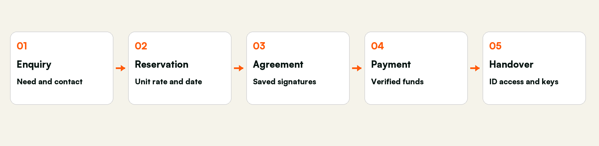
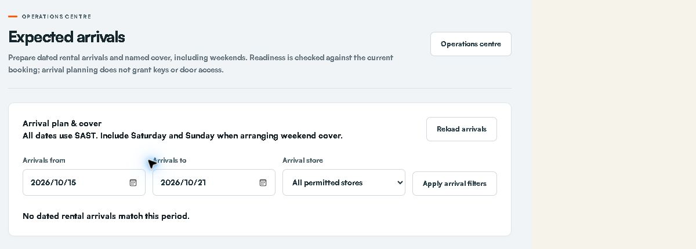
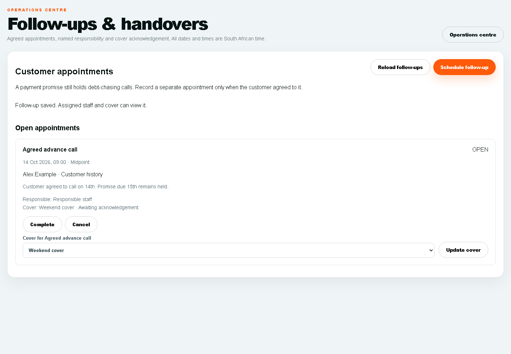

# STOR24 Facilities Manager Manual

Daily site operations maintenance and customer arrival handover

15 October 2026

## How to use this manual

This manual explains the STOR24 internal staff portal at https://portal.stor24.co.za. The public booking website and Counter tablet are customer journeys. Keep staff sign-in and customer use separate. All operational dates and times use South African Standard Time.

Read the daily routine first, then the workflow for the task in front of you. Each workflow identifies the screen, sequence and checks. Where a task needs another role, stop at the handover point and record who is responsible.

Audience: The facilities manager responsible for the assigned store and approved covering staff.

Edition status: the manual documents current workflows and preserves the permission and acceptance conditions below. It does not authorise a financial transaction, policy change or access override.

Screenshots dated 15 October show the live owner session, cropped to the working area. An owner can see additional controls and stores. Your permission list governs your use. Images labelled example use fictitious data in actual application components. They demonstrate the interface, not completed customer work.

## Sign in and find your work

- Open https://portal.stor24.co.za/login and sign in using your own work account. Complete the verification requested by the sign-in screen.

- If your password is not accepted, use the normal password recovery flow. Ask the owner to verify your account and scope if recovery fails. Never share credentials or recovery codes.

- Use Menu to open a workspace, Find a workspace to search, or Guide me for the on-screen tutorial. A lock or Access restricted means permission is missing; record the task and store and ask the owner.

- After an access change, sign in again if the session has expired. On a shared computer, sign out and close private downloads before handing over the device.

## Customer journey at a glance

A reservation protects a unit temporarily. A saved signed agreement records acceptance. A verified payment establishes eligible funds. Identity, access readiness and actual physical key handover remain separate checks. None of these stages can stand in for the others.

## Your restricted role

The proposed role is Facilities Operations Coordinator, scoped to the assigned store. The candidate covers operational queues, tasks, maintenance, unit/map viewing and access-status viewing. It excludes financial transactions, customer exports, staff administration, store configuration and physical-access changes. It has not been assigned to any employee.

Activation gate: STOR24 currently shares operations.manage between tasks, maintenance and wider operational/customer edits. A candidate using that grant cannot promise maintenance-only access. The owner must explicitly accept the wider operational scope or the software must first split those capabilities. Until then this is a reviewable role design, not an enforced production restriction.

Your responsibility | Hand over to
Site readiness maintenance tasks and arrival cover | Faeez for quotes reservations agreement changes customer payments and account questions
Read current unit and physical-access status | Authorised access operator for enrolment revocation suspension restoration or door configuration
Record facts and unfinished work | Finance for receipts refunds billing adjustments debt policy and settlement
Report a system or permission problem | Organisation owner for employee access provider settings company setup and data exports

## Daily site routine

- Sign in as yourself and verify the store. Check operations reminders and the maintenance queue before the site walk.

- Compare actual unit condition with unit/map records. Report a discrepancy rather than changing rates availability or plans to make the screen agree.

- Review expected arrivals with Faeez. Confirm who is meeting the customer and which readiness checks are still blocked.

- Create a maintenance request only for a real fault. Selecting a unit may remove it from booking availability. Record the actual condition and follow the approved maintenance process.

- Before leaving, check open tasks, upcoming arrivals, named cover and acknowledgement. Keep access and key decisions with the designated authorised operator.

## Tasks and maintenance

- Open Operations and select New task. Choose the assigned store, enter a clear title and enough description for the next person, set the priority and optional due date, and save only actual work.

- Read Assigned operational tasks. Complete a task only after the real work is done and supporting evidence is recorded. If the result is uncertain, refresh the saved task before trying again.

- In Maintenance queue choose New request. Select the store and optional unit. Enter the fault title, description, priority and due date. Confirm the unit is the one physically affected before saving.

- Use Start, Complete or Cancel for the actual maintenance outcome. Reopen the record and check the unit state. If the unit remains in service, investigate other open requests or ask the owner; do not force availability.

- Do not use Record daily close, product price controls or customer account transactions under this role. Pass discrepancies to the responsible person.

## Unit and map checks

Open Units & rates or Facility map for the assigned store. Use the store/floor/type filters to find the correct unit and compare its number and size with the site. View-only access does not authorise changing rent, removing a unit, redrawing walls or duplicating a floor. Note the unit number, observed issue and required next action in an operational task. A drawing is not proof that physical inventory has been created or is bookable.

## Prepare expected arrivals and weekend cover

Review dated rental arrivals, current handover blockers and named cover before the manager is away.

Access: Read and update only within the approved operations scope after the role activation gate is resolved.

Coordinate with Faeez. If customer history is restricted, ask Faeez for the minimum arrival instructions needed for the physical handover.

Open: https://portal.stor24.co.za/operations/arrivals

### 1 Choose the period and store

Choose the SAST arrival dates and permitted store, including Saturday and Sunday for weekend cover. Only active rental bookings with agreed arrival dates are listed. Undated active bookings are identified separately so missing dates are not treated as an empty plan.

### 2 Review the actual handover checks

Each arrival reuses the current booking's identity, signed-document, photo, operational unit and verified receipt checks. Read the blockers. Future arrival dates and test-only payments do not allow keys now; planning an arrival does not grant physical access.

### 3 Assign a responsible colleague and cover

Choose Assign or update cover, nominate active staff with store access and record the agreed arrival instructions. Saving a new cover or changed instructions clears old acknowledgement. Review customer history and the source move-in checks before confirming the plan.

### 4 Acknowledge the current arrival plan

The named cover signs in with their own account and acknowledges the current booking and readiness. A date, source, readiness or cover-access change requires review again. If a save is uncertain or a colleague changed the handover, reload the current record before confirming.

If blocked: Open Expected arrivals and wait for it to load. Check your permission and store scope if the area is unavailable. You can keep reading without changing a record.

Finish by checking the saved record and the stated outcome. Reading the guide or opening a screen does not complete the work.

## Schedule customer follow ups and acknowledge cover

Record agreed appointments in South African time, assign responsibility and acknowledge covering work without changing collection holds.

Access: Only assigned operational appointments and covering work within the approved store scope.

Do not negotiate account terms or record promises as the facilities manager. Ask Faeez to own those actions; cover only the agreed site task.

Open: https://portal.stor24.co.za/operations/followups

### 1 Read the open appointment queue

Open appointments show the agreed SAST time, customer, store, responsible staff and named cover. Open Customer history to read the exact customer's notes and communications. Load more appointments includes later open pages. Store permissions still apply.

### 2 Schedule an agreed customer appointment

Choose Schedule follow-up, search and select the correct customer, store, responsible staff and optional cover. Enter the agreed SAST date/time, title and action, then save. An agreed call on the14th stays separate from a payment promise due15th; the debt-chasing hold is unchanged.

### 3 Hand over to a named colleague

Update cover to nominate an active colleague with access to the store. Only that colleague can acknowledge cover from their own signed-in account. A changed cover clears the previous acknowledgement. Review the original customer history before carrying out the agreed action.

### 4 Check uncertain saves before retrying

Complete or cancel an appointment after checking its current status. If a save cannot be confirmed, reload and review the recorded appointment before retrying. Stale handovers are rejected rather than overwriting a colleague. A failed reload keeps changes blocked; a lost grant clears the records.

If blocked: Open Follow-ups and handovers and wait for it to load. Check your permission and store scope if the area is unavailable. You can keep reading without changing a record.

Finish by checking the saved record and the stated outcome. Reading the guide or opening a screen does not complete the work.

## Read booking and move in events

Read recorded booking stages and acknowledge only your own event inbox without sending a message or granting access.

Access: Operational store events only. Reading an event does not authorise the next customer or financial action.

Open: https://portal.stor24.co.za/operations/events

### 1 Read the source stage

The store event inbox lists booking creation, recorded signed agreements, move-in starts and explicit key-handover audit records. These are separate stages. A booking or signed document does not establish a verified payment, physical key collection or active door access.

### 2 Open the customer history

Use Customer history to open the exact customer and read staff notes and recorded communications before acting. Events show their store, unit where recorded, and SAST timestamp. Only stores in your current operations permission are included.

### 3 Acknowledge for your own account

Mark an event as read only after reviewing it. The acknowledgement belongs to your signed-in account; another colleague still has their own unread state. Changed source evidence needs a fresh read. Acknowledgement sends no email, WhatsApp or SMS and grants no financial or access approval.

### 4 Reload and review older records

Use Older events for later pages and Latest events to return to recent records. If confirmation is uncertain, reload and check your recorded read state before retrying. A failed source read is an unavailable queue, not proof that no events exist.

If blocked: Open Booking and move-in event inbox and wait for it to load. Check your permission and store scope if the area is unavailable. You can keep reading without changing a record.

Finish by checking the saved record and the stated outcome. Reading the guide or opening a screen does not complete the work.

## Physical customer arrival and keys

- Locate the arrival on the agreed date and verify the intended store and unit. Ask Faeez to resolve changes to the customer booking.

- Use the approved handover process to check that the original agreement, eligible payment, intended date and identity requirements are satisfied. If you cannot inspect a required record under your role, ask the authorised colleague to perform that check.

- Do not photograph or retain identity documents in a personal phone or general task. Use the approved private review process and operator.

- If a blocker remains, explain that the authorised colleague must resolve it and record the site action. Do not mark payment received or change access to clear it.

- Hand over keys only under the agreed authorised procedure after the checks pass. Record actual handover through the designated operator if your account lacks the action. Afterwards check the relevant site and tenancy records.

## Counter tablet and staff devices

Keep the customer on the public Counter journey and staff work on the staff device. Let Faeez prepare the correct store visit and verify the saved booking. After each customer, use the approved clear/end-visit flow and confirm the previous customer cannot be reopened. Never leave the staff account signed in on a customer device. Physical tablet installation camera scanning privacy clearing and real staff acceptance must be demonstrated on the device.

## During an outage

Browser online means network connectivity, not provider or door availability. Report the time, store, affected workflow and a safe error description. Continue approved physical procedures. Do not promise offline agreement signing payments or access activation. Only use an encrypted offline snapshot if the authorised staff member has prepared and tested it; expired or missing snapshots are not usable readiness evidence. Reconcile saved work after reconnection before repeating any action.

## End of shift handover

- Review every open site task and state the actual next step and responsible person.

- Review tomorrow and the weekend for arrivals. Obtain cover acknowledgement and explain unresolved checks.

- Hand customer account or payment questions to Faeez and faults or access changes to the designated operator.

- Leave keys equipment and site records under the approved control procedure. Sign out and close private records.

## What you should not use under this role

Do not use payment recording, adjustment approval, refund payout, settlement, monthly billing posting, debit-order submission, customer history export, general personal-data export, store setup, employee permissions, integration credentials or physical-access changes. If a shared screen shows an unavailable or out-of-role control, stop and ask the owner. A visible button is not authority to use it.

## Troubleshooting and escalation

What you see | What to do
Access restricted or a locked workspace | Record the screen task and store. Ask the owner to check the exact grant and scope. Sign in again after a confirmed change.
Could not load or failed reload | Stop changes. Retry the read once and check the saved record before resubmitting. Never repeat a payment or send because a browser timed out.
No rows or zero count | Check date store status filters and snapshot age. Empty results do not prove data migration bank reconciliation or provider delivery.
Changed record stale handover or conflict | Reload the current record. Check the other staff member and agree the next action; do not overwrite blindly.
Export blocked or missing content | Use the safe request reference and ask the owner. Do not copy blocked data through another channel.
Message pending or uncertain | Review the customer channel provider event and time. Do not claim receipt or retry automatically.
Payment or key handover blocked | Retain the blocker and pass it to the authorised finance identity or access operator.

## Practice and acceptance checklist

- To demonstrate: Sign in using the assigned manager account and show the correct store scope.

- To demonstrate: Demonstrate permitted task and maintenance actions on approved practice data and prove customer/financial actions remain restricted.

- To demonstrate: Find a unit on the map and identify a physical discrepancy without changing rates or layout.

- To demonstrate: Review a weekend arrival accept your actual cover assignment and explain all key-handover blockers.

- To demonstrate: Complete an end-of-shift handover and demonstrate sign-out and device privacy.

Record tester, date, store, expected result, observed result and evidence for each exercise. Do not practise financial transactions, customer messaging, physical-access changes or signatures on live customers. Owner-approved training and isolated data must be arranged. Training progress and technical tests do not replace staff acceptance.

## Terms used in this manual

Term | Meaning
Enquiry or lead | Customer need and the next sales action.
Reservation or hold | Time-limited protection of a unit.
Tenancy and account | Occupancy relationship and its financial record.
Receipt | Recorded confirmed funds for the exact account.
Mandate | Customer authority for a payment method rather than proof of collected funds.
Promise or hold | Recorded collections arrangement that affects follow-up eligibility.
Cover acknowledgement | A named colleague confirms the current assigned handover.
Provider accepted delivered read | Different evidence stages; none automatically establishes the customer acted.

## Edition evidence and outstanding gates

Prepared 15 October 2026 from the current staff guide catalogue and role guards at CRM main 19f00c58c68f4c102f1998f43f556d720f5c3b0b, the 23-item Faeez meeting register and fresh authenticated owner screen reads. The meeting register contains historical gaps; newer source and live screens establish only the specifically observed additions. The original full meeting transcript was not independently re-transcribed for this edition.

Live read-only checks covered Faeez account and permission preview, move-in, Operations, follow-ups, expected arrivals, payments awaiting review, collections, report library, reservations, adjustments and Counter preparation. Empty forms were opened without submitting. No payment message signature operational record permission or provider setting was changed.

Pending: approval and application of the role profiles; a named facilities manager; resolution of shared operations.manage scope; verification of proposed receipt-investigation release/grants; screenshots and acceptance signed in as each actual role; human handover, finance and real-device UAT; provider inbox/handset and physical-access checks; policy legal privacy data migration training and launch approval. No operational completion is claimed by publishing a manual.

Maintain this manual when screens or permissions change. Keep the dated evidence and remaining gates aligned with the canonical PROJECT_CONTEXT.md. The current files are role-specific training review editions pending the acceptance checks above.
