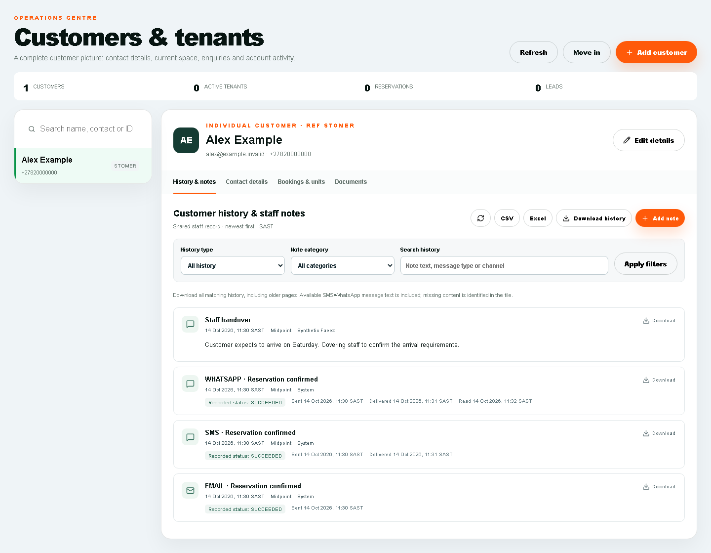
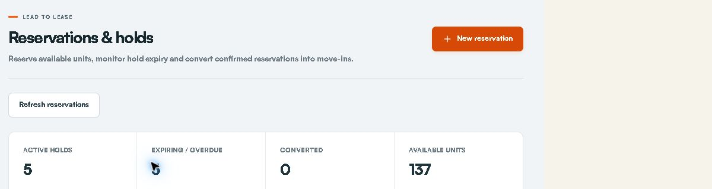
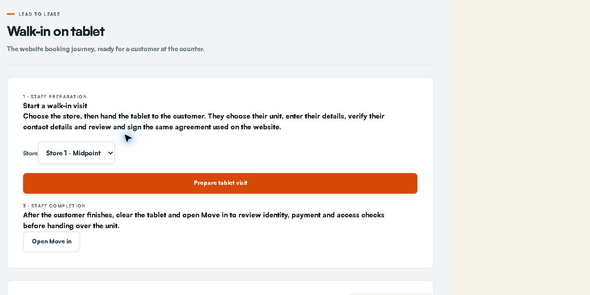
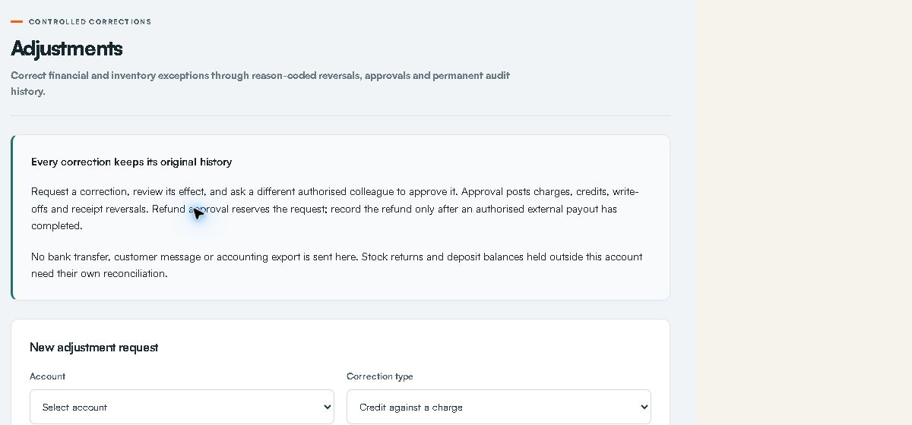
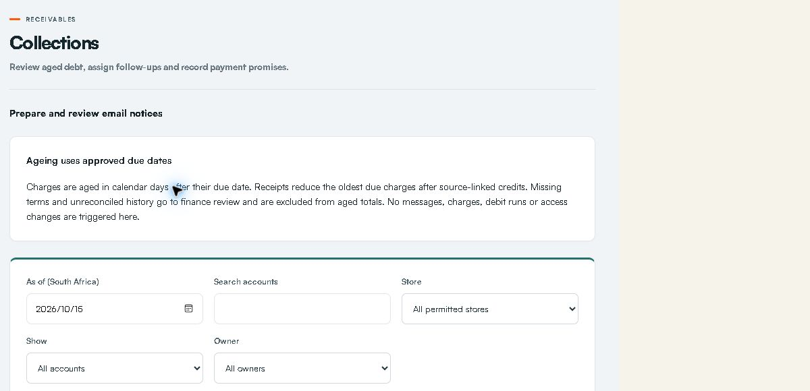
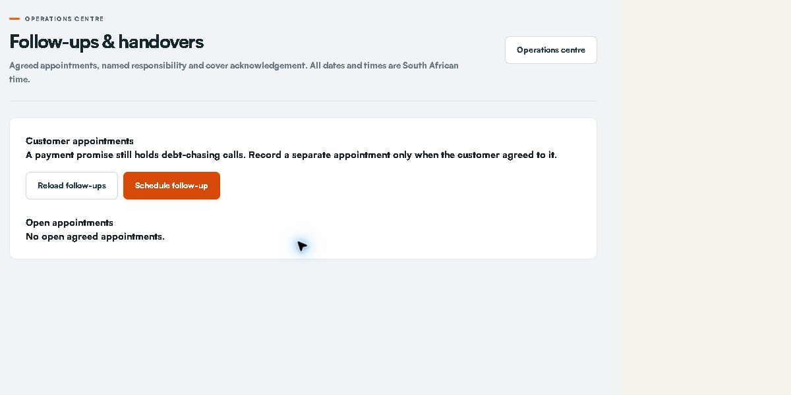

# STOR24 Faeez Operating Manual

Customer operations leasing and commercial follow up

15 October 2026

## How to use this manual

This manual explains the STOR24 internal staff portal at https://portal.stor24.co.za. The public booking website and Counter tablet are customer journeys. Keep staff sign-in and customer use separate. All operational dates and times use South African Standard Time.

Read the daily routine first, then the workflow for the task in front of you. Each workflow identifies the screen, sequence and checks. Where a task needs another role, stop at the handover point and record who is responsible.

Audience: Faeez Baboo and an explicitly authorised covering colleague at Store 1 Midpoint.

Edition status: the manual documents current workflows and preserves the permission and acceptance conditions below. It does not authorise a financial transaction, policy change or access override.

Screenshots dated 15 October show the live owner session, cropped to the working area. An owner can see additional controls and stores. Your permission list governs your use. Images labelled example use fictitious data in actual application components. They demonstrate the interface, not completed customer work.

## Sign in and find your work

- Open https://portal.stor24.co.za/login and sign in using your own work account. Complete the verification requested by the sign-in screen.

- If your password is not accepted, use the normal password recovery flow. Ask the owner to verify your account and scope if recovery fails. Never share credentials or recovery codes.

- Use Menu to open a workspace, Find a workspace to search, or Guide me for the on-screen tutorial. A lock or Access restricted means permission is missing; record the task and store and ask the owner.

- After an access change, sign in again if the session has expired. On a shared computer, sign out and close private downloads before handing over the device.

## Customer journey at a glance

A reservation protects a unit temporarily. A saved signed agreement records acceptance. A verified payment establishes eligible funds. Identity, access readiness and actual physical key handover remain separate checks. None of these stages can stand in for the others.

## Your access and approval boundaries

Your live account was checked on 15 October 2026: Active, Custom access, Store 1 - Midpoint, 27 selected permissions. This is a custom employee role. It is not the built-in Facility manager or Organisation owner role.

You may handle | Escalate to another authorised person
Enquiries reservations customer details shared dated notes and history downloads | Staff access company settings provider credentials and general personal-data exports
Review accounts record evidenced receipts request financial corrections | Approve your own correction refund payout settlement billing posting and debit-order submission
Record collection follow-ups prepare reviewed notices and read permitted reports | Collection policy decisions fees lockouts physical access changes and legal disposal decisions

The proposed named profile is Customer Operations Lead. Its existing-workflow core retains 26 of your present grants and removes Manage store setup (facility.*). Three additional unidentified-payment investigation grants are proposed separately after release and scope checks. No profile or permission change has been applied by producing this manual.

## Start and end each day

- Check Operations reminders and the age of the snapshot. Open the actual queue behind each count.

- Review leads needing a next action, expiring holds, expected arrivals, open agreed appointments and cover acknowledgements.

- Review payments awaiting evidence and arrears follow-ups. A zero queue does not establish bank reconciliation or full provider health.

- Before leaving, add dated notes, assign a named cover, check acknowledgement and hand over unresolved blockers. Leave a clear next action and date.

## Find the customer and keep a shared record

Search for the existing customer before creating a record. Check the customer name, contact and unit before editing. Open History & notes first to understand prior promises, disputes and agreed actions. Use Contact details, Bookings & units and Documents for their respective records.

- Use Add note for a new interaction. Choose the store and category, record what happened, what was agreed and the next action, then save. The system records the author and date.

- Correct a dated note with another dated note. Do not present the older editable profile summary as an author-dated contact record.

- Use History type, category and search filters. Open Date and communication filters where available. Check channel, dates and status without assuming every external conversation was retained.

- Use Download history or the permitted CSV/Excel controls for that customer. Open the file and confirm the customer, period, records and missing-content labels. Individual communication downloads retain the recorded evidence. General export permission is a separate authority.

## Customer records and consent

Create or find a customer, maintain contacts and locate signed documents.

Access: Use your current Midpoint grants. A disabled or restricted action must be escalated rather than bypassed.

Open: https://portal.stor24.co.za/tenants

### 1 Find the existing customer first

Search name, contact or ID in the left list. Select the matching person or business and confirm contact details. A customer record can exist before any tenancy; avoid creating a second record for the same customer.

### 2 Add or edit the right details

Add customer opens the customer form; Edit details updates the selected record. Choose Individual or Business, then enter names, company where relevant, phone, email and the required identity details. Complete the primary address, alternate contact, emergency and work sections before saving.

### 3 Record the customer s actual consent

In Consent and notes, select Email, SMS, WhatsApp and Phone only for channels the customer approved. Include useful operational notes. A contact number or an existing tenancy does not itself mean WhatsApp consent.

Check before acting: Saving changes a real customer record. Do not enter invented identities or consent during training.

### 4 Read tenancy and booking records separately

Tenancies and units shows the facility, occupancy, account and balance. Signed booking agreements lists the original booking PDF. Debit-order mandates have a separate reference, status and PDF; a signed mandate is not a successful collection.

### 5 Continue into the correct workflow

Use Reservations for a hold, Move in for the selected booking and Operations â†' Payments for the account ledger. A signed PDF can precede an active tenancy. Check payment, date and physical handover before telling the customer they can move in.

If blocked: Open Tenants and wait for it to load. Check your permission and store scope if the area is unavailable. You can keep reading without changing a record.

Finish by checking the saved record and the stated outcome. Reading the guide or opening a screen does not complete the work.

## Track an enquiry through the sales pipeline

Track customer details, follow-ups, saved stages and enquiry sources.

Access: Use your current Midpoint grants. A disabled or restricted action must be escalated rather than bypassed.

Open: https://portal.stor24.co.za/leads

### 1 Review sales performance

Filter by store, creation period, stage or customer. Pipeline bars show current positions, not a historical funnel. Source conversion uses saved moved-in outcomes. Landing-to-submission journeys only appear where analytics consent and journey data were captured; missing data is not direct traffic.

### 2 Capture an enquiry

Add enquiry records the customer's contact details, store, enquiry source and requirements. It creates a real customer and enquiry together. The capturing employee becomes the initial sales owner.

### 3 Manage the next action

Open a customer in the worklist. Review notes, source, journey and activity history. Staff with access can save a sales stage, owner, follow-up time and requirements. Follow-up times use South Africa time. Stale edits require a refresh; no stage change is complete until saved.

### 4 Reserve and complete the journey

In the enquiry detail choose Reserve a unit, select available inventory and confirm the quote and date. The saved hold is linked to this enquiry and advances it to Reserved. Manage live bookings in Reservations and complete the real Move-in checks; Moved in cannot be manually claimed from a sales-stage dropdown.

Check before acting: A reservation does not prove payment, signature or handover. Existing release gates remain.

If blocked: Open Leads & sales performance and wait for it to load. Check your permission and store scope if the area is unavailable. You can keep reading without changing a record.

Finish by checking the saved record and the stated outcome. Reading the guide or opening a screen does not complete the work.

## Manage a reservation

Find a hold, understand its dates and prepare the move-in handoff.

Access: Use your current Midpoint grants. A disabled or restricted action must be escalated rather than bypassed.

Open: https://portal.stor24.co.za/reservations

### 1 Find the right customer and store

Select the store, choose a status and search by customer, unit or unit type. The default list shows active reservations. Change the status filter if you are looking for a converted, cancelled or expired hold.

### 2 Review the hold before acting

Check the customer, unit, quoted rate, hold expiry and intended move-in. A reservation holds a unit; it does not by itself confirm payment, occupancy or permission to collect keys.

### 3 Create a hold when it is needed

New reservation opens a form for the store, existing customer, available unit, quoted monthly rate and dates. The button needs an available unit and a customer record. Review the form carefully before choosing Reserve unit.

Check before acting: Reserve unit creates a real hold. To explore without saving, open the form and then choose Cancel.

### 4 Keep the hold accurate

Extend asks for a later expiry date and a reason. Expire is for an overdue active hold. Cancel ends a reservation. Read the confirmation and resulting message: a unit can remain protected by another reservation or occupancy.

Check before acting: Extend, Expire and Cancel change live records. Only use them for a confirmed operational reason.

### 5 Carry the reservation into move in

Choose Move in beside the correct reservation to carry its customer and unit into the next screen. Signed bookings use the saved agreement and move-in checks. The Prepare a move-in guide explains that next stage.

If blocked: Open Reservations. If access is denied, ask your administrator for the appropriate store permissions.

Finish by checking the saved record and the stated outcome. Reading the guide or opening a screen does not complete the work.

## Hand the website journey to a walk in customer

Prepare the counter tablet, let the customer complete the website journey, then continue from the saved booking.

Access: Use your current Midpoint grants. A disabled or restricted action must be escalated rather than bypassed.

Open: https://portal.stor24.co.za/operations/walk-in

### 1 Prepare the correct store

Choose the customer’s store and prepare a tablet visit. This creates a temporary handover, not a customer or booking. In the installed STOR24 Counter app, scan the visit QR shown here or enter its eight-character code within five minutes. Both open the same visit and work once. Install the app once from stor24.co.za/walk-in.

### 2 Hand the device to the customer

Confirm the correct store has opened on the tablet, then hand it to the customer. The customer selects a unit, enters their own details, verifies their contact details, supplies identity and reads and initials the saved agreement clauses before signing. Staff must not provide the customer’s acceptance or signature.

### 3 Clear the tablet and complete Move In

When the customer finishes, use Finish visit and clear tablet before another customer uses the device. The booking is retained. Refresh this staff page, choose the exact recent booking and continue Move In; payment, identity, access and key-handover checks still apply.

If blocked: Open Walk-in tablet and wait for it to load. Check your permission and store scope if the area is unavailable. You can keep reading without changing a record.

Finish by checking the saved record and the stated outcome. Reading the guide or opening a screen does not complete the work.

## Prepare an unsigned rental agreement

Select the unit and account details before an agreement is sent.

Access: Use your current Midpoint grants. A disabled or restricted action must be escalated rather than bypassed.

Open: https://portal.stor24.co.za/operations/move-in

### 1 Choose the booking or unit

Prefer Move in on the existing reservation. On Select unit, use the store and unit filters and check the selected unit's rate and availability. A signed reservation follows the separate Move-in checks path described in Prepare a move-in.

### 2 Confirm the account details

Continue to Account details. Select the existing customer or use Add a new customer if there is no record. Check Start date, Monthly rent, Initial charge and Payment method. Initial charge is provisional until finance rules are confirmed. Do not create a duplicate customer or lease to bypass a blocker.

### 3 Review and sign with the customer

Read Lease agreement and confirm the payment arrangement. Review and sign now is the default for a walk-in or phone-in; Email invitation for later signing is an explicit alternative. Continue to agreement signing creates the saved lease and opens the next signing step.

Check before acting: Preparing a lease is a real action. For training, read the fields and leave without submitting.

### 4 Continue from saved signature evidence

On the signing screen, let the customer review and sign, then complete representative signing if required and refresh. Preparation recovery reuses the saved lease. The completed copy is sent afterwards; payment, date, identity/access and physical key handover remain distinct checks.

If blocked: Open Move in and wait for it to load. Check your permission and store scope if the area is unavailable. You can keep reading without changing a record.

Finish by checking the saved record and the stated outcome. Reading the guide or opening a screen does not complete the work.

## Complete signing during a visit or call

Guide the customer through agreement review and signing without waiting for an emailed return.

Access: Use your current Midpoint grants. A disabled or restricted action must be escalated rather than bypassed.

Open: https://portal.stor24.co.za/operations/lease-signing

### 1 Review with the customer

Check the saved lease and customer before opening signing. For a walk-in, let the customer review, initial and sign on the counter device. For a phone-in, copy and share the customer signing link during the call; the customer provides their own acceptance and signature.

### 2 Complete each signing step

Open the current signer's link. Return to this screen after signing and refresh the status. Customer signing comes before the authorised representative, unless authorised automatic countersigning is configured. Opening or copying a link never records a signature.

### 3 Continue from saved evidence

Once the portal confirms the signed agreement is saved, continue to the same account for payment and move-in checks. BlendSign sends the completed copy afterwards. If preparation failed, retry the saved lease; never create a second lease to bypass a blocker.

If blocked: Open Agreement signing and wait for it to load. Check your permission and store scope if the area is unavailable. You can keep reading without changing a record.

Finish by checking the saved record and the stated outcome. Reading the guide or opening a screen does not complete the work.

## Prepare a move in

Follow the booking into agreement, payment and key-handover checks.

Access: Use your current Midpoint grants. A disabled or restricted action must be escalated rather than bypassed.

Open: https://portal.stor24.co.za/reservations or https://portal.stor24.co.za/operations/move-in

### 1 Start from the existing reservation

Find the correct customer and unit, then choose Move in on that reservation. This carries the booking into the move-in screen. If you already opened Move in, continue to the next guide step.

### 2 Confirm the customer and the booking path

A signed reservation opens Move-in checks and shows the customer and unit. Other bookings use Select unit and Account details to prepare the agreement. Always verify that you are working on the intended customer's booking.

### 3 Use the agreement already on file

For a signed booking, View signed agreement opens the original document. No new signature is required. If the booking is not yet signed, review the Account details and agreement workflow instead; do not treat it as ready for key collection.

Check before acting: Sending an unsigned lease is a separate, deliberate action. This guide never sends an agreement or message.

### 4 Check eligible payment and the agreed date

Review the verified amount against the amount required, the agreed move-in date and any listed blockers. A sandbox payment does not clear a real booking. A debit-order mandate is not proof of payment. Refresh checks after an authorised update.

Check before acting: Record a receipt only for actual confirmed funds and with the required evidence. Never enter a receipt merely to clear a training step.

### 5 Record handover only when it happens

When the checks permit it, verify the customer's identity and unit at the physical handover. The attestation and Confirm move-in / key handover record that real event. A disabled button means a requirement remains outstanding.

Check before acting: Do not tick the handover attestation or confirm a move-in as a tutorial exercise. Facial access is handled separately.

### 6 Check the outcome and separate access work

After an actual successful handover, review the resulting tenancy and occupancy in the relevant records. Facial access has its own checks and operational approval. Finishing this guide confirms reading only; it does not confirm a payment, key collection or working door access.

If blocked: Open Reservations to choose an active booking, or continue if you are already on its Move-in screen.

Finish by checking the saved record and the stated outcome. Reading the guide or opening a screen does not complete the work.

## Review a customer identity document

Privately review ID uploads before staff-confirmed key handover.

Access: Current identity.review permission; review privately and apply the approved policy.

Open: https://portal.stor24.co.za/identity

### 1 Check whether collection is open

The hold notice means the approved ID policy has not been enabled. Online ID collection is separate from facial access and requires approved document types, privacy wording and retention arrangements. Existing bookings continue to their normal handover check.

### 2 Open the correct submission

Choose the customer's submission and confirm the store, unit and booking reference. You need explicit identity-review permission for the store. The queue contains review details; document images only open when you request a private preview.

### 3 Review every page before accepting

Open the photo page or both sides of the ID card. Check the name, photograph, readability and completeness against the booking. Every view is recorded; acceptance requires your preview of every page of the exact current version. A replaced or expired version must be reviewed again.

### 4 Resolve replacements and complete handover

Choose the appropriate replacement reason when a clearer or complete copy is needed. The customer sees that request when reopening the identity step from the agreement. No email is sent by this action. An accepted document permits the identity part of handover; staff must still check the original and person, payment and signed agreement before handing over keys.

If blocked: Open Identity review and wait for it to load. Check your permission and store scope if the area is unavailable. You can keep reading without changing a record.

Finish by checking the saved record and the stated outcome. Reading the guide or opening a screen does not complete the work.

## Read a customer account

Find balances, ledger entries, lease documents and account actions.

Access: Use your current Midpoint grants. A disabled or restricted action must be escalated rather than bypassed.

Open: https://portal.stor24.co.za/operations/accounts

### 1 Open the correct account

Search account, tenant or unit in the account list. Select a result, then verify account number, customer, facility and unit above the balance. On a small screen, Back to accounts returns to the list.

### 2 Understand the displayed balance

Review Security status, Monthly rent, Unit type and Tenancy status together with the ledger. An amount due is an account total, not proof that a particular invoice is overdue. If Reconciliation required or Historical test entries is shown, finance must resolve the underlying records before the balance or statement is relied on.

### 3 Trace transactions and signed documents

Read the dates, descriptions, types and amounts in the ledger. Completed lease opens the signed document; a completion certificate is offered for the supported signing provider. A missing document link is not evidence that a lease was signed.

### 4 Choose a specific account workflow

Take payment posts a receipt, Transfer changes the occupied unit, Move out closes the occupancy and Account statement opens statement controls. Each has its own guide. Disabled actions can reflect the tenancy status; inspect the record instead of changing its status just to enable a button.

If blocked: Open Accounts and wait for it to load. Check your permission and store scope if the area is unavailable. You can keep reading without changing a record.

Finish by checking the saved record and the stated outcome. Reading the guide or opening a screen does not complete the work.

## Record a received payment

Post confirmed funds and check the resulting ledger entry.

Access: Current payments.manage; actual verified funds and correct account are required.

Open: https://portal.stor24.co.za/operations/accounts

### 1 Identify the account and receipt

Search and select the customer account. Check the actual bank, till or terminal evidence, amount, date and reference against payments already recorded. Booking receipts before a tenancy use Move-in checks instead of this account form.

### 2 Open Take payment

Take payment opens Amount, Payment method, Reference and Date received. Choose EFT, Card, Cash or Bank debit to match the actual receipt. The default amount is the account balance; replace it with the amount really received.

### 3 Use a traceable reference

Replace the generated reference with the customer's bank or receipt reference where available. Confirm the received date and amount to cents before Post payment. Posting a bank-debit receipt does not initiate a debit-order collection.

Check before acting: Post payment changes the ledger. A screenshot, pending callback, sandbox result or mandate alone is not proof of cleared funds.

### 4 Verify once  then reconcile

After a successful post, inspect the new PAYMENT row and updated balance. If the response is unclear, refresh and inspect the ledger before repeating. Reconcile against the real bank or till evidence; use Netcash operations for provider exceptions and System audit for the operator trail.

If blocked: Open Accounts and wait for it to load. Check your permission and store scope if the area is unavailable. You can keep reading without changing a record.

Finish by checking the saved record and the stated outcome. Reading the guide or opening a screen does not complete the work.

## Review pending payments and receipt evidence

Open source payment records while keeping pending, test, receipt matching and actual bank settlement distinct.

Access: Use your current Midpoint grants. A disabled or restricted action must be escalated rather than bypassed.

Open: https://portal.stor24.co.za/operations/payment-review

### 1 Read what needs attention

The queue lists recorded pending payments and unresolved internal receipt evidence in your permitted stores. Test records are excluded. Awaiting confirmation, missing receipt, multiple receipt matches and source-review reasons do not describe new settled money.

### 2 Open the original workflow

Choose Review source to open payment operations or the tenant account for the recorded payment. Check the customer, store and record reference. This queue does not call the provider, post or allocate a receipt, approve a refund, send a notice or change access.

### 3 Keep unresolved items visible

Review acknowledgement is not resolution. Items leave this queue only when the underlying source becomes a terminal or internally reconciled record through its existing authorised workflow. Internal receipt matching still does not prove provider statement or bank settlement.

### 4 Read older pages and failures

Review older payments includes later recorded attempts, including pages with no current exceptions. The operations reminder counts the bounded source queue and shows Unavailable if evidence cannot be read completely. Reload after source changes; never infer zero from a failed read.

If blocked: Open Payments awaiting review and wait for it to load. Check your permission and store scope if the area is unavailable. You can keep reading without changing a record.

Finish by checking the saved record and the stated outcome. Reading the guide or opening a screen does not complete the work.

## Handle corrections  reversals and refunds

Request supported corrections and review approval and payout evidence separately.

Access: Request and view only. Independent approval and refund recording remain withheld.

Open: https://portal.stor24.co.za/adjustments

### 1 Choose a supported correction

Select the account and correction type. Credit a specific charge, write off unpaid debt, add an evidenced charge, reverse a full receipt for an unpaid/error notice, or refund a cleared overpayment. Stock returns and off-ledger deposits need separate reconciliation.

### 2 Preview the source and balance

Select the original entry where required. Enter the amount, a specific reason and an evidence reference. Preview checks source limits, account reconciliation, test contamination and refund policy. Credits inherit proportional tax; write-offs do not claim tax relief. Review the balance before requesting approval.

Check before acting: Do not submit a request to practise this guide.

### 3 Use independent approval

A different authorised colleague reviews the saved evidence. Approval posts a charge, credit, write-off or full receipt reversal once. Refund approval changes no balance. If the account changes, cancel the unposted request and prepare a new review. The requester cannot approve their own work.

### 4 Record a completed refund separately

After approval, arrange the authorised payout outside Stor24 and verify its completion. An authorised colleague records the unique payout reference and date; this posts the refund to the account. This screen sends no money, messages or MRI export. Never cancel a refund already paid; resolve any recording failure with finance. Inspect the saved adjustment record and account statement.

Check before acting: Use real payment evidence only. The guide does not authorise a payout or posting.

If blocked: Open Adjustments and wait for it to load. Check your permission and store scope if the area is unavailable. You can keep reading without changing a record.

Finish by checking the saved record and the stated outcome. Reading the guide or opening a screen does not complete the work.

## Review arrears and plan follow up

Use approved due dates and evidenced follow-ups without triggering automatic contact.

Access: Use your current Midpoint grants. A disabled or restricted action must be escalated rather than bypassed.

Open: https://portal.stor24.co.za/collections

### 1 Read the ageing scope

Select the South African as-of date and permitted store. Current, 1â€"30, 31â€"60, 61â€"90 and 91+ day totals follow your filters. Missing approved terms, test receipts and unreconciled accounts go to Finance review and are excluded from aged totals. Historical reports use current terms and recorded ledger history.

### 2 Check before contacting

Review the account, charge due dates, original ledger and holds. Finance must approve due days, invoice overrides and oldest-due-first allocation before ageing is used. Disputes and pending adjustments or debit instructions are held out of the next-follow-up queue.

### 3 Assign and record follow up

Open next follow-up selects an eligible account; it does not dial or message. Open Review, record the actual contact outcome or internal plan, assign a permitted colleague and set the next date. Export filtered CSV downloads the displayed report scope. Never record a real contact outcome merely to practise.

### 4 Track promises and disputes

Record only a customer-agreed amount and date. New verified receipts, excluding reversals and refunds, provide progress evidence; credits and write-offs are not payment. Confirm kept only when on-time receipts cover the promise. A dispute hold stops queue selection, not provider debits or physical access. Notices, fees and access changes remain separate authorised work.

If blocked: Open Collections and wait for it to load. Check your permission and store scope if the area is unavailable. You can keep reading without changing a record.

Finish by checking the saved record and the stated outcome. Reading the guide or opening a screen does not complete the work.

## Review and send collection email notices

Check the account and recipient, prepare an immutable message and obtain independent approval before one email attempt.

Access: Prepare and send only through your allowed workflow; independent approval remains required where requested.

Open: https://portal.stor24.co.za/collections/notices

### 1 Select an eligible account

Choose an account from your permitted stores. Notice eligibility reuses approved due-date, reconciled receipt and collection-hold rules. Active tenancy, verified email and explicit email consent are required. Missing terms, disputes, pending payments, adjustments or promises must be resolved before preparing a message.

### 2 Prepare the exact reviewed message

Read the selected recipient, subject and account reminder before preparing the draft. The saved message is encrypted and bound to current account, consent and source evidence. A changed account or recipient requires a fresh draft. These reminders add no fees, collect no money and change no access state.

### 3 Obtain an independent approval

Another colleague with collections management permission for this store must approve with a review reference. Preparers cannot approve their own draft. Reopening clears approval; cancelled and attempted notices cannot be edited into a second send. Generic configuration cannot replace these controlled records.

### 4 Confirm one email attempt and check the result

An authorised sender also needs billing-document send permission for this store. Review the recipient and message again, tick the sending confirmation and send the approved notice. Provider acceptance is separate from inbox delivery. Pending or uncertain outcomes require review and never authorise an automatic replay.

If blocked: Open Collection email notices and wait for it to load. Check your permission and store scope if the area is unavailable. You can keep reading without changing a record.

Finish by checking the saved record and the stated outcome. Reading the guide or opening a screen does not complete the work.

## Prepare and independently approve a collection email audience

Review a bounded selected audience, save drafts together and obtain independent group approval before separate delivery.

Access: Preparation and authorised delivery only. Do not perform the independent review yourself.

Open: https://portal.stor24.co.za/collections/notices/bulk

### 1 Select the intended accounts

Choose up to twenty accounts from stores where you can manage collections. Search filters the list while retaining selected accounts; changing store clears the selection. Preview includes every selected account, including those hidden by a search. No draft or message is created by selection.

### 2 Review each recipient and message

Read the exact recipient, subject and reminder for every selected account. Verified email consent, reconciled overdue amounts and the existing dispute, pending-payment and promise holds remain required. Deselect or resolve held accounts and preview again; approved or attempted notices must be handled individually.

### 3 Save together and obtain independent approval

Confirm draft preparation and save the group. A different authorised colleague selects the same accounts and previews every saved message, records a review reference and explicitly confirms independent group approval. Every account, consent and saved revision is rechecked; a changed, held or contributor-owned draft rolls back all approvals. Follow approved account links for separate send confirmation. Approval sends no email and changes no money or access.

### 4 Confirm delivery and review every outcome

Preview the approved audience again and read every recipient and message. Sending needs your email-send grant for every store and a configured provider. Explicitly confirm delivery; keep the page open while it sends one account at a time. The group stops at the first failed or uncertain result. Earlier accepted emails cannot be rolled back. Leaving interrupts remaining work; reload individual notices before any new confirmation. Provider acceptance is not verified inbox delivery. There is no automatic retry or resume.

If blocked: Open Collection email audience and wait for it to load. Check your permission and store scope if the area is unavailable. You can keep reading without changing a record.

Finish by checking the saved record and the stated outcome. Reading the guide or opening a screen does not complete the work.

## Schedule customer follow ups and acknowledge cover

Record agreed appointments in South African time, assign responsibility and acknowledge covering work without changing collection holds.

Access: Current operations.view and operations.manage within Midpoint.

Open: https://portal.stor24.co.za/operations/followups

### 1 Read the open appointment queue

Open appointments show the agreed SAST time, customer, store, responsible staff and named cover. Open Customer history to read the exact customer's notes and communications. Load more appointments includes later open pages. Store permissions still apply.

### 2 Schedule an agreed customer appointment

Choose Schedule follow-up, search and select the correct customer, store, responsible staff and optional cover. Enter the agreed SAST date/time, title and action, then save. An agreed call on the14th stays separate from a payment promise due15th; the debt-chasing hold is unchanged.

### 3 Hand over to a named colleague

Update cover to nominate an active colleague with access to the store. Only that colleague can acknowledge cover from their own signed-in account. A changed cover clears the previous acknowledgement. Review the original customer history before carrying out the agreed action.

### 4 Check uncertain saves before retrying

Complete or cancel an appointment after checking its current status. If a save cannot be confirmed, reload and review the recorded appointment before retrying. Stale handovers are rejected rather than overwriting a colleague. A failed reload keeps changes blocked; a lost grant clears the records.

If blocked: Open Follow-ups and handovers and wait for it to load. Check your permission and store scope if the area is unavailable. You can keep reading without changing a record.

Finish by checking the saved record and the stated outcome. Reading the guide or opening a screen does not complete the work.

## Prepare expected arrivals and weekend cover

Review dated rental arrivals, current handover blockers and named cover before the manager is away.

Access: Current operations access within Midpoint. Arrival cover never grants keys.

Open: https://portal.stor24.co.za/operations/arrivals

### 1 Choose the period and store

Choose the SAST arrival dates and permitted store, including Saturday and Sunday for weekend cover. Only active rental bookings with agreed arrival dates are listed. Undated active bookings are identified separately so missing dates are not treated as an empty plan.

### 2 Review the actual handover checks

Each arrival reuses the current booking's identity, signed-document, photo, operational unit and verified receipt checks. Read the blockers. Future arrival dates and test-only payments do not allow keys now; planning an arrival does not grant physical access.

### 3 Assign a responsible colleague and cover

Choose Assign or update cover, nominate active staff with store access and record the agreed arrival instructions. Saving a new cover or changed instructions clears old acknowledgement. Review customer history and the source move-in checks before confirming the plan.

### 4 Acknowledge the current arrival plan

The named cover signs in with their own account and acknowledges the current booking and readiness. A date, source, readiness or cover-access change requires review again. If a save is uncertain or a colleague changed the handover, reload the current record before confirming.

If blocked: Open Expected arrivals and wait for it to load. Check your permission and store scope if the area is unavailable. You can keep reading without changing a record.

Finish by checking the saved record and the stated outcome. Reading the guide or opening a screen does not complete the work.

## Read booking and move in events

Read recorded booking stages and acknowledge only your own event inbox without sending a message or granting access.

Access: Current operations access. Reading affects your own inbox acknowledgement only.

Open: https://portal.stor24.co.za/operations/events

### 1 Read the source stage

The store event inbox lists booking creation, recorded signed agreements, move-in starts and explicit key-handover audit records. These are separate stages. A booking or signed document does not establish a verified payment, physical key collection or active door access.

### 2 Open the customer history

Use Customer history to open the exact customer and read staff notes and recorded communications before acting. Events show their store, unit where recorded, and SAST timestamp. Only stores in your current operations permission are included.

### 3 Acknowledge for your own account

Mark an event as read only after reviewing it. The acknowledgement belongs to your signed-in account; another colleague still has their own unread state. Changed source evidence needs a fresh read. Acknowledgement sends no email, WhatsApp or SMS and grants no financial or access approval.

### 4 Reload and review older records

Use Older events for later pages and Latest events to return to recent records. If confirmation is uncertain, reload and check your recorded read state before retrying. A failed source read is an unavailable queue, not proof that no events exist.

If blocked: Open Booking and move-in event inbox and wait for it to load. Check your permission and store scope if the area is unavailable. You can keep reading without changing a record.

Finish by checking the saved record and the stated outcome. Reading the guide or opening a screen does not complete the work.

## Statements and customer portal invitations

View, download or deliberately email the correct account statement.

Access: Use your current Midpoint grants. A disabled or restricted action must be escalated rather than bypassed.

Open: https://portal.stor24.co.za/operations/accounts

### 1 Start from the account

Select the account, verify customer and facility, then choose Account statement. Use this account link so the correct account ID is carried forward; there is no generic statement for all customers.

### 2 Set the statement period

On the statement screen, choose From and To and select View statement. Changing either date clears the old preview. Historical test contamination can block generation; escalate the reconciliation rather than bypassing it.

### 3 Check the result before downloading

Verify customer, account, facility, period, opening balance, each debit and credit and closing balance. Download PDF or Print uses the displayed statement. These controls do not create new charges.

### 4 Send only after checking the recipient

Email secure link requires a separate confirmation and uses the customer's verified email. Send / resend My STOR24 welcome is a different action for portal access instructions. Check the returned message and avoid repeated sends if delivery is uncertain.

Check before acting: Both email controls can send real messages. A welcome email does not confirm payment or grant physical access.

If blocked: Open Accounts and wait for it to load. Check your permission and store scope if the area is unavailable. You can keep reading without changing a record.

Finish by checking the saved record and the stated outcome. Reading the guide or opening a screen does not complete the work.

## Transfer an active tenant

Move an active tenancy to another available unit with the agreed rate and date.

Access: Use only the permitted action with an actual authorised customer instruction.

Open: https://portal.stor24.co.za/operations/accounts

### 1 Confirm the existing tenancy

Select the account and verify customer, facility, current unit and ACTIVE tenancy status. Transfer is disabled for other states. Confirm availability and the physical move with the customer before editing the account.

### 2 Choose the destination and date

Open Transfer. New unit lists available units for this facility; choose the agreed destination. Set Effective date and use Monthly rent override only when the agreed rent differs. This form is not an inter-store transfer workflow.

### 3 Review before completing

Confirm source and destination, rate and date. Use the Prorate calculator only as an indicative calendar-day preview and get the actual billing treatment agreed before Complete transfer. Save only when the real transfer should be recorded.

Check before acting: Complete transfer changes occupancy. Do not submit a practice transfer on a live tenant.

### 4 Check records and access after the move

Verify the account now shows the correct occupied unit, rate and ledger changes. Check Units & rates and the physical units. Review access separately if doors or permissions differ; a recorded transfer alone does not prove the customer's door access works.

If blocked: Open Accounts and wait for it to load. Check your permission and store scope if the area is unavailable. You can keep reading without changing a record.

Finish by checking the saved record and the stated outcome. Reading the guide or opening a screen does not complete the work.

## Complete a move out

Check final charges, deposit handling, unit condition and access follow-up.

Access: Use only the permitted action after physical vacation and financial review.

Open: https://portal.stor24.co.za/operations/accounts

### 1 Review the account before departure

Select the correct account, check the balance and tenancy, confirm notice and inspect the unit. Move out is available for ACTIVE or NOTICE GIVEN tenancies. Agree final charges and deposit handling through your approved process first.

### 2 Enter the actual departure details

Open Move out and enter Move-out date and Final charge. Add the required move-out reason and condition notes, including outstanding physical actions. The default zero charge should only remain if it is correct.

### 3 Choose the deposit treatment deliberately

Choose No deposit action, Refund requires processing or Apply deposit to balance, and enter the relevant deposit amount. Refund requires processing records follow-up; it does not send money to the customer.

Check before acting: Confirm deposit evidence and approval. Never create a refund or charge to satisfy a guide step.

### 4 Complete and check the outcome

Complete move-out records the real departure. Verify tenancy and occupancy status, final ledger and the unit's availability. Resolve outstanding balances through finance and retain the original transaction history.

### 5 Close the physical and access work

Record outstanding cleaning or damage in Operations maintenance before offering the unit again. Check Facial access revocation and physical access separately. Arrange the approved refund process where needed, then produce a checked statement from the account.

If blocked: Open Accounts and wait for it to load. Check your permission and store scope if the area is unavailable. You can keep reading without changing a record.

Finish by checking the saved record and the stated outcome. Reading the guide or opening a screen does not complete the work.

## Track marketing performance

Create campaigns, share tracked links and compare real enquiry outcomes.

Access: Current leads and reports grants; changing an ad budget or publishing an ad is separate.

Open: https://portal.stor24.co.za/marketing

### 1 Choose the reporting period and store

Set the South African date range and choose a store within your permitted access. Enquiry results describe records created in that period and their current confirmed move-in outcomes. Historical enquiries and rejected analytics consent remain unattributed; an empty result is not a tracking failure.

### 2 Create a campaign and its tracked links

Create a campaign for the relevant store, channel, budget and dates, then open Tracked links and make one link per placement or creative. Use the generated URL in your ads, social posts, email or QR code. Registered identifiers connect a consented website session to an enquiry without publishing customer details or arbitrary search terms.

Check before acting: Campaign and link creation require lead-create permission. Never put customer details into marketing names or URLs.

### 3 Record activity and inspect results

Open Activity to record online or offline marketing work and non-overlapping spend, clicks and impressions from platform reports. Campaign cost metrics compare those recorded figures with the enquiry cohort; they are not finance ledger postings or verified ad-platform settlement. Channels compares CTR, CPC and CPM and offers campaign drill-downs. Budgets shows lifetime spend and scheduled pacing; Placements compares creatives and landing pages; Calendar groups activity by South African day and lists campaign dates. Overview compares the previous equal-length period. Export downloads the current view, with lifetime budget totals kept distinct from period activity. Google Analytics traffic requires a separate read-only reporting connection and all-store reporting access.

If blocked: Open Marketing and wait for it to load. Check your permission and store scope if the area is unavailable. You can keep reading without changing a record.

Finish by checking the saved record and the stated outcome. Reading the guide or opening a screen does not complete the work.

## Choose and export a report

Choose report, period and facility, then validate the exported figures.

Access: Use your current Midpoint grants. A disabled or restricted action must be escalated rather than bypassed.

Open: https://portal.stor24.co.za/reports

### 1 Browse the available reports

Use the category tabs and report cards to read purpose, format and permission. Category tabs filter the catalogue; select the actual report in Report parameters before exporting.

### 2 Set the exact parameters

Choose Report, From, To and Facility. For Current-plan recurring charges, choose one billing month, plan status, payment method, charge category and account/tenant/unit filter. This uses current approved plans, not historical plan versions or amounts eligible for collection. All permitted facilities uses your allowed scope; the server validates each run.

### 3 Check the export and collection route

Recurring-charge CSV is a backup. Review online totals and exceptions first. For direct Netcash debit collection, choose one store and open Review Netcash debit batch; its separate review checks posted invoices, signed mandates and duplicate reservations. Report filters do not select the collection audience. Direct submission is controlled-test only until provider/live release approval. For downloaded reports, reconcile headings, period, row counts and totals before sharing.

### 4 Handle restrictions and statements correctly

If your role can view but not export, request the appropriate permission from your administrator. Customer account statements and their PDFs are available from the selected account's Account statement link, not every report card.

If blocked: Open Reports and wait for it to load. Check your permission and store scope if the area is unavailable. You can keep reading without changing a record.

Finish by checking the saved record and the stated outcome. Reading the guide or opening a screen does not complete the work.

## Build a custom report without SQL

Choose approved data, fields, filters and totals, then save a reusable report.

Access: Current report grants. Personal-data fields and export policies are checked separately.

Open: https://portal.stor24.co.za/reports/builder

### 1 Choose a template and its source

Start in Report library and choose Use template, or Create custom report. Read the data basis and record grain before selecting a period. STOR24 records and imported SiteLink extracts are separate sources; an extract is dated historical evidence. A report marked Data or definition required needs that source or an agreed definition before it can run.

### 2 Choose fields  filters and totals

Open Build a report. Select the columns you need, reorder them and add typed filters. Every filter must match. Grouping combines records only when you add a total; money totals require currency grouping. Preview the result and check unrecorded values, dates and row counts. Whole-period occupancy is different from any overlap in a period.

### 3 Save  export and schedule

Save a private definition for reuse, or ask the organisation owner to share a template. Export rechecks current permissions; personal fields require separate authority. Schedule a saved definition for a private encrypted snapshot at 08:00 SAST, then check Schedules & history for success, failure or expiry. Worker configuration and imported-history review remain prerequisites; saving a report does not prove financial reconciliation.

If blocked: Open Custom reports and wait for it to load. Check your permission and store scope if the area is unavailable. You can keep reading without changing a record.

Finish by checking the saved record and the stated outcome. Reading the guide or opening a screen does not complete the work.

## Plan work with the calendar

Read tasks, agreed follow-ups, viewings, expected rental arrivals and move-outs in SAST.

Access: Use your current Midpoint grants. A disabled or restricted action must be escalated rather than bypassed.

Open: https://portal.stor24.co.za/calendar

### 1 Read the scheduled work

Calendar groups facility-scoped tasks, lead follow-ups, viewings, expected rental arrivals and scheduled move-outs by day. Times use South African time. An expected arrival still needs current handover checks; an empty day does not establish that every operational task is finished.

### 2 Open the source record

Choose an item to open its linked workflow. Check customer, facility and due time before acting. This calendar is a linked view; it does not offer drag-and-drop rescheduling or a general appointment creation form.

### 3 Create or resolve work at its source

Use Operations â†' Customer follow-ups and covering-staff handovers for an agreed customer appointment with responsible staff and cover. Use Expected arrivals for dated rental bookings and weekend preparation. Complete or update work at its source, then revisit Calendar; reading guidance does not clear entries or grant keys.

If blocked: Open Calendar and wait for it to load. Check your permission and store scope if the area is unavailable. You can keep reading without changing a record.

Finish by checking the saved record and the stated outcome. Reading the guide or opening a screen does not complete the work.

## Understand restricted access

Understand your permissions and request the access needed for your work.

Access: Use your current Midpoint grants. A disabled or restricted action must be escalated rather than bypassed.

Open: https://portal.stor24.co.za/access-restricted

### 1 Recognise a restricted section

Grey menu items with a lock indicate sections unavailable to your account. A direct link displays Access restricted. This is an account permission boundary, and refreshing alone does not grant additional access.

### 2 Contact your administrator

Tell your administrator which section you need, which facility it relates to and the work you need to perform. The administrator reviews the request and decides whether to update your permissions; this page does not submit or approve that request.

### 3 Continue with available work

Return to the dashboard and use the sections available to you. After your administrator confirms a permission change, reload the page to refresh the menu. Never use another employee's account to work around a restriction.

If blocked: Open Access restricted and wait for it to load. Check your permission and store scope if the area is unavailable. You can keep reading without changing a record.

Finish by checking the saved record and the stated outcome. Reading the guide or opening a screen does not complete the work.

## Investigate money with no identified customer

The meeting requested a way to investigate unidentified receipts. A matching-review workflow is now present in the reviewed source at /billing/unidentified-receipts, but it is not included in your verified 27 permissions and its current production release was not established for this manual. Do not use a guessed account or duplicate receipt as a workaround.

The proposed additions are View unidentified payment investigations, Retain unidentified evidence without financial posting, and Suggest accounts or withdraw matching investigations. Independent review stays with another authorised person. These grants do not post money or prove settlement. Until enabled and verified, pass the original reference, date and amount through the approved finance process without copying bank details into general notes.

## Monthly billing debit orders and physical access

Read invoices and permitted records to answer the customer. Finance owns posting approved billing, debit-run preparation/submission, settlement and refunds. A mandate authorises a collection method; it is not payment. Use the separate advance payment and move-in evidence checks. Physical access enrolment suspension and restoration are not in your current role; hand these to the designated access operator.

## Resolve the meeting examples correctly

Situation | Required action
Receipt on the wrong account | Retain the original source. Request the full original receipt reversal with evidence. A different approver reviews. Reallocate only through the approved finance process.
Promise due on the 15th customer agrees a call on the 14th | Keep the promise hold. Create a separate agreed appointment for the 14th and name the responsible person and cover.
Customer arrives on Saturday while manager is away | Review Expected arrivals for both weekend days. Assign cover and obtain acknowledgement. Recheck payment identity agreement and keys at actual handover.
A sent message seems missing | Check exact customer channel time and retained provider state. Sent accepted delivered read and customer response mean different things.
Staff member goes on leave | Write a dated handover note and assign the actual agreed appointment cover. A shared note alone does not prove acknowledgement.

## Troubleshooting and escalation

What you see | What to do
Access restricted or a locked workspace | Record the screen task and store. Ask the owner to check the exact grant and scope. Sign in again after a confirmed change.
Could not load or failed reload | Stop changes. Retry the read once and check the saved record before resubmitting. Never repeat a payment or send because a browser timed out.
No rows or zero count | Check date store status filters and snapshot age. Empty results do not prove data migration bank reconciliation or provider delivery.
Changed record stale handover or conflict | Reload the current record. Check the other staff member and agree the next action; do not overwrite blindly.
Export blocked or missing content | Use the safe request reference and ask the owner. Do not copy blocked data through another channel.
Message pending or uncertain | Review the customer channel provider event and time. Do not claim receipt or retry automatically.
Payment or key handover blocked | Retain the blocker and pass it to the authorised finance identity or access operator.

## Practice and acceptance checklist

- To demonstrate: Find an existing customer and explain the four workspace tabs.

- To demonstrate: Save a dated note and have an authorised covering colleague find it. Verify author category SAST timestamp and a correction note.

- To demonstrate: Download the permitted customer history and check the exact customer older pages and missing-content labels.

- To demonstrate: Complete the agreed 14th-call and 15th-promise example without removing the payment hold.

- To demonstrate: Prepare a weekend arrival assign cover and have that colleague acknowledge the current handover.

- To demonstrate: Demonstrate a receipt and wrong-account reversal request using approved isolated practice data with a separate reviewer.

- To demonstrate: Demonstrate the Counter QR/code journey and privacy clearing on the actual tablet.

Record tester, date, store, expected result, observed result and evidence for each exercise. Do not practise financial transactions, customer messaging, physical-access changes or signatures on live customers. Owner-approved training and isolated data must be arranged. Training progress and technical tests do not replace staff acceptance.

## Terms used in this manual

Term | Meaning
Enquiry or lead | Customer need and the next sales action.
Reservation or hold | Time-limited protection of a unit.
Tenancy and account | Occupancy relationship and its financial record.
Receipt | Recorded confirmed funds for the exact account.
Mandate | Customer authority for a payment method rather than proof of collected funds.
Promise or hold | Recorded collections arrangement that affects follow-up eligibility.
Cover acknowledgement | A named colleague confirms the current assigned handover.
Provider accepted delivered read | Different evidence stages; none automatically establishes the customer acted.

## Edition evidence and outstanding gates

Prepared 15 October 2026 from the current staff guide catalogue and role guards at CRM main 19f00c58c68f4c102f1998f43f556d720f5c3b0b, the 23-item Faeez meeting register and fresh authenticated owner screen reads. The meeting register contains historical gaps; newer source and live screens establish only the specifically observed additions. The original full meeting transcript was not independently re-transcribed for this edition.

Live read-only checks covered Faeez account and permission preview, move-in, Operations, follow-ups, expected arrivals, payments awaiting review, collections, report library, reservations, adjustments and Counter preparation. Empty forms were opened without submitting. No payment message signature operational record permission or provider setting was changed.

Pending: approval and application of the role profiles; a named facilities manager; resolution of shared operations.manage scope; verification of proposed receipt-investigation release/grants; screenshots and acceptance signed in as each actual role; human handover, finance and real-device UAT; provider inbox/handset and physical-access checks; policy legal privacy data migration training and launch approval. No operational completion is claimed by publishing a manual.

Maintain this manual when screens or permissions change. Keep the dated evidence and remaining gates aligned with the canonical PROJECT_CONTEXT.md. The current files are role-specific training review editions pending the acceptance checks above.
