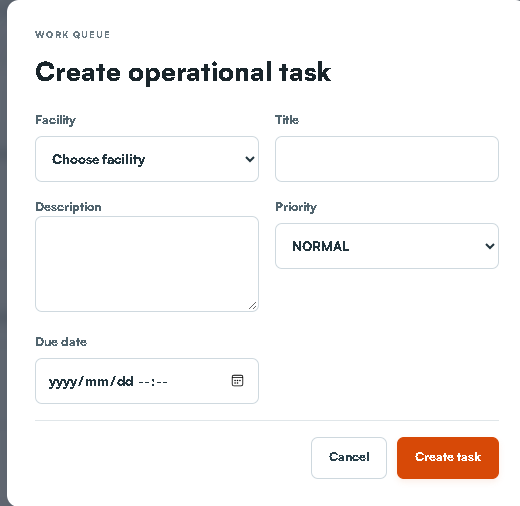
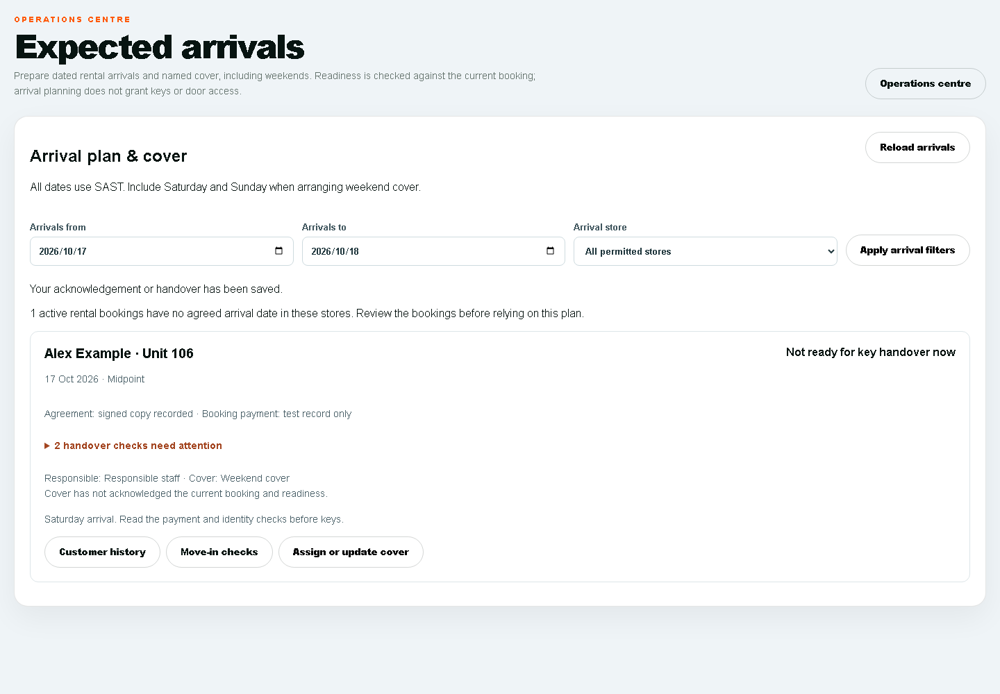

# STOR24 Facilities Manager Manual

Site operations maintenance arrivals and covering staff handover

15 October 2026

## Using this manual

This is the operating manual for the facilities manager and authorised site cover using the STOR24 staff portal. It explains where to go, what to enter, when to confirm, how to check the saved result and how to handle an exception. Keep it available beside the system during training and daily work.

Start with the daily routine. Then choose the task from the clickable contents. The field tables are practical entry instructions; the steps explain the process. For money, agreements, identity and keys, follow the separate checks rather than assuming an earlier stage completes the next one.

The staff portal is https://portal.stor24.co.za. The public customer website is https://stor24.co.za. All staff appointments and operational dates in this manual use South African Standard Time, UTC plus two hours.

The screenshots show the real interface on 15 October 2026. Empty live forms were opened without submitting records. Owner-view screenshots may show more stores or controls than your own account. Customer examples are clearly labelled and use fictitious data. Use only the actions granted to your account and assigned store.

## Sign in find a workspace and get help

- Open the staff portal and sign in with your own work account. Complete the verification requested by the sign-in screen. Do not use another employee's password.

- If the password fails, use the normal password recovery route. If the account or store is wrong, tell the owner which screen and work you need. Do not create another account to bypass the issue.

- Choose Menu and the named workspace, or use Find a workspace. On a small screen, the menu may be collapsed. Guide me opens the on-screen instructions; reading them does not perform the work.

- Confirm the store before changing a record. A locked workspace or Access restricted means that action is unavailable to your account. A visible control is not permission to perform an out-of-role task.

- When finished, sign out and close private files. Do not leave a staff session, customer document or downloaded history available on a shared device.

## The customer journey

Enquiry records the customer need. Reservation protects a unit for a limited time. Agreement records acceptance. Payment records eligible confirmed funds. Handover checks identity, date, access readiness and the real release of keys. A signed mandate is not payment, and a booking is not occupancy.

## Your duties and handover boundaries

Your work is site readiness, operational tasks, maintenance, physical arrival preparation and clear handover. Use the actions granted to your account. The manual describes the facilities duties; it does not assign a production account or imply that every visible shared-screen control belongs to your role.

Facilities duty | Who handles the related decision
Site task fault and maintenance condition | Manager records factual site work and verifies the physical result.
Customer booking quote agreement account or payment | Faeez or an authorised customer/finance operator.
Door enrolment suspension restoration or configuration | Designated access operator under approved policy.
Staff permissions provider setup commercial settings or general exports | Organisation owner or delegated administrator.

## Daily operating routine

- Review assigned tasks maintenance and the age of the reminder snapshot.

- Walk the site and compare the actual unit numbers and condition with the system.

- Review expected arrivals for today and the next cover period, including weekends.

- Resolve real site tasks and report booking payment identity or access blockers to the responsible operator.

- Before leaving, hand over open work to named cover and check acknowledgement.

Read the timestamp and scope of a reminder count. Open its underlying queue before acting. Reload to refresh; a zero does not establish that source data, bank reconciliation or provider delivery is complete.

## Create and complete a site task

Use this for a real operational action that another person can understand and complete. Open Operations and choose New task.

Field | How to use it
Facility | Choose the store where the work must happen.
Title | Use an action and location, for example Inspect corridor lighting.
Description | State what happened, the exact location, required action and who should receive the outcome. Keep customer identity/bank data out.
Priority | Choose LOW, NORMAL, HIGH or URGENT according to the actual operational urgency.
Due date | Enter the agreed date/time if needed. Check the local date and time before saving.

- Review the store title description priority and due date. Choose Create task once.

- Find the saved task in Assigned operational tasks. Check its store and due time. View request details may provide the related source/customer link.

- Do the actual work and retain any required evidence in the relevant source. Only then choose Complete.

- After an uncertain save/completion, use the displayed Reload and review the saved task before another change. Do not create another task merely because the response was delayed.

Example for training discussion: Inspect corridor lighting, Store 1 - Midpoint, describe the location and observed fault, agree the priority/due time. This example is not an instruction to create a live practice record.

## Report and resolve maintenance

In Operations, find Maintenance queue and choose New request. Check the store and whether this is a unit fault or a shared facility issue before saving.

Field | How to use it
Facility | Select the correct store first.
Unit (optional) | Choose the affected unit, or Facility-level request for a shared-area fault. Selecting the unit changes bookable availability.
Title | Name the specific fault and location.
Description | Record the observed condition, impact and required remedy. Use factual wording.
Priority and Due date | Set the actual urgency and agreed response target.

- Select Create request only for an actual fault. A selected unit is removed from bookable availability while linked maintenance remains open.

- Locate the saved request and confirm the right store/unit/title/priority/due date. A task and a maintenance request are different records.

- Use Start when work actually starts. Use Complete after the real fault is resolved, or Cancel only when the request legitimately no longer applies.

- Reopen the queue and verify the request status and unit state. Other open maintenance may keep the unit unavailable even after one request closes.

- If the system cannot confirm the change, reload and inspect the saved status and availability. Do not force unit availability or repeat the request without checking.

### When to stop and escalate

Escalate an unsafe condition through the approved site response procedure immediately. A system priority field does not call a contractor, emergency service or access operator. Do not promise that a request has been attended merely because it was saved.

## Read units and the facility map

- Open Units & rates or Facility map from Menu. Select the assigned store and floor.

- Locate the actual unit number and compare its position size type and displayed status with the physical site.

- View-only use does not authorise rate changes unit deletion wall edits floor duplication or commercial configuration. A drawing is not proof of a bookable physical unit.

- If the map/unit disagrees with the site, create a factual task identifying store floor unit observed issue and who should check it. Ask the authorised owner/inventory person to correct the source.

## Prepare a customer arrival

- Ask Faeez to confirm the exact saved booking date store and unit. Do not create a substitute reservation from a phone message.

- Check the unit is physically ready and that unresolved maintenance is recorded. Agree who will meet the customer.

- Review the Expected arrivals card and its current handover checks. Ask the authorised operator to resolve payment agreement identity or access blockers.

- At the actual arrival recheck current readiness. Future planning and cover acknowledgement do not themselves permit keys.

- Complete key handover only under the approved authorised procedure, after the required checks pass and keys are physically released. If your account cannot record that step, the designated operator records the real event.

## Prepare expected arrivals and weekend cover

Review dated rental arrivals, current handover blockers and named cover before the manager is away.

Who handles this: Facilities manager reviews assigned-store arrivals and accepts actual site cover within the granted operations access.

Faeez handles commercial/customer changes. Ask for the minimum site instructions if customer history is restricted.

Where to go: https://portal.stor24.co.za/operations/arrivals

### Before you start

Know the period and the agreed staff cover, including Saturday and Sunday.

### 1 Choose the period and store

Choose the SAST arrival dates and permitted store, including Saturday and Sunday for weekend cover. Only active rental bookings with agreed arrival dates are listed. Undated active bookings are identified separately so missing dates are not treated as an empty plan.

### 2 Review the actual handover checks

Each arrival reuses the current booking's identity, signed-document, photo, operational unit and verified receipt checks. Read the blockers. Future arrival dates and test-only payments do not allow keys now; planning an arrival does not grant physical access.

### 3 Assign a responsible colleague and cover

Choose Assign or update cover, nominate active staff with store access and record the agreed arrival instructions. Saving a new cover or changed instructions clears old acknowledgement. Review customer history and the source move-in checks before confirming the plan.

### 4 Acknowledge the current arrival plan

The named cover signs in with their own account and acknowledges the current booking and readiness. A date, source, readiness or cover-access change requires review again. If a save is uncertain or a colleague changed the handover, reload the current record before confirming.

### Field and control reference

Field or control | What to enter or check
Arrivals from and Arrivals to | Choose the actual cover period in South African dates.
Arrival store | Choose the permitted store and Apply arrival filters.
Arrival card | Read customer/unit/date and expand handover checks needing attention. Planning an arrival does not clear a blocker.
Assign or update cover | Choose responsible staff and cover and record arrival instructions. The new cover reviews the current booking/readiness and acknowledges in their own account.

### Check that it worked

The plan retains the agreed staff and acknowledgement for the current booking. At actual arrival, recheck the live payment, identity, agreement, unit/photo and handover requirements.

### If something goes wrong

Undated bookings are flagged separately and must be reviewed. A future arrival or a test-only payment does not allow keys today. Changed source/readiness/cover may invalidate acknowledgement.

## Schedule customer follow ups and acknowledge cover

Record agreed appointments in South African time, assign responsibility and acknowledge covering work without changing collection holds.

Who handles this: Facilities manager handles agreed site work and actual covering duties. Faeez owns customer debt terms and commercial promises.

Use your own account to acknowledge your assignment. Assignment alone is not acknowledgement.

Where to go: https://portal.stor24.co.za/operations/followups

### Before you start

Obtain the customer's agreement to the appointment, its time and action. An internal desire to chase debt is not an agreed appointment.

### 1 Read the open appointment queue

Open appointments show the agreed SAST time, customer, store, responsible staff and named cover. Open Customer history to read the exact customer's notes and communications. Load more appointments includes later open pages. Store permissions still apply.

### 2 Schedule an agreed customer appointment

Choose Schedule follow-up, search and select the correct customer, store, responsible staff and optional cover. Enter the agreed SAST date/time, title and action, then save. An agreed call on the14th stays separate from a payment promise due15th; the debt-chasing hold is unchanged.

### 3 Hand over to a named colleague

Update cover to nominate an active colleague with access to the store. Only that colleague can acknowledge cover from their own signed-in account. A changed cover clears the previous acknowledgement. Review the original customer history before carrying out the agreed action.

### 4 Check uncertain saves before retrying

Complete or cancel an appointment after checking its current status. If a save cannot be confirmed, reload and review the recorded appointment before retrying. Stale handovers are rejected rather than overwriting a colleague. A failed reload keeps changes blocked; a lost grant clears the records.

### Field and control reference

Field or control | What to enter or check
Find customer by name | Enter at least two characters, choose Search customers and select the exact Customer.
Store | Choose the customer's operational store.
Responsible staff and Covering staff | Choose the actual accountable person and optional cover with store access. Assigning cover is not their acknowledgement.
Agreed date and time (SAST) | Enter the customer-agreed local time. This is separate from a promise-to-pay date.
Appointment title | Use a clear task such as Agreed advance call, not an unexplained reminder.
Agreed action and handover details | Record what the customer agreed, what cover must do and any existing promise/hold that must remain in place.

### Check that it worked

Save agreed appointment, then confirm the saved title/customer/store/time/responsible person/cover in Open appointments. The named cover uses their own login and Acknowledge cover. A changed handover needs fresh review.

### If something goes wrong

When a save is uncertain, reload and check before retrying. Do not tick Complete until the agreed action occurred. If someone changed the same appointment, reload rather than overwrite.

## Write a useful dated note and handover

For a customer matter, use Customers & tenants, select the exact customer and open History & notes. Choose Add note if your account has that action. For a site-only matter, use an operational task. Do not put bank numbers, identity images, passwords or private signing links in general notes.

Include | Example using fictitious data
What happened | Customer asked for a Saturday arrival.
What was agreed | Arrival is expected at 09:00. Payment still needs finance confirmation.
Who acts next | Responsible staff will check the booking; the named site cover will meet the customer.
When | Record the agreed appointment in Follow-ups & handovers, not only in the free-text note.
What remains blocked | Keys remain on hold until the current move-in checks pass.

- Choose the correct note store and category. Record facts, agreed actions and unresolved issues. The system records the author and timestamp automatically.

- Save the note, refresh the customer and confirm the text/category/author/SAST time. Have covering staff locate the same note through their own permitted account.

- Correct a dated note by adding another note that explains the correction. The older editable profile summary is not the same as the dated note history.

- A shared note does not schedule an appointment or prove that cover acknowledged it. Create or update the linked handover and check the acknowledgement separately.

If customer history or Add note is unavailable, ask Faeez to retain the customer note. Keep your site task factual and limited to the work you are responsible for.

## Read booking and move in events

Read recorded booking stages and acknowledge only your own event inbox without sending a message or granting access.

Who handles this: Review store operational events and your own read acknowledgement.

A booking or signed-agreement event does not establish paid arrival or physical key collection.

Where to go: https://portal.stor24.co.za/operations/events

### Before you start

Open the inbox as yourself. Its unread status belongs to your account.

### 1 Read the source stage

The store event inbox lists booking creation, recorded signed agreements, move-in starts and explicit key-handover audit records. These are separate stages. A booking or signed document does not establish a verified payment, physical key collection or active door access.

### 2 Open the customer history

Use Customer history to open the exact customer and read staff notes and recorded communications before acting. Events show their store, unit where recorded, and SAST timestamp. Only stores in your current operations permission are included.

### 3 Acknowledge for your own account

Mark an event as read only after reviewing it. The acknowledgement belongs to your signed-in account; another colleague still has their own unread state. Changed source evidence needs a fresh read. Acknowledgement sends no email, WhatsApp or SMS and grants no financial or access approval.

### 4 Reload and review older records

Use Older events for later pages and Latest events to return to recent records. If confirmation is uncertain, reload and check your recorded read state before retrying. A failed source read is an unavailable queue, not proof that no events exist.

### Field and control reference

Field or control | What to enter or check
Event stage | Distinguish booking created, recorded signed agreement, move-in started and actual key-handover audit event.
Customer history | Open the exact customer history to understand the next action.
Mark read | Mark read only after reviewing the event. This acknowledges your inbox; it does not send a staff/customer message.

### Check that it worked

Your read status is retained after reload and the underlying booking remains unchanged.

### If something goes wrong

An event is evidence of its stated stage only. It is not proof of payment, active door access, another employee's acknowledgement or a delivered manager alert.

## Plan work with the calendar

Read tasks, agreed follow-ups, viewings, expected rental arrivals and move-outs in SAST.

Who handles this: Use the calendar as a planning view and open the source record for changes.

Use Expected arrivals for rental arrival/cover checks rather than assuming a calendar entry proves readiness.

Where to go: https://portal.stor24.co.za/calendar

### Before you start

Choose the actual date range and store for the work you are planning.

### 1 Read the scheduled work

Calendar groups facility-scoped tasks, lead follow-ups, viewings, expected rental arrivals and scheduled move-outs by day. Times use South African time. An expected arrival still needs current handover checks; an empty day does not establish that every operational task is finished.

### 2 Open the source record

Choose an item to open its linked workflow. Check customer, facility and due time before acting. This calendar is a linked view; it does not offer drag-and-drop rescheduling or a general appointment creation form.

### 3 Create or resolve work at its source

Use Operations  >  Customer follow-ups and covering-staff handovers for an agreed customer appointment with responsible staff and cover. Use Expected arrivals for dated rental bookings and weekend preparation. Complete or update work at its source, then revisit Calendar; reading guidance does not clear entries or grant keys.

### Field and control reference

Field or control | What to enter or check
Scheduled item | Read its source type, time, customer and staff owner.
Source record | Open the actual source workflow to change the action. Calendar is an overview, not a universal editor.
Appointments and arrivals | Use Follow-ups & handovers for agreed appointments and Expected arrivals for rental arrival readiness/cover.

### Check that it worked

The planned item has the correct next action in its source and the covering person knows what they must do.

### If something goes wrong

A calendar entry does not clear a payment/identity/access blocker or establish the customer attended.

## Counter tablet and shared device care

- Keep customer use on the public Counter journey and staff work on the staff device. Ask Faeez to prepare the correct store visit.

- The customer supplies and verifies their own contact details and signs their own agreement. Do not sign or enter acceptance on their behalf.

- After a visit use the approved clear/end-visit process and verify the previous customer cannot be reopened from the tablet.

- Do not store identity images or private signing/payment links on a personal phone. Sign out of staff accounts before handing over a shared device.

- Real Android installation camera scanning privacy clearing and reconnect behaviour must be checked on the actual equipment. A browser screenshot does not perform device setup.

## Stock goods and customer collections

Check the actual product and quantity against the authorised order. A product list is not permission to alter selling prices, adjust stock or mark an order supplied. Release goods only through the permitted paid-order and physical handover process. Payment review means investigate first. A stock return does not issue a refund. If stock work is outside your assigned access, pass it to the designated operator.

## Weekly review and shift handover

Review | What to leave for the next person
Open tasks | Current status actual action next responsible person and due time.
Maintenance | Affected store/unit real condition next contractor/staff action and remaining availability restriction.
Weekend arrivals | Both days checked booking readiness named cover and current acknowledgement.
Keys and access | Actual physical handover or issue and the authorised operator who must act.
Device issues | Equipment affected time safe error and whether the previous customer/session is cleared.

Before leaving, confirm the next person has the actual handover, not only that a note was saved. Sign out and secure keys/equipment through the approved site process.

## Exceptions and recovery

Situation | What to do next
Save result is uncertain | Stop and reload the saved record. Look for the original reference before retrying.
Another person changed the record | Reload the current version and agree the next action. Do not overwrite blindly.
Access restricted | Record the task screen and store and ask the owner to review access. Continue with available work.
No records match | Check date store status and search filters. Confirm the snapshot age.
Payment or signature missing | Retain the existing booking reference and use its supported recovery route. Do not create a substitute record.
Export blocked | Use the safe reason/request reference. Do not copy blocked content through another screen.
Message outcome uncertain | Check the exact customer channel reference and provider state before any separately authorised retry.
Unit stays unavailable | Review remaining reservations occupancy and maintenance; do not force the status.
Unexpected customer information | Close the record and report the store/scope issue to the owner. Do not download it.

## Outage and device recovery

Browser online describes the browser connection. It does not prove provider, gate or payment availability. If the system fails, record the time, store, affected task and safe error text. Follow the approved site/customer escalation procedure. Do not repeat financial or messaging actions while their result is unknown.

Offline work requires a prepared, authorised encrypted snapshot and a tested unlock/reconnect process. Missing or expired snapshots are not usable readiness. Counter signing and payment are not an offline completion route. On reconnect, inspect queued work and conflicts before repeating capture.

## Training exercise checklist

- Find your assigned store, the unit/map and actual tasks.

- Create and complete a site task on approved practice data.

- Explain the availability effect of a unit maintenance request and verify its status after a permitted change.

- Review a weekend arrival and explain every unresolved handover check.

- Acknowledge assigned cover using your own account.

- Give an end-of-shift handover that names the next action and person.

- Demonstrate a blocked action and explain how to escalate without using another login.

Use owner-approved training or isolated data for practice. Do not use real customers for sample financial postings, messages, signatures or access changes. Record trainer, learner, date, store, observed result and any follow-up. The manual is the instruction document; staff acceptance is a separate training record.

## Glossary

Term | Meaning
Customer | The individual or business record.
Lead or enquiry | The storage need and next sales action.
Reservation or hold | Time-limited protection of a unit.
Agreement | Saved terms and signature evidence.
Tenancy and account | The occupancy relationship and its financial record.
Receipt | Recorded actual confirmed funds on the correct account.
Mandate | Authority for a payment method, rather than proof of funds collected.
Promise or dispute hold | A case arrangement affecting collection follow-up eligibility.
Acknowledged cover | The named covering colleague reviewed the current handover through their own account.
Source record | The actual booking account task or provider evidence behind an overview.

## Edition and verification notes

Edition 2, 15 October 2026. This manual was checked against the STOR24 first-party workflow guides and current form source at CRM main 19f00c58c68f4c102f1998f43f556d720f5c3b0b, the recorded 23-item Faeez meeting register and authenticated live screen reads. The original full meeting recording was not independently re-transcribed for this edition.

Fresh live reads and empty forms cover tasks maintenance enquiries customer details/address/consent reservations agreed appointments arrivals payment review correction requests report navigation Counter preparation and unidentified evidence intake. Screenshots retain the date and distinguish live empty forms from fictitious component examples. No production customer financial messaging signing access or permission record was submitted for this documentation work.

Document verification covers source/field/step consistency, screenshot legibility, contents/bookmarks, PDF extraction, page bounds and rendered-page review. It does not establish customer/provider delivery, bank settlement, physical access, actual-device installation or staff training acceptance. Apply the current approved legal privacy finance access and site procedures; unresolved provider data and operational gates remain separate from the manual.
