# STOR24 Faeez Operating Manual

Customer service leasing accounts collections and staff handover

15 October 2026

## Using this manual

This is the operating manual for Faeez and explicitly authorised customer operations cover using the STOR24 staff portal. It explains where to go, what to enter, when to confirm, how to check the saved result and how to handle an exception. Keep it available beside the system during training and daily work.

Start with the daily routine. Then choose the task from the clickable contents. The field tables are practical entry instructions; the steps explain the process. For money, agreements, identity and keys, follow the separate checks rather than assuming an earlier stage completes the next one.

The staff portal is https://portal.stor24.co.za. The public customer website is https://stor24.co.za. All staff appointments and operational dates in this manual use South African Standard Time, UTC plus two hours.

The screenshots show the real interface on 15 October 2026. Empty live forms were opened without submitting records. Owner-view screenshots may show more stores or controls than your own account. Customer examples are clearly labelled and use fictitious data. Use only the actions granted to your account and assigned store.

## Sign in find a workspace and get help

- Open the staff portal and sign in with your own work account. Complete the verification requested by the sign-in screen. Do not use another employee's password.

- If the password fails, use the normal password recovery route. If the account or store is wrong, tell the owner which screen and work you need. Do not create another account to bypass the issue.

- Choose Menu and the named workspace, or use Find a workspace. On a small screen, the menu may be collapsed. Guide me opens the on-screen instructions; reading them does not perform the work.

- Confirm the store before changing a record. A locked workspace or Access restricted means that action is unavailable to your account. A visible control is not permission to perform an out-of-role task.

- When finished, sign out and close private files. Do not leave a staff session, customer document or downloaded history available on a shared device.

## The customer journey

Enquiry records the customer need. Reservation protects a unit for a limited time. Agreement records acceptance. Payment records eligible confirmed funds. Handover checks identity, date, access readiness and the real release of keys. A signed mandate is not payment, and a booking is not occupancy.

## Responsibility and approval boundaries

Faeez's current custom access was verified with 27 selected permissions at Store 1 - Midpoint on 15 October 2026. This manual covers that customer and commercial work. It does not change the account, role or scope.

Handle within your granted scope | Pass to the authorised colleague
Customers enquiries reservations notes and scoped history downloads | Staff administration company configuration provider credentials and general personal-data export
Read accounts record evidenced receipts and request corrections | Independent adjustment approval refund payout settlement and debit/billing administration
Collection follow-up reviewed notices and permitted reports | Debt policy fees physical-access action legal wording and disposal decisions

## Daily operating routine

- Review new enquiries owner assignments and next sales actions.

- Review expiring reservations and upcoming arrivals.

- Read new customer history and agreed appointments before contacting anyone.

- Review payment evidence and collection cases, including holds and promises.

- Prepare the next day and weekend handover with named cover and acknowledgement.

Read the timestamp and scope of a reminder count. Open its underlying queue before acting. Reload to refresh; a zero does not establish that source data, bank reconciliation or provider delivery is complete.

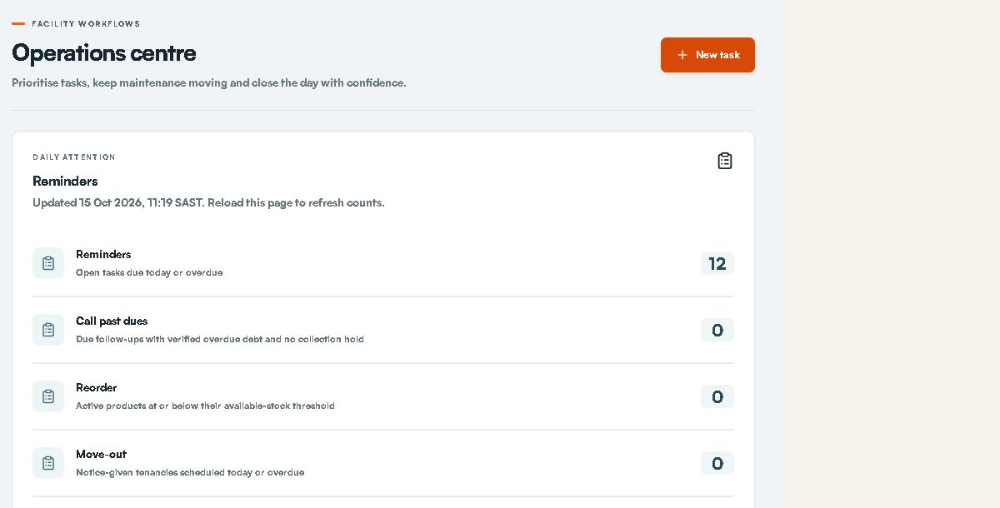

## Write a useful dated note and handover

For a customer matter, use Customers & tenants, select the exact customer and open History & notes. Choose Add note if your account has that action. For a site-only matter, use an operational task. Do not put bank numbers, identity images, passwords or private signing links in general notes.

Include | Example using fictitious data
What happened | Customer asked for a Saturday arrival.
What was agreed | Arrival is expected at 09:00. Payment still needs finance confirmation.
Who acts next | Responsible staff will check the booking; the named site cover will meet the customer.
When | Record the agreed appointment in Follow-ups & handovers, not only in the free-text note.
What remains blocked | Keys remain on hold until the current move-in checks pass.

- Choose the correct note store and category. Record facts, agreed actions and unresolved issues. The system records the author and timestamp automatically.

- Save the note, refresh the customer and confirm the text/category/author/SAST time. Have covering staff locate the same note through their own permitted account.

- Correct a dated note by adding another note that explains the correction. The older editable profile summary is not the same as the dated note history.

- A shared note does not schedule an appointment or prove that cover acknowledged it. Create or update the linked handover and check the acknowledgement separately.

## Find communications and download customer evidence

- Select the exact customer before searching. Check their displayed reference and unit.

- In History & notes, choose History type and Note category as needed. Enter a useful term in Search history and Apply filters. Use Date and communication filters for the required range/channel/status when available.

- Read the retained event and its recorded times. Sent or provider acceptance is different from Delivered or Read. Missing original content or attachments must remain identified as missing.

- Use the event Download control for one communication, or Download history for the permitted customer scope. CSV and Excel are alternatives for the available tabular evidence.

- Open the downloaded file. Check the customer, period, record types, older entries and missing-content notices before using it for a complaint or handover. Store/share it only through the approved internal process.

Recorded state | What you can say
Queued or pending | A send or processing step is still pending.
Sent or accepted | The provider accepted the request; inbox/handset receipt is a separate question.
Delivered | The provider recorded delivery for that channel.
Read | A supported provider recorded a read event.
Failed or uncertain | Investigate the exact reference; do not silently resend.
No retained original | The system does not have that original content. Do not reconstruct it as a quotation.

## Customer records and consent

Create or find a customer, maintain contacts and locate signed documents.

Who handles this: Faeez within current store permissions; another authorised colleague handles any withheld action.

Where to go: https://portal.stor24.co.za/tenants

### Before you start

Have the existing customer reference or confirmed name and contact details. Search first; create a new record only when you have checked there is no match.

### 1 Find the existing customer first

Search name, contact or ID in the left list. Select the matching person or business and confirm contact details. A customer record can exist before any tenancy; avoid creating a second record for the same customer.

### 2 Add or edit the right details

Add customer opens the customer form; Edit details updates the selected record. Choose Individual or Business, then enter names, company where relevant, phone, email and the required identity details. Complete the primary address, alternate contact, emergency and work sections before saving.

### 3 Record the customer s actual consent

In Consent and notes, select Email, SMS, WhatsApp and Phone only for channels the customer approved. Include useful operational notes. A contact number or an existing tenancy does not itself mean WhatsApp consent.

Check before confirming: Saving changes a real customer record. Do not enter invented identities or consent during training.

### 4 Read tenancy and booking records separately

Tenancies and units shows the facility, occupancy, account and balance. Signed booking agreements lists the original booking PDF. Debit-order mandates have a separate reference, status and PDF; a signed mandate is not a successful collection.

### 5 Continue into the correct workflow

Use Reservations for a hold, Move in for the selected booking and Operations  >  Payments for the account ledger. A signed PDF can precede an active tenancy. Check payment, date and physical handover before telling the customer they can move in.

### Field and control reference

Field or control | What to enter or check
Customer type | Choose Individual or Business to match the contracting customer.
Contact and identity | Capture the supplied first/last names or company name, mobile and email. Identity reference, date of birth and tax number belong only in their intended fields when required.
Billing address | Enter street and address line 2; choose Province before City. Check the suggested Postal code against the actual address. Country defaults to South Africa.
Other contacts | Record the real alternate, emergency or work contact and the correct relationship. Do not substitute their contact for the storer.
Consent and notes | Tick only the channels actually agreed to. Use dated History notes for later interactions; the profile summary does not provide the same author/date history.

### Check that it worked

After Save customer, locate the customer again. Open Contact details and confirm the name, contact, billing address and channel consent. Confirm the record is the intended individual or business.

### If something goes wrong

A failed save is not a new record. Read the error, correct only the affected fields and check the customer list before trying again. If two records seem to exist, ask the owner to resolve the duplicate; do not invent another identity.

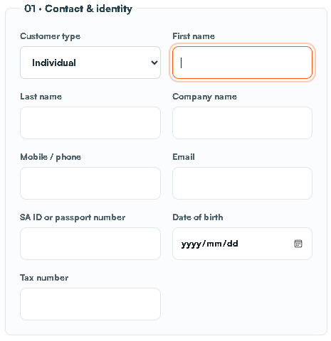

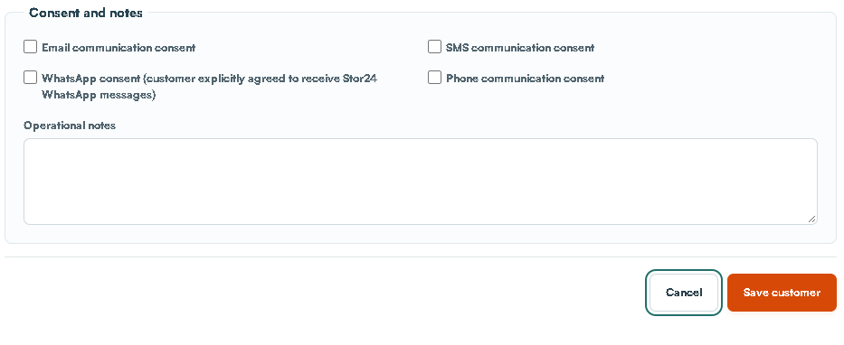

## Track an enquiry through the sales pipeline

Track customer details, follow-ups, saved stages and enquiry sources.

Who handles this: Faeez within current store permissions; another authorised colleague handles any withheld action.

Where to go: https://portal.stor24.co.za/leads

### Before you start

Know which store the enquiry concerns, what space is required and whether this is an existing customer.

### 1 Review sales performance

Filter by store, creation period, stage or customer. Pipeline bars show current positions, not a historical funnel. Source conversion uses saved moved-in outcomes. Landing-to-submission journeys only appear where analytics consent and journey data were captured; missing data is not direct traffic.

### 2 Capture an enquiry

Add enquiry records the customer's contact details, store, enquiry source and requirements. It creates a real customer and enquiry together. The capturing employee becomes the initial sales owner.

### 3 Manage the next action

Open a customer in the worklist. Review notes, source, journey and activity history. Staff with access can save a sales stage, owner, follow-up time and requirements. Follow-up times use South Africa time. Stale edits require a refresh; no stage change is complete until saved.

### 4 Reserve and complete the journey

In the enquiry detail choose Reserve a unit, select available inventory and confirm the quote and date. The saved hold is linked to this enquiry and advances it to Reserved. Manage live bookings in Reservations and complete the real Move-in checks; Moved in cannot be manually claimed from a sales-stage dropdown.

Check before confirming: A reservation does not prove payment, signature or handover. Existing release gates remain.

### Field and control reference

Field or control | What to enter or check
Store and customer | Choose Store first. Search an existing customer; use + Create new customer here only when needed. Check the selected customer before continuing.
Enquiry source | Record how the enquiry reached staff: for example Walk-in, Phone in or WhatsApp. This differs from the advertising source.
Expected move-in and requirements | Record the customer estimate and the actual storage need. Include type/size, timing and next agreed action.
Storage use and discovery | Choose Personal, Business or Personal and business. Ask How did you hear about us? rather than assuming an advert caused the enquiry.
Voluntary profile and location | Gender is self-reported and optional. Record city/town, province/region, postal code and country only as supplied. These enquiry fields do not update billing address.
Owner stage and follow-up | In the saved enquiry, choose the real owner, stage and next follow-up. Save the change. Do not mark Moved in without the actual move-in workflow.

### Check that it worked

Save enquiry & continue creates a real enquiry. Confirm the customer and store, then return to the worklist and find the saved enquiry with its owner, current stage and next action.

### If something goes wrong

If the next step is uncertain, search the worklist before creating anything else. A stage is the current state, not proof of the earlier customer journey. Missing source data stays unknown.

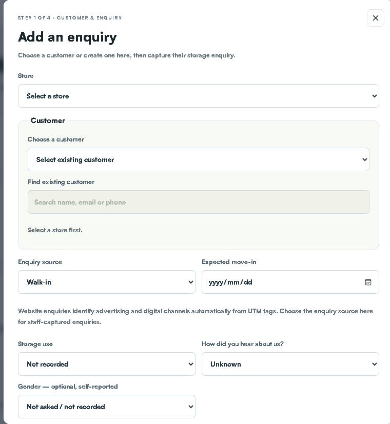

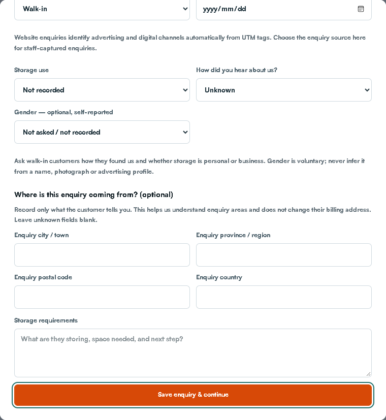

## Manage a reservation

Find a hold, understand its dates and prepare the move-in handoff.

Who handles this: Faeez within current store permissions; another authorised colleague handles any withheld action.

Where to go: https://portal.stor24.co.za/reservations

### Before you start

Confirm the customer, store, agreed unit/rate, intended move-in date and the length of the hold. Prefer Reserve a unit from the saved enquiry when it belongs to that enquiry.

### 1 Find the right customer and store

Select the store, choose a status and search by customer, unit or unit type. The default list shows active reservations. Change the status filter if you are looking for a converted, cancelled or expired hold.

### 2 Review the hold before acting

Check the customer, unit, quoted rate, hold expiry and intended move-in. A reservation holds a unit; it does not by itself confirm payment, occupancy or permission to collect keys.

### 3 Create a hold when it is needed

New reservation opens a form for the store, existing customer, available unit, quoted monthly rate and dates. The button needs an available unit and a customer record. Review the form carefully before choosing Reserve unit.

Check before confirming: Reserve unit creates a real hold. To explore without saving, open the form and then choose Cancel.

### 4 Keep the hold accurate

Extend asks for a later expiry date and a reason. Expire is for an overdue active hold. Cancel ends a reservation. Read the confirmation and resulting message: a unit can remain protected by another reservation or occupancy.

Check before confirming: Extend, Expire and Cancel change live records. Only use them for a confirmed operational reason.

### 5 Carry the reservation into move in

Choose Move in beside the correct reservation to carry its customer and unit into the next screen. Signed bookings use the saved agreement and move-in checks. The Prepare a move-in guide explains that next stage.

### Field and control reference

Field or control | What to enter or check
Store and Customer | Choose the exact existing customer and permitted store.
Storage space | Use Floor / layout and select an available unit. Green units are available, grey are unavailable and orange is the current selection. Check Available unit before saving.
Monthly quote (R) | Enter the agreed positive monthly amount. Review the same amount in the agreement and initial charge. Do not silently alter a protected saved online quote.
Hold expires | Set the expiry agreed with the customer. It controls the hold; it is not the tenancy start date.
Intended move-in | Record the expected arrival date separately from expiry.

### Check that it worked

Choose Reserve unit only after review. Refresh reservations and confirm customer, unit, quote, expiry and intended move-in. The active hold is distinct from agreement, payment and occupancy.

### If something goes wrong

If availability changed, recheck the current unit. Do not force a grey unit or create another hold to bypass a conflict. Before repeating an uncertain save, reload and search for the original reservation.

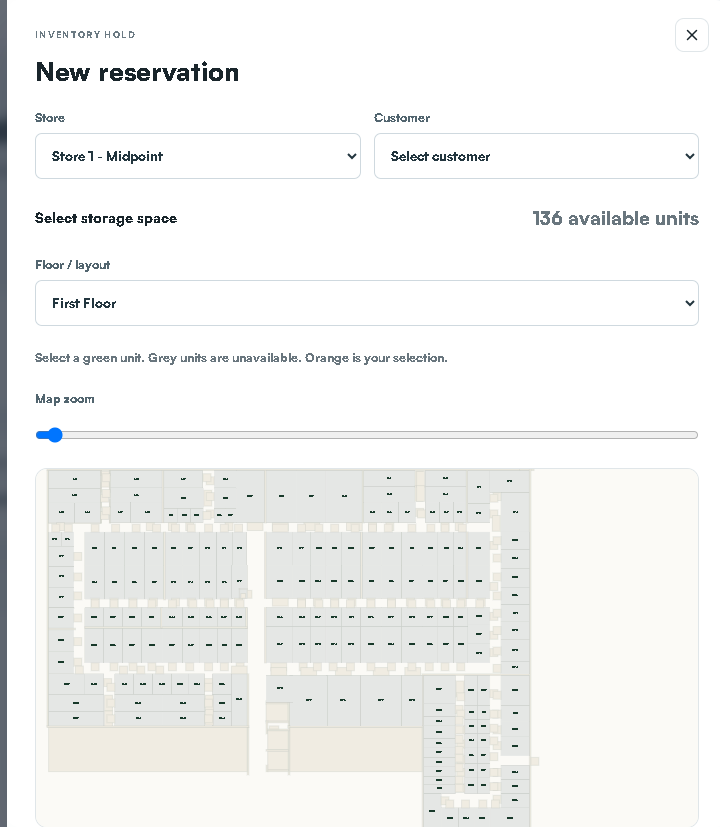

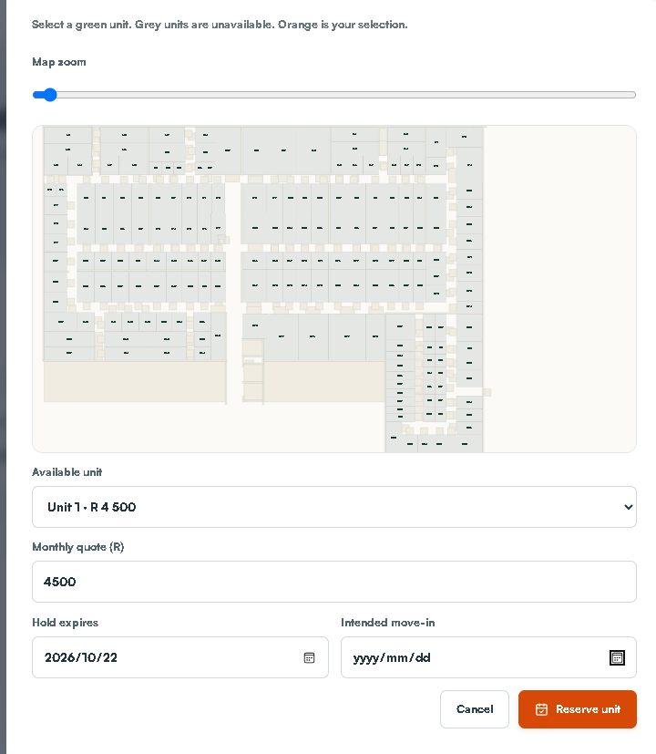

## Hand the website journey to a walk in customer

Prepare the counter tablet, let the customer complete the website journey, then continue from the saved booking.

Who handles this: Faeez within current store permissions; another authorised colleague handles any withheld action.

Where to go: https://portal.stor24.co.za/operations/walk-in

### Before you start

Have the correct store, a prepared customer tablet and a separate staff device. Check that the previous customer visit has been cleared.

### 1 Prepare the correct store

Choose the customer's store and prepare a tablet visit. This creates a temporary handover, not a customer or booking. In the installed STOR24 Counter app, scan the visit QR shown here or enter its eight-character code within five minutes. Both open the same visit and work once. Install the app once from stor24.co.za/walk-in.

### 2 Hand the device to the customer

Confirm the correct store has opened on the tablet, then hand it to the customer. The customer selects a unit, enters their own details, verifies their contact details, supplies identity and reads and initials the saved agreement clauses before signing. Staff must not provide the customer's acceptance or signature.

### 3 Clear the tablet and complete Move In

When the customer finishes, use Finish visit and clear tablet before another customer uses the device. The booking is retained. Refresh this staff page, choose the exact recent booking and continue Move In; payment, identity, access and key-handover checks still apply.

### Field and control reference

Field or control | What to enter or check
Staff preparation | On Walk-in on tablet choose Store, then Prepare tablet visit for a real visitor.
Customer entry | Use the presented customer journey, QR code or short code as directed by the screen. Keep the staff login away from the customer device.
Customer completion | The customer supplies their own details, verifies contact and reviews/signs their agreement. Staff do not provide acceptance for the customer.
Staff completion | Clear/end the customer visit, then open the exact saved reservation in Move in. Verify the same customer, store and unit.

### Check that it worked

The customer booking is retained, the previous visit is cleared from the tablet and staff resume that saved booking. No duplicate customer/lease is needed.

### If something goes wrong

If scanning fails, use the available short-code route. If a signature, payment or identity step is blocked, keep the saved reference and use its recovery route. The Counter journey requires network access for private transactions.

## Prepare an unsigned rental agreement

Select the unit and account details before an agreement is sent.

Who handles this: Faeez within current store permissions; another authorised colleague handles any withheld action.

Where to go: https://portal.stor24.co.za/operations/move-in

### Before you start

Locate the existing reservation if one exists and confirm the proposed unit and contracting customer.

### 1 Choose the booking or unit

Prefer Move in on the existing reservation. On Select unit, use the store and unit filters and check the selected unit's rate and availability. A signed reservation follows the separate Move-in checks path described in Prepare a move-in.

### 2 Confirm the account details

Continue to Account details. Select the existing customer or use Add a new customer if there is no record. Check Start date, Monthly rent, Initial charge and Payment method. Initial charge is provisional until finance rules are confirmed. Do not create a duplicate customer or lease to bypass a blocker.

### 3 Review and sign with the customer

Read Lease agreement and confirm the payment arrangement. Review and sign now is the default for a walk-in or phone-in; Email invitation for later signing is an explicit alternative. Continue to agreement signing creates the saved lease and opens the next signing step.

Check before confirming: Preparing a lease is a real action. For training, read the fields and leave without submitting.

### 4 Continue from saved signature evidence

On the signing screen, let the customer review and sign, then complete representative signing if required and refresh. Preparation recovery reuses the saved lease. The completed copy is sent afterwards; payment, date, identity/access and physical key handover remain distinct checks.

### Field and control reference

Field or control | What to enter or check
Account details | Confirm existing customer, Start date, Monthly rent, Initial charge and Payment method. Check the commercial figures against the approved quote.
Signing choice | Review and sign now supports a walk-in or phone-in. Email invitation for later signing is a deliberate alternative.
Agreement preparation | Continue to agreement signing creates a saved lease. Review every field before this action; it is not a read-only preview.

### Check that it worked

A saved agreement reference opens in the signing workflow. Continue from that reference and refresh its saved signature status.

### If something goes wrong

If preparation fails, use recovery for the saved lease. Creating another customer, reservation or agreement can duplicate records and does not resolve the original blocker.

## Complete signing during a visit or call

Guide the customer through agreement review and signing without waiting for an emailed return.

Who handles this: Faeez within current store permissions; another authorised colleague handles any withheld action.

Where to go: https://portal.stor24.co.za/operations/lease-signing

### Before you start

Confirm the current customer and saved agreement. The person signing must be the intended signer.

### 1 Review with the customer

Check the saved lease and customer before opening signing. For a walk-in, let the customer review, initial and sign on the counter device. For a phone-in, copy and share the customer signing link during the call; the customer provides their own acceptance and signature.

### 2 Complete each signing step

Open the current signer's link. Return to this screen after signing and refresh the status. Customer signing comes before the authorised representative, unless authorised automatic countersigning is configured. Opening or copying a link never records a signature.

### 3 Continue from saved evidence

Once the portal confirms the signed agreement is saved, continue to the same account for payment and move-in checks. BlendSign sends the completed copy afterwards. If preparation failed, retry the saved lease; never create a second lease to bypass a blocker.

### Field and control reference

Field or control | What to enter or check
Review and customer signing | Show the current agreement. For phone-in, share the customer signing link through the authorised process and let the customer sign on their own device.
Representative signing | Complete the authorised representative step only as required by the agreement workflow.
Status refresh | Return to Agreement signing and refresh the saved status. Opening a link is not a signature.

### Check that it worked

The system retains the completed agreement and any supported completion evidence. A completed copy is sent by its configured process; check delivery separately.

### If something goes wrong

Keep failed preparation, incomplete signature and completed agreement as separate states. Never mark a document signed based only on a verbal assurance or an opened link.

## Prepare a move in

Follow the booking into agreement, payment and key-handover checks.

Who handles this: Faeez within current store permissions; another authorised colleague handles any withheld action.

Where to go: https://portal.stor24.co.za/reservations or https://portal.stor24.co.za/operations/move-in

### Before you start

Open Move in on the existing reservation. Check the same customer, unit and intended date throughout the workflow.

### 1 Start from the existing reservation

Find the correct customer and unit, then choose Move in on that reservation. This carries the booking into the move-in screen. If you already opened Move in, continue to the next guide step.

### 2 Confirm the customer and the booking path

A signed reservation opens Move-in checks and shows the customer and unit. Other bookings use Select unit and Account details to prepare the agreement. Always verify that you are working on the intended customer's booking.

### 3 Use the agreement already on file

For a signed booking, View signed agreement opens the original document. No new signature is required. If the booking is not yet signed, review the Account details and agreement workflow instead; do not treat it as ready for key collection.

### 4 Check eligible payment and the agreed date

Review the verified amount against the amount required, the agreed move-in date and any listed blockers. A sandbox payment does not clear a real booking. A debit-order mandate is not proof of payment. Refresh checks after an authorised update.

Check before confirming: Record a receipt only for actual confirmed funds and with the required evidence. Never enter a receipt merely to clear a training step.

### 5 Record handover only when it happens

When the checks permit it, verify the customer's identity and unit at the physical handover. The attestation and Confirm move-in / key handover record that real event. A disabled button means a requirement remains outstanding.

Check before confirming: Do not tick the handover attestation or confirm a move-in as a tutorial exercise. Facial access is handled separately.

### 6 Check the outcome and separate access work

After an actual successful handover, review the resulting tenancy and occupancy in the relevant records. Facial access has its own checks and operational approval. Finishing this guide confirms reading only; it does not confirm a payment, key collection or working door access.

### Field and control reference

Field or control | What to enter or check
Agreement | Use View signed agreement for a signed booking. Read the saved original; do not request another signature for an already completed booking.
Payment and date | Compare the eligible verified amount with the required amount and check the agreed move-in date. Test payments and signed mandates do not satisfy a real payment check.
Identity and access photo | Complete the private approved review and check the person/original document at handover as required. Photo/access work has its own permissions and provider conditions.
Physical handover | Only after the required checks pass, record the actual handover attestation and Confirm move-in / key handover when keys are physically handed over.

### Check that it worked

Confirm the resulting tenancy/account and occupied unit. Record the real handover. Working physical door access still needs its own verification.

### If something goes wrong

Read the blocker shown by the screen. Refresh after an authorised correction. Do not add a receipt, backdate a booking or tick an attestation to make a blocked training/customer journey continue.

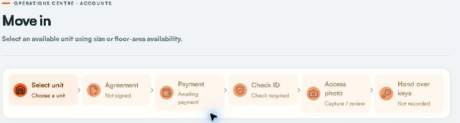

## Review a customer identity document

Privately review ID uploads before staff-confirmed key handover.

Who handles this: Faeez within current store permissions; another authorised colleague handles any withheld action.

Where to go: https://portal.stor24.co.za/identity

### Before you start

Use the approved identity collection policy and the explicit identity-review permission for the store.

### 1 Check whether collection is open

The hold notice means the approved ID policy has not been enabled. Online ID collection is separate from facial access and requires approved document types, privacy wording and retention arrangements. Existing bookings continue to their normal handover check.

### 2 Open the correct submission

Choose the customer's submission and confirm the store, unit and booking reference. You need explicit identity-review permission for the store. The queue contains review details; document images only open when you request a private preview.

### 3 Review every page before accepting

Open the photo page or both sides of the ID card. Check the name, photograph, readability and completeness against the booking. Every view is recorded; acceptance requires your preview of every page of the exact current version. A replaced or expired version must be reviewed again.

### 4 Resolve replacements and complete handover

Choose the appropriate replacement reason when a clearer or complete copy is needed. The customer sees that request when reopening the identity step from the agreement. No email is sent by this action. An accepted document permits the identity part of handover; staff must still check the original and person, payment and signed agreement before handing over keys.

### Field and control reference

Field or control | What to enter or check
Submission | Match customer, store, unit and booking reference.
Private preview | Open every required page or both sides of the exact current version. Check name/photo/readability and completeness.
Replacement | Use the appropriate replacement reason if unreadable or incomplete. A replaced version must be reviewed again.

### Check that it worked

The exact submission has the correct review outcome. Identity acceptance clears only that check; payment, agreement, person and handover remain separate.

### If something goes wrong

A policy hold means collection has not been enabled under the approved rules. Do not collect images through a personal phone, general task or unapproved message to bypass that hold.

## Read a customer account

Find balances, ledger entries, lease documents and account actions.

Who handles this: Faeez within current store permissions; another authorised colleague handles any withheld action.

Where to go: https://portal.stor24.co.za/operations/accounts

### Before you start

Have the account number or confirmed customer and unit. A customer may have a booking without an active tenancy account.

### 1 Open the correct account

Search account, tenant or unit in the account list. Select a result, then verify account number, customer, facility and unit above the balance. On a small screen, Back to accounts returns to the list.

### 2 Understand the displayed balance

Review Security status, Monthly rent, Unit type and Tenancy status together with the ledger. An amount due is an account total, not proof that a particular invoice is overdue. If Reconciliation required or Historical test entries is shown, finance must resolve the underlying records before the balance or statement is relied on.

### 3 Trace transactions and signed documents

Read the dates, descriptions, types and amounts in the ledger. Completed lease opens the signed document; a completion certificate is offered for the supported signing provider. A missing document link is not evidence that a lease was signed.

### 4 Choose a specific account workflow

Take payment posts a receipt, Transfer changes the occupied unit, Move out closes the occupancy and Account statement opens statement controls. Each has its own guide. Disabled actions can reflect the tenancy status; inspect the record instead of changing its status just to enable a button.

### Field and control reference

Field or control | What to enter or check
Account selection | Search account, tenant or unit. Confirm the account number, customer, facility and occupied unit above the balance.
Balance and status | Read monthly rent, tenancy/security status and the ledger together. Amount due is not necessarily overdue.
Documents and ledger | Trace dated debit/credit/payment records and the completed lease link. A missing link is not evidence of a signature.

### Check that it worked

You can identify the source of the balance and use the action for the correct account. Return to accounts on a small screen before selecting a different customer.

### If something goes wrong

Reconciliation required or Historical test entries means finance must resolve the source. Do not rely on the total or edit the account status to enable a disabled action.

## Record a received payment

Post confirmed funds and check the resulting ledger entry.

Who handles this: Faeez within current store permissions; another authorised colleague handles any withheld action.

Where to go: https://portal.stor24.co.za/operations/accounts

### Before you start

Have independently confirmed actual funds, the exact customer/account and the original receipt evidence. A customer screenshot or browser success page alone is insufficient.

### 1 Identify the account and receipt

Search and select the customer account. Check the actual bank, till or terminal evidence, amount, date and reference against payments already recorded. Booking receipts before a tenancy use Move-in checks instead of this account form.

### 2 Open Take payment

Take payment opens Amount, Payment method, Reference and Date received. Choose EFT, Card, Cash or Bank debit to match the actual receipt. The default amount is the account balance; replace it with the amount really received.

### 3 Use a traceable reference

Replace the generated reference with the customer's bank or receipt reference where available. Confirm the received date and amount to cents before Post payment. Posting a bank-debit receipt does not initiate a debit-order collection.

Check before confirming: Post payment changes the ledger. A screenshot, pending callback, sandbox result or mandate alone is not proof of cleared funds.

### 4 Verify once  then reconcile

After a successful post, inspect the new PAYMENT row and updated balance. If the response is unclear, refresh and inspect the ledger before repeating. Reconcile against the real bank or till evidence; use Netcash operations for provider exceptions and System audit for the operator trail.

### Field and control reference

Field or control | What to enter or check
Amount | Enter the actual received amount, not an assumed balance. The form may default to the balance; replace it if actual funds differ.
Payment method | Choose EFT, Card, Cash or Bank debit to match what really occurred.
Reference | Use the original bank/EFT or verified receipt reference when available. The generated reference can be replaced; avoid unrelated text.
Date received | Use the actual received date. Check the South African date before Post payment.

### Check that it worked

After Post payment, verify the receipt appears once in the account ledger, the amount/method/reference/date match the evidence, and the balance changes by the expected amount.

### If something goes wrong

If the request times out or the result is unclear, reload the account and search for the reference before doing anything else. Do not change the reference to force a second receipt. Use Adjustments for an evidenced correction.

## Review pending payments and receipt evidence

Open source payment records while keeping pending, test, receipt matching and actual bank settlement distinct.

Who handles this: Faeez within current store permissions; another authorised colleague handles any withheld action.

Where to go: https://portal.stor24.co.za/operations/payment-review

### Before you start

Start from Payments awaiting review in Operations and check the snapshot scope.

### 1 Read what needs attention

The queue lists recorded pending payments and unresolved internal receipt evidence in your permitted stores. Test records are excluded. Awaiting confirmation, missing receipt, multiple receipt matches and source-review reasons do not describe new settled money.

### 2 Open the original workflow

Choose Review source to open payment operations or the tenant account for the recorded payment. Check the customer, store and record reference. This queue does not call the provider, post or allocate a receipt, approve a refund, send a notice or change access.

### 3 Keep unresolved items visible

Review acknowledgement is not resolution. Items leave this queue only when the underlying source becomes a terminal or internally reconciled record through its existing authorised workflow. Internal receipt matching still does not prove provider statement or bank settlement.

### 4 Read older pages and failures

Review older payments includes later recorded attempts, including pages with no current exceptions. The operations reminder counts the bounded source queue and shows Unavailable if evidence cannot be read completely. Reload after source changes; never infer zero from a failed read.

### Field and control reference

Field or control | What to enter or check
Queue item | Read customer/account, original amount, reference, recorded time, provider state and any review reason.
Review source | Open the source workflow to investigate. An unresolved item remains until its source is corrected.
Older records | Use Review older payments where offered. The currently loaded attempts may not contain every historical record.

### Check that it worked

The source has been investigated and its remaining uncertainty is recorded with the responsible finance person. A resolved source may remove the item after refresh.

### If something goes wrong

An empty queue is not a bank reconciliation. Never post another payment solely to remove a queue item.

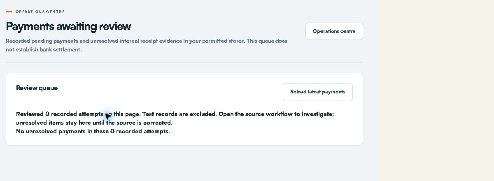

## Handle corrections  reversals and refunds

Request supported corrections and review approval and payout evidence separately.

Who handles this: Faeez prepares the work. A different authorised reviewer performs the independent approval.

Where to go: https://portal.stor24.co.za/adjustments

### Before you start

Identify the exact account and original transaction, obtain supporting evidence and agree which supported correction is needed.

### 1 Choose a supported correction

Select the account and correction type. Credit a specific charge, write off unpaid debt, add an evidenced charge, reverse a full receipt for an unpaid/error notice, or refund a cleared overpayment. Stock returns and off-ledger deposits need separate reconciliation.

### 2 Preview the source and balance

Select the original entry where required. Enter the amount, a specific reason and an evidence reference. Preview checks source limits, account reconciliation, test contamination and refund policy. Credits inherit proportional tax; write-offs do not claim tax relief. Review the balance before requesting approval.

### 3 Use independent approval

A different authorised colleague reviews the saved evidence. Approval posts a charge, credit, write-off or full receipt reversal once. Refund approval changes no balance. If the account changes, cancel the unposted request and prepare a new review. The requester cannot approve their own work.

### 4 Record a completed refund separately

After approval, arrange the authorised payout outside Stor24 and verify its completion. An authorised colleague records the unique payout reference and date; this posts the refund to the account. This screen sends no money, messages or MRI export. Never cancel a refund already paid; resolve any recording failure with finance. Inspect the saved adjustment record and account statement.

### Field and control reference

Field or control | What to enter or check
Account and Correction type | Choose the account and Additional charge, Credit against a charge, Write off unpaid debt, Reverse a receipt (NSF / error) or Refund a cleared overpayment.
Original entry | Select the actual source where required. A receipt reversal is for the full original receipt.
Amount (including tax) | Use the evidenced amount within the original-entry limits. Credits inherit proportional tax; write-offs do not claim tax relief.
Supporting evidence reference | Record a traceable approved instruction or source document reference.
Reason and preview | Explain the specific error. Choose Preview adjustment, review the effect, then request the correction through the displayed review controls.

### Check that it worked

The request and original history are retained. A different authorised approver reviews. After a posted correction, verify the ledger and account statement. Refund approval is separate from an externally completed payout and its recording.

### If something goes wrong

Do not approve your own request, reallocate an error by creating another unsupported receipt, or treat a refund request as money sent. If the underlying account changed, prepare a fresh review through the approved process.

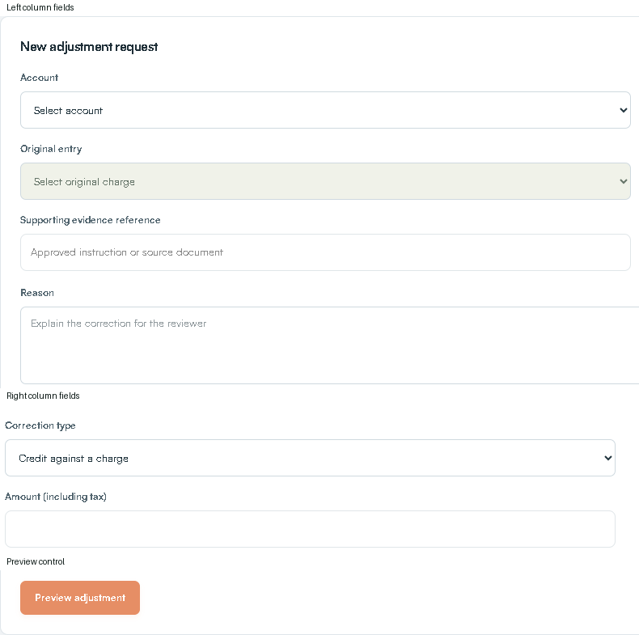

## Review arrears and plan follow up

Use approved due dates and evidenced follow-ups without triggering automatic contact.

Who handles this: Faeez within current store permissions; another authorised colleague handles any withheld action.

Where to go: https://portal.stor24.co.za/collections

### Before you start

Use today's report for edits and ensure approved due dates/reconciliation support the ageing. Check all contact holds before contacting a customer.

### 1 Read the ageing scope

Select the South African as-of date and permitted store. Current, 1-30, 31-60, 61-90 and 91+ day totals follow your filters. Missing approved terms, test receipts and unreconciled accounts go to Finance review and are excluded from aged totals. Historical reports use current terms and recorded ledger history.

### 2 Check before contacting

Review the account, charge due dates, original ledger and holds. Finance must approve due days, invoice overrides and oldest-due-first allocation before ageing is used. Disputes and pending adjustments or debit instructions are held out of the next-follow-up queue.

### 3 Assign and record follow up

Open next follow-up selects an eligible account; it does not dial or message. Open Review, record the actual contact outcome or internal plan, assign a permitted colleague and set the next date. Export filtered CSV downloads the displayed report scope. Never record a real contact outcome merely to practise.

### 4 Track promises and disputes

Record only a customer-agreed amount and date. New verified receipts, excluding reversals and refunds, provide progress evidence; credits and write-offs are not payment. Confirm kept only when on-time receipts cover the promise. A dispute hold stops queue selection, not provider debits or physical access. Notices, fees and access changes remain separate authorised work.

### Field and control reference

Field or control | What to enter or check
Report filters | Set As of (South Africa), Store, Show and Owner. Use Search accounts for the intended account.
Eligible next action | Open next follow-up selects eligible overdue debt; it does not place a call or send a message.
Case work | Review the account and record the actual contact or plan, responsible colleague and next date through the case controls.
Promise and dispute | Only record customer-agreed amount/date. Payment promises and disputes can hold debt-chasing eligibility. Credits/write-offs are not payment progress.

### Check that it worked

The account case shows the saved owner, next action, actual contact result and any current hold/promise. Confirm that the next-follow-up queue behaves consistently with those facts.

### If something goes wrong

A promise due on the 15th should not be removed to arrange an agreed call on the 14th. Keep the promise hold and use a separate agreed appointment. Escalate fees, policy, legal wording or access changes.

## Review and send collection email notices

Check the account and recipient, prepare an immutable message and obtain independent approval before one email attempt.

Who handles this: Faeez within current store permissions; another authorised colleague handles any withheld action.

Where to go: https://portal.stor24.co.za/collections/notices

### Before you start

Use an eligible account with approved overdue evidence and verified email consent. Check disputes promises pending payments and other holds before preparation.

### 1 Select an eligible account

Choose an account from your permitted stores. Notice eligibility reuses approved due-date, reconciled receipt and collection-hold rules. Active tenancy, verified email and explicit email consent are required. Missing terms, disputes, pending payments, adjustments or promises must be resolved before preparing a message.

### 2 Prepare the exact reviewed message

Read the selected recipient, subject and account reminder before preparing the draft. The saved message is encrypted and bound to current account, consent and source evidence. A changed account or recipient requires a fresh draft. These reminders add no fees, collect no money and change no access state.

### 3 Obtain an independent approval

Another colleague with collections management permission for this store must approve with a review reference. Preparers cannot approve their own draft. Reopening clears approval; cancelled and attempted notices cannot be edited into a second send. Generic configuration cannot replace these controlled records.

### 4 Confirm one email attempt and check the result

An authorised sender also needs billing-document send permission for this store. Review the recipient and message again, tick the sending confirmation and send the approved notice. Provider acceptance is separate from inbox delivery. Pending or uncertain outcomes require review and never authorise an automatic replay.

### Field and control reference

Field or control | What to enter or check
Account | Choose the exact account and read the displayed recipient subject account number and message.
Prepare notice draft | Save the reviewed draft. Refresh draft from current source replaces an unapproved draft with current evidence and requires fresh review.
Review reference | A different authorised colleague records the real review reference and uses Approve email notice. The preparer cannot approve the same draft.
Delivery confirmation | An authorised sender rechecks the approved recipient/account/message, ticks the explicit email-now confirmation and chooses Send approved email.
Reopen or Cancel | Use a review reference and the permitted unattempted-draft controls. Do not treat a cancelled or attempted message as a reusable second send.

### Check that it worked

The saved notice has its actual state and reference. Accepted by email provider is not verified inbox receipt. An accepted notice is not sent again by this workflow.

### If something goes wrong

If consent/source/recipient changes or a hold appears, stop and refresh the review. If sending is uncertain, inspect the same saved notice rather than preparing or sending a duplicate. Provider configuration and the independent approval are separate requirements.

## Prepare and independently approve a collection email audience

Review a bounded selected audience, save drafts together and obtain independent group approval before separate delivery.

Who handles this: Faeez prepares the work. A different authorised reviewer performs the independent approval.

Where to go: https://portal.stor24.co.za/collections/notices/bulk

### 1 Select the intended accounts

Choose up to twenty accounts from stores where you can manage collections. Search filters the list while retaining selected accounts; changing store clears the selection. Preview includes every selected account, including those hidden by a search. No draft or message is created by selection.

### 2 Review each recipient and message

Read the exact recipient, subject and reminder for every selected account. Verified email consent, reconciled overdue amounts and the existing dispute, pending-payment and promise holds remain required. Deselect or resolve held accounts and preview again; approved or attempted notices must be handled individually.

### 3 Save together and obtain independent approval

Confirm draft preparation and save the group. A different authorised colleague selects the same accounts and previews every saved message, records a review reference and explicitly confirms independent group approval. Every account, consent and saved revision is rechecked; a changed, held or contributor-owned draft rolls back all approvals. Follow approved account links for separate send confirmation. Approval sends no email and changes no money or access.

### 4 Confirm delivery and review every outcome

Preview the approved audience again and read every recipient and message. Sending needs your email-send grant for every store and a configured provider. Explicitly confirm delivery; keep the page open while it sends one account at a time. The group stops at the first failed or uncertain result. Earlier accepted emails cannot be rolled back. Leaving interrupts remaining work; reload individual notices before any new confirmation. Provider acceptance is not verified inbox delivery. There is no automatic retry or resume.

### If the screen or action is unavailable

Open Collection email audience and wait for it to load. Check your permission and store scope if the area is unavailable. You can keep reading without changing a record.

## Schedule customer follow ups and acknowledge cover

Record agreed appointments in South African time, assign responsibility and acknowledge covering work without changing collection holds.

Who handles this: Faeez within current store permissions; another authorised colleague handles any withheld action.

Where to go: https://portal.stor24.co.za/operations/followups

### Before you start

Obtain the customer's agreement to the appointment, its time and action. An internal desire to chase debt is not an agreed appointment.

### 1 Read the open appointment queue

Open appointments show the agreed SAST time, customer, store, responsible staff and named cover. Open Customer history to read the exact customer's notes and communications. Load more appointments includes later open pages. Store permissions still apply.

### 2 Schedule an agreed customer appointment

Choose Schedule follow-up, search and select the correct customer, store, responsible staff and optional cover. Enter the agreed SAST date/time, title and action, then save. An agreed call on the14th stays separate from a payment promise due15th; the debt-chasing hold is unchanged.

### 3 Hand over to a named colleague

Update cover to nominate an active colleague with access to the store. Only that colleague can acknowledge cover from their own signed-in account. A changed cover clears the previous acknowledgement. Review the original customer history before carrying out the agreed action.

### 4 Check uncertain saves before retrying

Complete or cancel an appointment after checking its current status. If a save cannot be confirmed, reload and review the recorded appointment before retrying. Stale handovers are rejected rather than overwriting a colleague. A failed reload keeps changes blocked; a lost grant clears the records.

### Field and control reference

Field or control | What to enter or check
Find customer by name | Enter at least two characters, choose Search customers and select the exact Customer.
Store | Choose the customer's operational store.
Responsible staff and Covering staff | Choose the actual accountable person and optional cover with store access. Assigning cover is not their acknowledgement.
Agreed date and time (SAST) | Enter the customer-agreed local time. This is separate from a promise-to-pay date.
Appointment title | Use a clear task such as Agreed advance call, not an unexplained reminder.
Agreed action and handover details | Record what the customer agreed, what cover must do and any existing promise/hold that must remain in place.

### Check that it worked

Save agreed appointment, then confirm the saved title/customer/store/time/responsible person/cover in Open appointments. The named cover uses their own login and Acknowledge cover. A changed handover needs fresh review.

### If something goes wrong

When a save is uncertain, reload and check before retrying. Do not tick Complete until the agreed action occurred. If someone changed the same appointment, reload rather than overwrite.

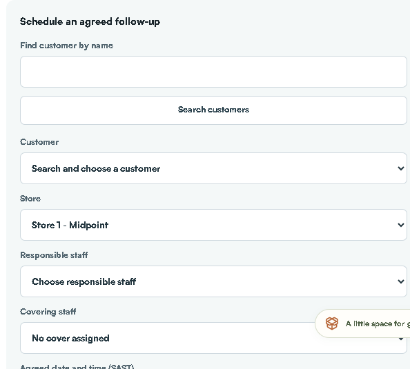

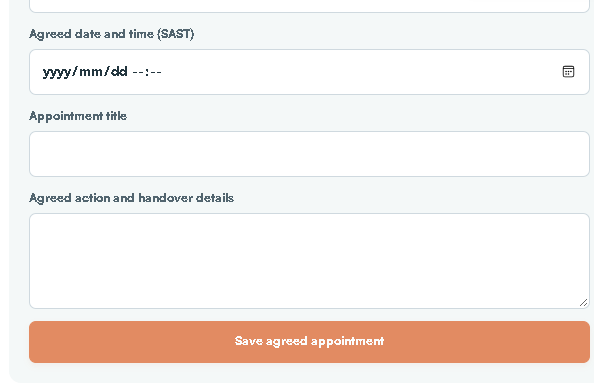

## Prepare expected arrivals and weekend cover

Review dated rental arrivals, current handover blockers and named cover before the manager is away.

Who handles this: Faeez within current store permissions; another authorised colleague handles any withheld action.

Where to go: https://portal.stor24.co.za/operations/arrivals

### Before you start

Know the period and the agreed staff cover, including Saturday and Sunday.

### 1 Choose the period and store

Choose the SAST arrival dates and permitted store, including Saturday and Sunday for weekend cover. Only active rental bookings with agreed arrival dates are listed. Undated active bookings are identified separately so missing dates are not treated as an empty plan.

### 2 Review the actual handover checks

Each arrival reuses the current booking's identity, signed-document, photo, operational unit and verified receipt checks. Read the blockers. Future arrival dates and test-only payments do not allow keys now; planning an arrival does not grant physical access.

### 3 Assign a responsible colleague and cover

Choose Assign or update cover, nominate active staff with store access and record the agreed arrival instructions. Saving a new cover or changed instructions clears old acknowledgement. Review customer history and the source move-in checks before confirming the plan.

### 4 Acknowledge the current arrival plan

The named cover signs in with their own account and acknowledges the current booking and readiness. A date, source, readiness or cover-access change requires review again. If a save is uncertain or a colleague changed the handover, reload the current record before confirming.

### Field and control reference

Field or control | What to enter or check
Arrivals from and Arrivals to | Choose the actual cover period in South African dates.
Arrival store | Choose the permitted store and Apply arrival filters.
Arrival card | Read customer/unit/date and expand handover checks needing attention. Planning an arrival does not clear a blocker.
Assign or update cover | Choose responsible staff and cover and record arrival instructions. The new cover reviews the current booking/readiness and acknowledges in their own account.

### Check that it worked

The plan retains the agreed staff and acknowledgement for the current booking. At actual arrival, recheck the live payment, identity, agreement, unit/photo and handover requirements.

### If something goes wrong

Undated bookings are flagged separately and must be reviewed. A future arrival or a test-only payment does not allow keys today. Changed source/readiness/cover may invalidate acknowledgement.

## Read booking and move in events

Read recorded booking stages and acknowledge only your own event inbox without sending a message or granting access.

Who handles this: Faeez within current store permissions; another authorised colleague handles any withheld action.

Where to go: https://portal.stor24.co.za/operations/events

### Before you start

Open the inbox as yourself. Its unread status belongs to your account.

### 1 Read the source stage

The store event inbox lists booking creation, recorded signed agreements, move-in starts and explicit key-handover audit records. These are separate stages. A booking or signed document does not establish a verified payment, physical key collection or active door access.

### 2 Open the customer history

Use Customer history to open the exact customer and read staff notes and recorded communications before acting. Events show their store, unit where recorded, and SAST timestamp. Only stores in your current operations permission are included.

### 3 Acknowledge for your own account

Mark an event as read only after reviewing it. The acknowledgement belongs to your signed-in account; another colleague still has their own unread state. Changed source evidence needs a fresh read. Acknowledgement sends no email, WhatsApp or SMS and grants no financial or access approval.

### 4 Reload and review older records

Use Older events for later pages and Latest events to return to recent records. If confirmation is uncertain, reload and check your recorded read state before retrying. A failed source read is an unavailable queue, not proof that no events exist.

### Field and control reference

Field or control | What to enter or check
Event stage | Distinguish booking created, recorded signed agreement, move-in started and actual key-handover audit event.
Customer history | Open the exact customer history to understand the next action.
Mark read | Mark read only after reviewing the event. This acknowledges your inbox; it does not send a staff/customer message.

### Check that it worked

Your read status is retained after reload and the underlying booking remains unchanged.

### If something goes wrong

An event is evidence of its stated stage only. It is not proof of payment, active door access, another employee's acknowledgement or a delivered manager alert.

## Statements and customer portal invitations

View, download or deliberately email the correct account statement.

Who handles this: Faeez within current store permissions; another authorised colleague handles any withheld action.

Where to go: https://portal.stor24.co.za/operations/accounts

### Before you start

Open the selected account and check its customer/store/account number.

### 1 Start from the account

Select the account, verify customer and facility, then choose Account statement. Use this account link so the correct account ID is carried forward; there is no generic statement for all customers.

### 2 Set the statement period

On the statement screen, choose From and To and select View statement. Changing either date clears the old preview. Historical test contamination can block generation; escalate the reconciliation rather than bypassing it.

### 3 Check the result before downloading

Verify customer, account, facility, period, opening balance, each debit and credit and closing balance. Download PDF or Print uses the displayed statement. These controls do not create new charges.

### 4 Send only after checking the recipient

Email secure link requires a separate confirmation and uses the customer's verified email. Send / resend My STOR24 welcome is a different action for portal access instructions. Check the returned message and avoid repeated sends if delivery is uncertain.

Check before confirming: Both email controls can send real messages. A welcome email does not confirm payment or grant physical access.

### Field and control reference

Field or control | What to enter or check
Account statement | Open from the account action so the real account reference is carried forward.
From and To | Select the required date range and View statement. Changing dates clears the previous preview.
Review and output | Check opening balance, all entries and closing balance before Download PDF or Print.
Email secure link | Treat this as a separate confirmed send to the verified customer address. My STOR24 welcome is a different action.

### Check that it worked

The downloaded file or printed statement matches the selected account and dates. A send response needs separate delivery confirmation.

### If something goes wrong

If historical test contamination or reconciliation blocks the statement, ask finance to correct the source. Never substitute a statement from another account or report period.

## Transfer an active tenant

Move an active tenancy to another available unit with the agreed rate and date.

Who handles this: Faeez within current store permissions; another authorised colleague handles any withheld action.

Where to go: https://portal.stor24.co.za/operations/accounts

### Before you start

Confirm the tenant is active, the move is authorised and the new unit is actually available in the correct store.

### 1 Confirm the existing tenancy

Select the account and verify customer, facility, current unit and ACTIVE tenancy status. Transfer is disabled for other states. Confirm availability and the physical move with the customer before editing the account.

### 2 Choose the destination and date

Open Transfer. New unit lists available units for this facility; choose the agreed destination. Set Effective date and use Monthly rent override only when the agreed rent differs. This form is not an inter-store transfer workflow.

### 3 Review before completing

Confirm source and destination, rate and date. Use the Prorate calculator only as an indicative calendar-day preview and get the actual billing treatment agreed before Complete transfer. Save only when the real transfer should be recorded.

Check before confirming: Complete transfer changes occupancy. Do not submit a practice transfer on a live tenant.

### 4 Check records and access after the move

Verify the account now shows the correct occupied unit, rate and ledger changes. Check Units & rates and the physical units. Review access separately if doors or permissions differ; a recorded transfer alone does not prove the customer's door access works.

### Field and control reference

Field or control | What to enter or check
New unit | Choose Select available unit and the actual destination.
Effective date | Use the agreed transfer date.
Monthly rent override | Enter only an approved replacement rate; do not assume blank or zero gives free storage.

### Check that it worked

After Complete transfer, check the old occupancy ended, the destination occupancy is active and the correct rate/account history remains. Arrange the real physical/access change separately.

### If something goes wrong

Do not create another customer or lease merely because the button is disabled. Resolve tenancy status, availability or approval first.

## Complete a move out

Check final charges, deposit handling, unit condition and access follow-up.

Who handles this: Faeez within current store permissions; another authorised colleague handles any withheld action.

Where to go: https://portal.stor24.co.za/operations/accounts

### Before you start

Confirm the unit has actually been vacated, inspect condition, collect keys and obtain the required finance decision.

### 1 Review the account before departure

Select the correct account, check the balance and tenancy, confirm notice and inspect the unit. Move out is available for ACTIVE or NOTICE GIVEN tenancies. Agree final charges and deposit handling through your approved process first.

### 2 Enter the actual departure details

Open Move out and enter Move-out date and Final charge. Add the required move-out reason and condition notes, including outstanding physical actions. The default zero charge should only remain if it is correct.

### 3 Choose the deposit treatment deliberately

Choose No deposit action, Refund requires processing or Apply deposit to balance, and enter the relevant deposit amount. Refund requires processing records follow-up; it does not send money to the customer.

Check before confirming: Confirm deposit evidence and approval. Never create a refund or charge to satisfy a guide step.

### 4 Complete and check the outcome

Complete move-out records the real departure. Verify tenancy and occupancy status, final ledger and the unit's availability. Resolve outstanding balances through finance and retain the original transaction history.

### 5 Close the physical and access work

Record outstanding cleaning or damage in Operations maintenance before offering the unit again. Check Facial access revocation and physical access separately. Arrange the approved refund process where needed, then produce a checked statement from the account.

### Field and control reference

Field or control | What to enter or check
Move-out date | Use the actual agreed/recorded date.
Final charge | Use an approved amount only; a default zero is not a finance decision.
Deposit treatment | Choose No deposit action, Refund requires processing or Apply deposit to balance as instructed by finance.
Deposit amount and notes | Use recorded deposit evidence and explain the actual outcome. Off-ledger deposits need separate reconciliation.

### Check that it worked

After the move-out action, verify the tenancy/occupancy status, unit availability, final ledger and retained history. A refund still needs the separate payout/review process.

### If something goes wrong

Do not release a still-occupied or unsafe unit or treat Refund requires processing as money already refunded. Keep physical inspection and access removal as explicit handover tasks.

## Track marketing performance

Create campaigns, share tracked links and compare real enquiry outcomes.

Who handles this: Faeez within current store permissions; another authorised colleague handles any withheld action.

Where to go: https://portal.stor24.co.za/marketing

### Before you start

Use the approved store, campaign purpose and recorded commercial figures. This workspace records marketing activity; it does not itself publish an ad or authorise advertising spend.

### 1 Choose the reporting period and store

Set the South African date range and choose a store within your permitted access. Enquiry results describe records created in that period and their current confirmed move-in outcomes. Historical enquiries and rejected analytics consent remain unattributed; an empty result is not a tracking failure.

### 2 Create a campaign and its tracked links

Create a campaign for the relevant store, channel, budget and dates, then open Tracked links and make one link per placement or creative. Use the generated URL in your ads, social posts, email or QR code. Registered identifiers connect a consented website session to an enquiry without publishing customer details or arbitrary search terms.

Check before confirming: Campaign and link creation require lead-create permission. Never put customer details into marketing names or URLs.

### 3 Record activity and inspect results

Open Activity to record online or offline marketing work and non-overlapping spend, clicks and impressions from platform reports. Campaign cost metrics compare those recorded figures with the enquiry cohort; they are not finance ledger postings or verified ad-platform settlement. Channels compares CTR, CPC and CPM and offers campaign drill-downs. Budgets shows lifetime spend and scheduled pacing; Placements compares creatives and landing pages; Calendar groups activity by South African day and lists campaign dates. Overview compares the previous equal-length period. Export downloads the current view, with lifetime budget totals kept distinct from period activity. Google Analytics traffic requires a separate read-only reporting connection and all-store reporting access.

### Field and control reference

Field or control | What to enter or check
Campaign name and Store | Name the activity clearly and choose its store. Do not include customer details.
Source and Medium | Choose the channel and medium that describe the campaign. Existing campaign store/source/medium may be locked when editing.
Budget (ZAR) and Status | Use the approved planning amount and PLANNED ACTIVE PAUSED or COMPLETE status. This recorded budget does not change an ad-platform budget.
Starts and Ends (optional) | Enter the campaign dates; keep the activity reporting period distinct from lifetime budget totals.
Tracked link | Choose Campaign then enter Placement / creative name and Landing page. Keyword label is optional and internal. Use the generated registered link; do not append personal information.
Log marketing activity | Choose Campaign Activity title Type and actual Date. Enter supported non-overlapping Spend (ZAR) Impressions Clicks and Notes from the source evidence.

### Check that it worked

Reopen the saved campaign/link/activity and confirm store dates source and figures. Check period metrics against the underlying recorded activity. Test a generated landing URL as a navigation check without pretending it proves a real attributed conversion.

### If something goes wrong

Avoid counting overlapping spend twice. Missing analytics consent or provider data stays unattributed/unknown. Do not infer gender or location from a name or photo, or claim a finance posting from a marketing activity total.

## Choose and export a report

Choose report, period and facility, then validate the exported figures.

Who handles this: Faeez within current store permissions; another authorised colleague handles any withheld action.

Where to go: https://portal.stor24.co.za/reports

### Before you start

Know the business question, reporting period, store and required data basis.

### 1 Find a report in the library

Open Reports. Use Find a report or Category to locate the required report. Read its description and any Imported history required or Data or definition required notice before opening it.

### 2 Open the result or use its template

Choose View online to inspect the available report, or Use template to start from that definition. Some reports use View online and download. In the resulting view set the permitted store and the applicable date range or filters, then preview the result. The selected report defines the available controls and date basis.

### 3 Check the meaning and completeness

Check the data source, record grain, row count, dates and missing values. A unit-level report and an account-level report count different things; do not add the same account balance once per unit. A payment record is not bank settlement. Missing imported history remains missing rather than zero.

### 4 Download only the permitted checked result

Use the output controls offered for the selected result after checking it. Open the file and verify its report title, store, period, columns, record count and totals. Private customer data and scheduled reports require their own permissions. Ask the owner to resolve a restriction; do not switch reports to bypass it.

### Field and control reference

Field or control | What to enter or check
Find a report and Category | Choose a relevant template. Use View online or Use template as offered.
Dates and store | Apply the report's stated date basis. Current balances, activity during a period and whole-period occupancy answer different questions.
Data definition | Read record grain and requirements. Imported history or missing definitions must not be treated as zeros.
Export | Export only the permitted result. Check totals and record count before sharing; sensitive personal fields have additional authority checks.

### Check that it worked

The on-screen/downloaded result matches the question, date basis, store, row grain and data completeness. A report is not independently reconciled finance evidence merely because it downloaded.

### If something goes wrong

If the report is blocked, use the safe reason/request reference. Do not remove filters or export through another screen to bypass the restriction.

## Build a custom report without SQL

Choose approved data, fields, filters and totals, then save a reusable report.

Who handles this: Faeez within current store permissions; another authorised colleague handles any withheld action.

Where to go: https://portal.stor24.co.za/reports/builder

### Before you start

Choose an approved template and understand whether its source is current STOR24 records or a dated imported extract.

### 1 Choose a template and its source

Start in Report library and choose Use template, or Create custom report. Read the data basis and record grain before selecting a period. STOR24 records and imported SiteLink extracts are separate sources; an extract is dated historical evidence. A report marked Data or definition required needs that source or an agreed definition before it can run.

### 2 Choose fields  filters and totals

Open Build a report. Select the columns you need, reorder them and add typed filters. Every filter must match. Grouping combines records only when you add a total; money totals require currency grouping. Preview the result and check unrecorded values, dates and row counts. Whole-period occupancy is different from any overlap in a period.

### 3 Save and export within your access

Save an appropriate private definition for reuse, or ask the organisation owner to share a template. Reopen it and verify fields and filters before exporting. Export rechecks current permissions and personal fields require separate authority. Faeez does not have report scheduling in the verified access snapshot; request any authorised schedule from the owner and check the actual saved snapshot outcome separately. A saved definition does not prove financial reconciliation.

### Field and control reference

Field or control | What to enter or check
Build a report | Select columns in the order needed.
Filters | Add typed conditions; all must match.
Grouping and totals | Group deliberately. Monetary totals require currency grouping; do not add account balances once per occupied unit.
Saved report | Save an appropriate private definition. Owner sharing and scheduled snapshot permissions are separate.

### Check that it worked

Preview and verify fields, filters, missing values and totals before saving/exporting. Reopen the saved definition to confirm the choices.

### If something goes wrong

An unknown field or missing source needs a defined dataset. Do not invent historical changes or treat scheduled-save success as proof that the worker delivered a snapshot.

## Plan work with the calendar

Read tasks, agreed follow-ups, viewings, expected rental arrivals and move-outs in SAST.

Who handles this: Faeez within current store permissions; another authorised colleague handles any withheld action.

Where to go: https://portal.stor24.co.za/calendar

### Before you start

Choose the actual date range and store for the work you are planning.

### 1 Read the scheduled work

Calendar groups facility-scoped tasks, lead follow-ups, viewings, expected rental arrivals and scheduled move-outs by day. Times use South African time. An expected arrival still needs current handover checks; an empty day does not establish that every operational task is finished.

### 2 Open the source record

Choose an item to open its linked workflow. Check customer, facility and due time before acting. This calendar is a linked view; it does not offer drag-and-drop rescheduling or a general appointment creation form.

### 3 Create or resolve work at its source

Use Operations  >  Customer follow-ups and covering-staff handovers for an agreed customer appointment with responsible staff and cover. Use Expected arrivals for dated rental bookings and weekend preparation. Complete or update work at its source, then revisit Calendar; reading guidance does not clear entries or grant keys.

### Field and control reference

Field or control | What to enter or check
Scheduled item | Read its source type, time, customer and staff owner.
Source record | Open the actual source workflow to change the action. Calendar is an overview, not a universal editor.
Appointments and arrivals | Use Follow-ups & handovers for agreed appointments and Expected arrivals for rental arrival readiness/cover.

### Check that it worked

The planned item has the correct next action in its source and the covering person knows what they must do.

### If something goes wrong

A calendar entry does not clear a payment/identity/access blocker or establish the customer attended.

## Unidentified payments and finance handover

The meeting requested investigation of money with no identified customer. Unidentified payment review is now visible in the live system. It retains evidence and matching suggestions; it does not allocate or post money. The three investigation grants are not in Faeez's verified 27-grant snapshot. If access is restricted, hand the case to authorised finance with its original reference rather than guessing an account.

For a delegated investigator, the fields are Evidence review store, Original imported source, Original evidence reference, Reported receipt date, Reported amount (ZAR) and Investigation note. Use Retain evidence for review only with real original evidence. Manually reported evidence remains unverified; omit bank/card numbers from the investigation note. Suggesting an account and independent matching review are later separate steps. Finance must independently verify actual funds and any posting.

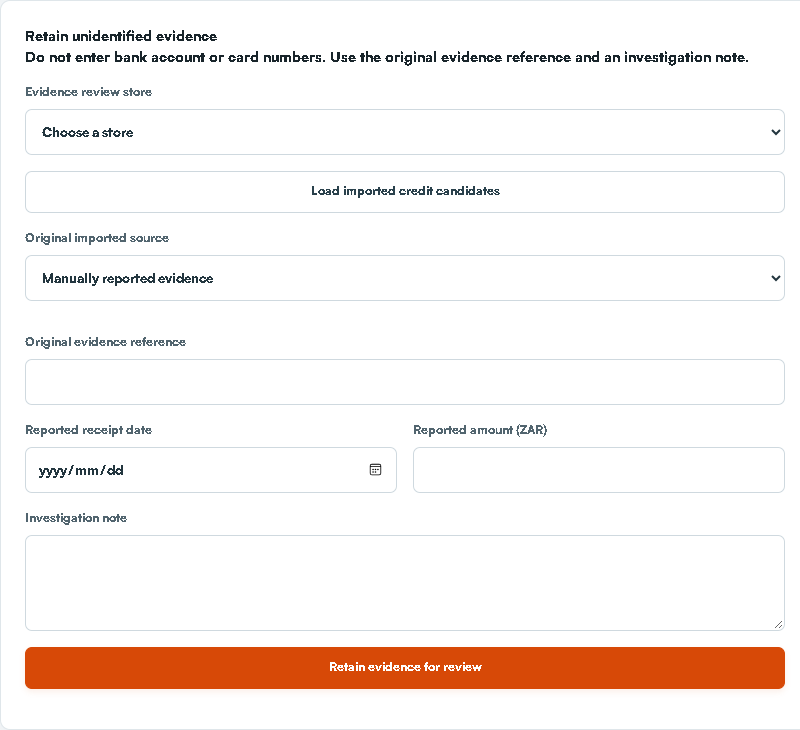

## Other system areas and who owns them

Area | Use or handover
Monthly billing and debit orders | Read permitted invoices and customer records. Finance controls approved posting, runs, bank evidence and reconciled outcomes.
Physical access | Read status when permitted; the designated access operator handles enrolment suspension restoration door mapping and live testing.
Merchandise and packages | Read applicable customer/order facts and pass supply or stock changes to the authorised stock operator. Payment review is not permission to release goods.
Insurance | Record only through the approved insurer/waiver process and role. A register entry does not prove policy activation or collected premium.
Company units and maps | Use existing facts for the quote; owner/authorised inventory staff control configuration commercial rates and physical layouts.
Users integrations and system audit | Escalate with safe references. Do not change staff access provider settings or credentials.
Offline readiness | Only use an authorised prepared encrypted snapshot and the approved reconnection process.

## Worked operational examples

Example | Correct sequence
Wrong-account receipt | Identify source and account; request full original reversal with evidence; independent review; check ledger and statement; finance handles any supported reallocation.
Call on 14th promise due 15th | Retain the promise hold; create a separate agreed appointment; set staff and cover; check acknowledgement; record actual result.
Saturday arrival without the manager | Filter both weekend days; review readiness; assign named cover; cover acknowledges; recheck current move-in evidence before actual keys.
Negotiated rent | Use the agreed positive quote before signing; verify agreement and charge; use an approved re-quote/amendment route for an existing protected online booking.
Missing message content | Search the exact customer/type/channel/date; retain recorded delivery state; identify missing originals; do not invent a transcript.

## Exceptions and recovery

Situation | What to do next
Save result is uncertain | Stop and reload the saved record. Look for the original reference before retrying.
Another person changed the record | Reload the current version and agree the next action. Do not overwrite blindly.
Access restricted | Record the task screen and store and ask the owner to review access. Continue with available work.
No records match | Check date store status and search filters. Confirm the snapshot age.
Payment or signature missing | Retain the existing booking reference and use its supported recovery route. Do not create a substitute record.
Export blocked | Use the safe reason/request reference. Do not copy blocked content through another screen.
Message outcome uncertain | Check the exact customer channel reference and provider state before any separately authorised retry.
Unit stays unavailable | Review remaining reservations occupancy and maintenance; do not force the status.
Unexpected customer information | Close the record and report the store/scope issue to the owner. Do not download it.

## Outage and device recovery

Browser online describes the browser connection. It does not prove provider, gate or payment availability. If the system fails, record the time, store, affected task and safe error text. Follow the approved site/customer escalation procedure. Do not repeat financial or messaging actions while their result is unknown.

Offline work requires a prepared, authorised encrypted snapshot and a tested unlock/reconnect process. Missing or expired snapshots are not usable readiness. Counter signing and payment are not an offline completion route. On reconnect, inspect queued work and conflicts before repeating capture.

## Training exercise checklist

- Find a customer, explain all four tabs, add a permitted dated note and find it from a covering account.

- Capture an enquiry with correct source, voluntary location and next action on approved practice data.

- Walk through a reservation and show the difference between quote, hold expiry and intended move-in.

- Explain agreement payment identity photo and physical key handover as separate checks.

- Demonstrate an evidenced receipt and a wrong-account reversal request on approved isolated data with a separate reviewer.

- Arrange the agreed call on the 14th while preserving a promise due on the 15th.

- Assign weekend cover and demonstrate acknowledgement in the covering person's own account.

- Download a permitted history and report, checking customer, scope, dates and missing-source labels.

Use owner-approved training or isolated data for practice. Do not use real customers for sample financial postings, messages, signatures or access changes. Record trainer, learner, date, store, observed result and any follow-up. The manual is the instruction document; staff acceptance is a separate training record.

## Glossary

Term | Meaning
Customer | The individual or business record.
Lead or enquiry | The storage need and next sales action.
Reservation or hold | Time-limited protection of a unit.
Agreement | Saved terms and signature evidence.
Tenancy and account | The occupancy relationship and its financial record.
Receipt | Recorded actual confirmed funds on the correct account.
Mandate | Authority for a payment method, rather than proof of funds collected.
Promise or dispute hold | A case arrangement affecting collection follow-up eligibility.
Acknowledged cover | The named covering colleague reviewed the current handover through their own account.
Source record | The actual booking account task or provider evidence behind an overview.

## Edition and verification notes

Edition 2, 15 October 2026. This manual was checked against the STOR24 first-party workflow guides and current form source at CRM main 19f00c58c68f4c102f1998f43f556d720f5c3b0b, the recorded 23-item Faeez meeting register and authenticated live screen reads. The original full meeting recording was not independently re-transcribed for this edition.

Fresh live reads and empty forms cover tasks maintenance enquiries customer details/address/consent reservations agreed appointments arrivals payment review correction requests report navigation Counter preparation and unidentified evidence intake. Screenshots retain the date and distinguish live empty forms from fictitious component examples. No production customer financial messaging signing access or permission record was submitted for this documentation work.

Document verification covers source/field/step consistency, screenshot legibility, contents/bookmarks, PDF extraction, page bounds and rendered-page review. It does not establish customer/provider delivery, bank settlement, physical access, actual-device installation or staff training acceptance. Apply the current approved legal privacy finance access and site procedures; unresolved provider data and operational gates remain separate from the manual.
