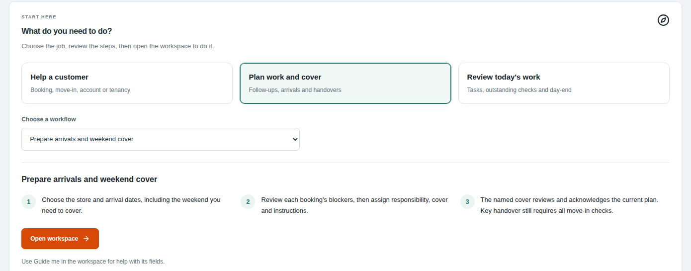
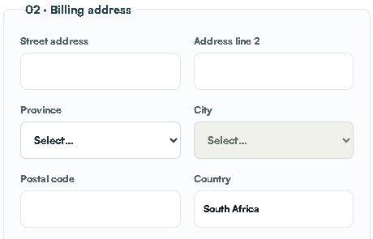
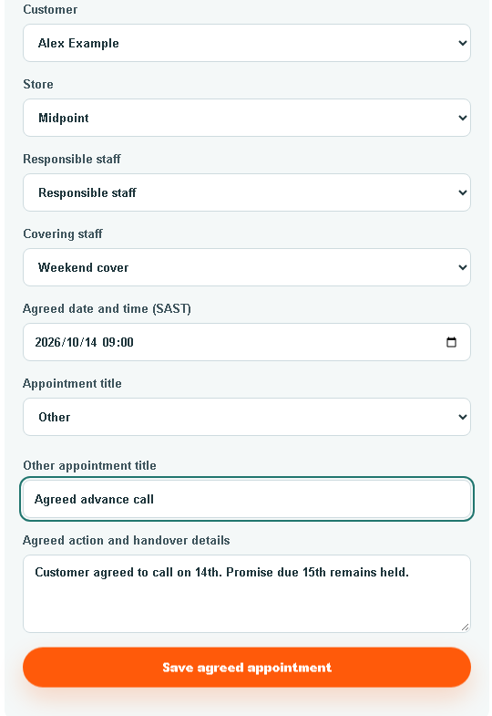

# STOR24 Customer Service Operator Manual

A practical beginner's guide | 21 October 2026 | Edition 4

Staff portal: https://portal.stor24.co.za

Read the first five sections before doing live work. Then open the workflow you need from the clickable contents.

> STOP: Use your own account and assigned store. Never create live practice payments, agreements or access commands.

Internal staff training copy. Keep customer records and downloaded files private.

## Contents

## 1. What this manual is for

For staff who handle customer questions and requests. Use this guide to find the right record, progress a booking and hand restricted decisions to an authorised colleague.

### Who this is for

Customer contact, enquiries, bookings and clear handovers

### How to use the visual cues

### What a successful step looks like

A success banner means the request received a response. Reopen or reload the exact saved record to check the intended result. Check the customer, store, status and relevant amount/date.

> TIP: Diagrams explain the route. Screenshots show where controls were positioned on the capture date. Your account may show fewer actions.

### Screenshots and this edition

Screenshots are retained captures from 15-17 October 2026. Captions distinguish live empty forms from actual-component examples with fictitious data. They are not fresh production screenshots. Sign-in now requires an authenticator, and later layouts may differ. Never copy example customer details into live records.

## 2. Your role and approval limits

The built-in Customer service operator role has 11 documented permissions. It includes customer/enquiry/reservation work, move-in, Operations, contact-history downloads and booking-price view/propose. It does not include billing, receipt posting, direct booking-price approval, identity review or general report exports.

### Work within your role

Find/update customers; record enquiries and notes; manage reservations; propose unsigned booking prices; prepare signing and move-in; manage agreed follow-ups; download scoped customer history.

### Who to ask

Faeez or the authorised price approver for quote decisions; finance for balances, receipts, refunds and debt decisions; identity reviewer for private documents; facilities staff for physical readiness; owner for access or MFA recovery.

> WAIT: Provider setup, real delivery, financial/source acceptance, physical devices and staff training remain separate. This manual does not close those gates.

## 3. Plain-English glossary

## 4. Getting started and signing in

You need an active staff account, the correct store assignment, a connected device and your own authenticator app. MFA means the second sign-in check from that app.

1. Open https://portal.stor24.co.za.

2. Sign in using your own work account.

3. Complete the authenticator check requested by the screen.

4. If prompted to enrol, choose Set up authenticator.

5. Scan the setup QR code using your own authenticator app.

6. Enter its verification code into the enrolment screen.

7. Save your recovery codes in your approved secure location.

8. Confirm the screen says Two-step verification is on.

9. Continue to STOR24.

10. Choose the assigned store before opening customer work.

> STOP: Authenticator setup QR codes, sign-in codes and recovery codes are private. Never send them in a support message or screenshot. A deal-specific manager authorisation code is a different process.

### If you cannot sign in

Use the normal password recovery route for a forgotten password. Use your own recovery code if the sign-in screen offers it and your authenticator is unavailable. Ask the owner to use the approved recovery process if you cannot continue. Do not create another account.

## 5. Start the day and find your workspace

1. Open Operations or the permitted dashboard.

2. Check the selected Store.

3. Review your assigned tasks and current appointments.

4. Open the source queue for the work you will do.

5. Check the source queue filters and update time.

6. Resolve urgent blockers through the right colleague.

Use Menu or Find a workspace. On Operations, Start here lets you choose a work category and workflow. Open workspace takes you to the real screen; reading the guide does not complete the task.

> CHECK: Queue counts can overlap. Do not add them together as a total. Unavailable is not zero. Refresh the actual queue before acting.

## 6. The customer journey at a glance

Enquiry records the need. Reservation holds the unit. Agreement records the customer's acceptance. Payment needs eligible confirmed funds. Handover needs the current date, identity, physical readiness and actual key release.

> STOP: A booking is not occupancy. A signature or debit mandate is not payment. A paid account is not proof the gate has been configured or tested.

## Workflow 01: Find or update a customer

Goal: Keep one accurate customer record.

Start: Customers & tenants

### Before you start

Have the existing customer reference or confirmed name and contact details. Search first; create a new record only when you have checked there is no match.

### Do the work

1. Search for the customer using their existing reference or confirmed name.

2. Open the matching customer.

3. Check the customer identity against the request.

4. Open Contact details.

5. Edit only the details the customer has supplied.

6. Set each contact-consent choice to match the actual agreement.

7. Select Save customer.

8. Reopen the record to check the saved details.

> CHECK: The correct customer record retains the intended contact details and consent choices.

> STOP: Search before creating a customer. Never put identity documents or bank details into a general note.

### Fields and choices explained

Customer type: Choose Individual or Business to match the contracting customer.
Contact and identity: Capture the supplied first/last names or company name, mobile and email. Identity reference, date of birth and tax number belong only in their intended fields when required.
Billing address: Enter street and address line 2; choose Province before City. Check the suggested Postal code against the actual address. Country defaults to South Africa.
Other contacts: Record the real alternate, emergency or work contact and the correct relationship. Do not substitute their contact for the storer.
Consent and notes: Tick only the channels actually agreed to. Use dated History notes for later interactions; the profile summary does not provide the same author/date history.

## Screen guide: Find or update a customer

> TIP: Read the field labels on your own screen. If a control is missing, check your role and store with the owner. Do not switch to another person's account.

## Workflow 02: Record a dated customer note

Goal: Leave a clear record another staff member can use.

Start: Customers & tenants > selected customer > History

### Before you start

Confirm the correct store, source record and permission for this action. Have the agreed instruction and any required approval ready.

### Do the work

1. Open the exact customer.

2. Open History.

3. Choose the note category matching the contact.

4. Enter the factual outcome.

5. Record the agreed next action in the note.

6. Save the note once.

7. Reload History to verify the note and author.

> CHECK: The note shows its saved author, date, category and text.

> STOP: A Payment follow-up note does not schedule a dated appointment. Do not erase a payment promise to arrange a call.

### Fields and choices explained

Category: Choose the actual contact type, such as phone call, payment follow-up or handover.
Free text: Record what happened, what was agreed and who must act next.

## Screen guide: Record a dated customer note

> TIP: Read the field labels on your own screen. If a control is missing, check your role and store with the owner. Do not switch to another person's account.

## Workflow 03: Find and download contact history

Goal: Find the retained evidence for one customer.

Start: Customers & tenants > selected customer > History

### Before you start

Confirm the correct store, source record and permission for this action. Have the agreed instruction and any required approval ready.

### Do the work

1. Open the exact customer.

2. Open History.

3. Set the required date range.

4. Apply the relevant type or text filters.

5. Review the matching records.

6. Choose PDF, CSV or Excel when a download is required.

7. Open the saved file to check its customer and period.

> CHECK: The file matches the selected customer, filters and stored records.

> STOP: Missing historical messages remain missing. A sent or accepted event does not prove inbox delivery. Protect downloaded personal information.

### Fields and choices explained

Dates: Use the required South African date range.
Formats: PDF is readable, CSV is plain rows and Excel is a workbook.
Missing data: Read source and availability labels; do not reconstruct messages.

## Workflow 04: Capture and progress an enquiry

Goal: Record the customer need and agree the next action.

Start: Lead to lease

### Before you start

Know which store the enquiry concerns, what space is required and whether this is an existing customer.

### Do the work

1. Choose the correct Store.

2. Select the existing customer, or create one after checking for duplicates.

3. Choose the actual Enquiry source.

4. Record the requested space and expected move-in date.

5. Capture the supplied requirements and optional marketing answers.

6. Select Save enquiry & continue.

7. Set the saved enquiry owner and next follow-up.

8. Reopen the worklist to verify the saved enquiry.

> CHECK: Save enquiry & continue creates a real enquiry. Confirm the customer and store, then return to the worklist and find the saved enquiry with its owner, current stage and next action.

> STOP: If the next step is uncertain, search the worklist before creating anything else. A stage is the current state, not proof of the earlier customer journey. Missing source data stays unknown.

### Fields and choices explained

Store and customer: Choose Store first. Search an existing customer; use + Create new customer here only when needed. Check the selected customer before continuing.
Enquiry source: Record how the enquiry reached staff: for example Walk-in, Phone in or WhatsApp. This differs from the advertising source.
Expected move-in and requirements: Record the customer estimate and the actual storage need. Include type/size, timing and next agreed action.
Storage use and discovery: Choose Personal, Business or Personal and business. Ask How did you hear about us? rather than assuming an advert caused the enquiry.
Voluntary profile and location: Gender is self-reported and optional. Record city/town, province/region, postal code and country only as supplied. These enquiry fields do not update billing address.
Owner stage and follow-up: In the saved enquiry, choose the real owner, stage and next follow-up. Save the change. Do not mark Moved in without the actual move-in workflow.

## Screen guide: Capture and progress an enquiry

> TIP: Read the field labels on your own screen. If a control is missing, check your role and store with the owner. Do not switch to another person's account.

## Workflow 05: Reserve an available unit

Goal: Hold the agreed unit without duplicating the customer journey.

Start: Reservations, or Reserve a unit from the saved enquiry

### Before you start

Confirm the customer, store, agreed unit/rate, intended move-in date and the length of the hold. Prefer Reserve a unit from the saved enquiry when it belongs to that enquiry.

### Do the work

1. Open the saved enquiry or reservation workspace.

2. Choose the customer and Store.

3. Select an available unit on Floor / layout.

4. Enter the agreed Monthly quote (R).

5. Set Hold expires.

6. Set Intended move-in separately.

7. Select Reserve unit once.

8. Refresh Reservations to verify the saved hold.

> CHECK: Choose Reserve unit only after review. Refresh reservations and confirm customer, unit, quote, expiry and intended move-in. The active hold is distinct from agreement, payment and occupancy.

> STOP: If availability changed, recheck the current unit. Do not force a grey unit or create another hold to bypass a conflict. Before repeating an uncertain save, reload and search for the original reservation.

### Fields and choices explained

Store and Customer: Choose the exact existing customer and permitted store.
Storage space: Use Floor / layout and select an available unit. Green units are available, grey are unavailable and orange is the current selection. Check Available unit before saving.
Monthly quote (R): Enter the agreed positive monthly amount. Review the same amount in the agreement and initial charge. Do not silently alter a protected saved online quote.
Hold expires: Set the expiry agreed with the customer. It controls the hold; it is not the tenancy start date.
Intended move-in: Record the expected arrival date separately from expiry.

## Screen guide: Reserve an available unit

> TIP: Read the field labels on your own screen. If a control is missing, check your role and store with the owner. Do not switch to another person's account.

## Workflow 06: Propose a booking price change

Goal: Record an unsigned booking-price proposal without silently changing the original quote.

Start: Reservations > Booking price review

### Before you start

Confirm the correct store, source record and permission for this action. Have the agreed instruction and any required approval ready.

### Do the work

1. Load the exact existing booking reference.

2. Review the original customer, unit, hold and quote.

3. Enter the proposed monthly rent.

4. Enter the negotiation reason.

5. Submit the proposal once.

6. Reload the booking to check its recorded status.

7. Arrange the required authorised price decision.

8. After approval, direct the customer to their quote-review process.

> CHECK: The proposal is retained. The customer still has to accept the exact approved offer and complete any new agreement and payment steps.

> STOP: A proposal is not an approved or accepted price. Signed bookings or bookings with financial activity require the separate finance/legal process. If access is denied, contact the owner; do not request billing authority just to bypass it.

### Fields and choices explained

Booking reference: Use the existing booking; do not create another hold.
Proposed monthly rent: Enter the agreed proposal in rand.
Reason: Explain the negotiation clearly.
Status: Read the saved state after reload. A success message alone is insufficient.

## Workflow 07: Request manager authorisation when configured

Goal: Obtain a named manager's decision without using their staff login.

Start: Booking price review > Manager authorisation on this screen

### Before you start

Confirm the correct store, source record and permission for this action. Have the agreed instruction and any required approval ready.

### Do the work

1. Check the screen confirms WhatsApp authorisation is configured.

2. Choose an eligible Authorising manager.

3. Show that manager the exact proposal for review.

4. Select Request manager WhatsApp code.

5. Wait for the manager to authorise use of the deal-specific code.

6. Enter the authorised code into this proposal only.

7. Select Confirm manager approval.

8. Reload the proposal to verify the decision.

> CHECK: A successful decision is retained under the authorising manager, with the requesting operator recorded.

> STOP: CONDITIONAL WORKFLOW: the last documented manager numbers/template were not configured. If unavailable, ask an authorised approver to use their own account. This deal-specific authorisation is separate from staff login MFA. Never share authenticator or recovery codes.

### Fields and choices explained

Number not set: The owner must register the manager through the approved settings.
New proposal or resend: Use a fresh code; an earlier code cannot authorise another deal.
Uncertain response: Reload the proposal before requesting another code.

## Workflow 08: Help a walk-in customer on Counter

Goal: Keep customer entry separate from the staff session.

Start: Operations > Walk-in on tablet

### Before you start

Confirm the correct store, source record and permission for this action. Have the agreed instruction and any required approval ready.

### Do the work

1. Check the customer device is ready and the previous visit is cleared.

2. Choose Store on the staff device.

3. Select Prepare tablet visit for the real visitor.

4. Give the customer the displayed QR or short-code route.

5. Let the customer complete their own verification and signing.

6. Clear or end the customer visit.

7. Open the saved booking on the staff device.

> CHECK: The customer booking is retained, the previous visit is cleared from the tablet and staff resume that saved booking. No duplicate customer/lease is needed.

> STOP: The actual tablet and complete customer/device journey still require acceptance. Physical door integration is not proven by finishing Counter. Never expose a staff login on the customer device.

### Fields and choices explained

Staff preparation: On Walk-in on tablet choose Store, then Prepare tablet visit for a real visitor.
Customer entry: Use the presented customer journey, QR code or short code as directed by the screen. Keep the staff login away from the customer device.
Customer completion: The customer supplies their own details, verifies contact and reviews/signs their agreement. Staff do not provide acceptance for the customer.
Staff completion: Clear/end the customer visit, then open the exact saved reservation in Move in. Verify the same customer, store and unit.

## Workflow 09: Prepare and complete agreement signing

Goal: Use the saved agreement and the real customer's signature.

Start: Move in on the existing reservation > Agreement signing

### Before you start

Confirm the correct store, source record and permission for this action. Have the agreed instruction and any required approval ready.

### Do the work

1. Open the existing reservation.

2. Check the contracting customer and agreed terms.

3. Choose Review and sign now or Email invitation for later signing as appropriate.

4. Select Continue to agreement signing when the details are ready.

5. Let the intended customer review and sign.

6. Complete any authorised representative signing step.

7. Refresh Agreement signing to check the saved status.

> CHECK: The correct saved agreement shows its actual signing status. Reuse a completed signed agreement.

> STOP: Opening a signing link is not signing. Staff must not accept for the customer. If an agreement already exists, recover that agreement instead of creating another.

### Fields and choices explained

Account details: Confirm existing customer, Start date, Monthly rent, Initial charge and Payment method. Check the commercial figures against the approved quote.
Signing choice: Review and sign now supports a walk-in or phone-in. Email invitation for later signing is a deliberate alternative.
Agreement preparation: Continue to agreement signing creates a saved lease. Review every field before this action; it is not a read-only preview.

## Workflow 10: Complete a ready move-in

Goal: Release keys only after all required checks pass.

Start: Move in on the existing reservation

### Before you start

Confirm the correct store, source record and permission for this action. Have the agreed instruction and any required approval ready.

### Do the work

1. Open Move in for the exact saved booking.

2. Review the retained signed agreement.

3. Check the required eligible payment evidence.

4. Check the agreed move-in date.

5. Obtain the authorised identity and access-readiness checks.

6. Check physical unit readiness with the site colleague.

7. Record the actual key-handover attestation at handover.

8. Verify the resulting tenancy and unit status.

> CHECK: Confirm the resulting tenancy/account and occupied unit. Record the real handover. Working physical door access still needs its own verification.

> STOP: CS operators must obtain payment/identity decisions from authorised staff where those workspaces are restricted. A mandate, screenshot, test payment or customer assurance is not confirmed funds. A blocked check means stop.

### Fields and choices explained

Agreement: Use View signed agreement for a signed booking. Read the saved original; do not request another signature for an already completed booking.
Payment and date: Compare the eligible verified amount with the required amount and check the agreed move-in date. Test payments and signed mandates do not satisfy a real payment check.
Identity and access photo: Complete the private approved review and check the person/original document at handover as required. Photo/access work has its own permissions and provider conditions.
Physical handover: Only after the required checks pass, record the actual handover attestation and Confirm move-in / key handover when keys are physically handed over.

## Screen guide: Complete a ready move-in

> TIP: Read the field labels on your own screen. If a control is missing, check your role and store with the owner. Do not switch to another person's account.

## Workflow 11: Schedule an agreed follow-up and cover

Goal: Retain a customer-agreed appointment with a responsible person.

Start: Operations > Open customer follow-ups, or Customers & tenants > customer > Follow-ups

### Before you start

Obtain the customer's agreement to the appointment, its time and action. An internal desire to chase debt is not an agreed appointment.

### Do the work

1. Open the exact customer from the Operations overview.

2. Open Follow-ups if it is not already selected.

3. Confirm the fixed customer and choose Store.

4. Select Responsible staff.

5. Select Covering staff if cover is needed.

6. Enter Agreed date and time (SAST).

7. Choose Appointment title, or describe Other.

8. Enter Agreed action and handover details.

9. Select Save agreed appointment.

10. Reload the queue to verify the appointment.

> CHECK: The appointment retains its customer, title, date/time and staff. The covering person must use their own login to Acknowledge cover.

> STOP: A note is not an appointment. An appointment is not an automatic customer reminder or permission to ignore a collections promise. Operations is the overview; use Open customer follow-ups to work inside the selected customer. If customer-profile access is restricted, use your permitted shared queue or ask the customer coordinator.

### Fields and choices explained

Customer: The customer profile fixes the selected customer. In the standalone Operations form, search and select the exact customer first.
Store: Choose the customer's operational store.
Responsible staff and Covering staff: Choose the actual accountable person and optional cover with store access. Assigning cover is not their acknowledgement.
Agreed date and time (SAST): Enter the customer-agreed local time. This is separate from a promise-to-pay date.
Appointment title: Use a clear task such as Agreed advance call, not an unexplained reminder.
Agreed action and handover details: Record what the customer agreed, what cover must do and any existing promise/hold that must remain in place.

## Screen guide: Schedule an agreed follow-up and cover

> TIP: Read the field labels on your own screen. If a control is missing, check your role and store with the owner. Do not switch to another person's account.

## Workflow 12: Reschedule, acknowledge or finish a follow-up

Goal: Keep the appointment queue accurate when plans change.

Start: Selected customer > Follow-ups, or permitted Operations > Follow-ups & handovers

### Before you start

Confirm the correct store, source record and permission for this action. Have the agreed instruction and any required approval ready.

### Do the work

1. Find the existing appointment using the queue filters.

2. Open its current details.

3. Edit the agreed date, owner or handover details when plans change.

4. Save the change once.

5. Ask the actual covering person to Acknowledge cover from their account.

6. Complete or cancel the existing appointment when justified.

7. Reload the queue to verify the saved state.

> CHECK: A finished appointment leaves the open queue. Changed handover details may need a fresh cover acknowledgement.

> STOP: Do not create a second appointment to hide an uncertain save. Check completed or cancelled filters when a record appears to have disappeared.

### Fields and choices explained

Assigned to me: Shows your assigned work.
Due / upcoming: Check both queues and their dates.
Completed / cancelled: Use these states to find closed work.

## Workflow 13: Prepare arrivals and weekend handover

Goal: Make the site and covering colleague ready for the actual booking.

Start: Operations > Expected arrivals

### Before you start

Confirm the correct store, source record and permission for this action. Have the agreed instruction and any required approval ready.

### Do the work

1. Choose the assigned Store.

2. Set the arrival date range.

3. Open the exact booking card.

4. Read its current readiness blockers.

5. Assign the responsible colleague and cover as permitted.

6. Record the factual site instructions.

7. Have the named cover acknowledge their own handover.

8. Recheck readiness when the customer arrives.

> CHECK: The booking has a named owner, current instructions and a genuine cover acknowledgement.

> STOP: Acknowledging cover does not clear payment, signature, identity or door-access blockers. Do not tick a physical handover before keys are released.

### Fields and choices explained

Date range: Use the intended arrival dates, not the hold-expiry date.
Undated count: Investigate bookings with no arrival date.
Readiness: Use the current source record; do not rely on an old screenshot.

## Screen guide: Prepare arrivals and weekend handover

> TIP: Read the field labels on your own screen. If a control is missing, check your role and store with the owner. Do not switch to another person's account.

## Workflow 14: Review booking and move-in events

Goal: Understand which stage actually occurred.

Start: Operations > booking and move-in events

### Before you start

Confirm the correct store, source record and permission for this action. Have the agreed instruction and any required approval ready.

### Do the work

1. Select the assigned Store.

2. Apply the required event filters.

3. Read the event type and time.

4. Open the related booking or customer.

5. Check the underlying record.

6. Mark read after reviewing the event.

7. Reload to confirm your read state.

> CHECK: Your read status is retained after reload and the underlying booking remains unchanged.

> STOP: An event is evidence of its stated stage only. It is not proof of payment, active door access, another employee's acknowledgement or a delivered manager alert.

### Fields and choices explained

Event stage: Distinguish booking created, recorded signed agreement, move-in started and actual key-handover audit event.
Customer history: Open the exact customer history to understand the next action.
Mark read: Mark read only after reviewing the event. This acknowledges your inbox; it does not send a staff/customer message.

## Workflow 15: Create and finish a site task

Goal: Give one real site action a clear owner and completion check.

Start: Operations > New task

### Before you start

Confirm the correct store, source record and permission for this action. Have the agreed instruction and any required approval ready.

### Do the work

1. Choose Facility.

2. Enter an action-based Title.

3. Describe the actual location and required work.

4. Choose Priority.

5. Enter the agreed Due date if needed.

6. Select Create task once.

7. Find the saved task in Assigned operational tasks.

8. Complete the actual work.

9. Select Complete and verify the task after reload.

> CHECK: The saved task identifies the correct store and due date. Completion reflects actual work.

> STOP: A system task does not call a contractor or emergency service. Use the approved site response procedure for immediate danger. Do not put private customer documents into a general task.

### Fields and choices explained

Facility: Choose the store where the work must happen.
Title: Use an action and location, for example Inspect corridor lighting.
Description: State what happened, the exact location, required action and who should receive the outcome. Keep customer identity/bank data out.
Priority: Choose LOW, NORMAL, HIGH or URGENT according to the actual operational urgency.
Due date: Enter the agreed date/time if needed. Check the local date and time before saving.

## Screen guide: Create and finish a site task

> TIP: Read the field labels on your own screen. If a control is missing, check your role and store with the owner. Do not switch to another person's account.

## Workflow 16: Plan the day and hand over a shift

Goal: Leave the next person a current, usable work plan.

Start: Calendar + Operations source queues

### Before you start

Choose the actual date range and store for the work you are planning.

### Do the work

1. Choose the Store and date range.

2. Review assigned tasks and arrivals.

3. Open the source record for each action that needs a change.

4. Update the permitted owner or next action.

5. Record unresolved blockers in the appropriate handover.

6. Ask actual cover to acknowledge their assigned work.

7. Confirm the incoming colleague can find the source records.

> CHECK: Every open item has a source reference, next action and responsible person.

> STOP: A calendar entry is an overview, not proof of completion or customer attendance. Do not paste sensitive identity or bank data into a shift handover.

## When something goes wrong

First stop the uncertain action. Keep the source reference and read the exact error. Check the saved record before trying again.

### What to include in an escalation

Your name; Store; customer/booking/task reference; screen; SAST time; exact safe error; intended result; observed saved status; and whether you retried. Exclude passwords, codes, identity images and bank details.

## Escalation map

Start at the top. Follow the branch matching the problem. These role names identify responsibility; they do not assume a named account has been appointed.

> STOP: For immediate danger, use the organisation's approved emergency/site procedure. This manual does not invent emergency numbers, safety instructions or a contractor call-out policy.

## Outage, recovery and end of shift

### When the connection drops

1. Stop private customer transactions that need the server.

2. Keep a safe reference to the last action attempted.

3. Reconnect using the approved network.

4. Sign in again if the session expired.

5. Reload the source record.

6. Check whether the original action was saved.

7. Resume only after resolving any conflict or uncertain result.

Use offline capture only where your actual approved device and screen support it. Snapshot expiry, queued changes and synchronisation conflicts must be reviewed. Do not perform offline payment, signing, identity submission or Counter transactions from this guide.

### Before leaving

1. Check each open item has a next action and owner.

2. Record unresolved source or approval blockers.

3. Ask the covering colleague to acknowledge their work.

4. Close private downloaded files.

5. Sign out of STOR24.

6. Check shared devices contain no previous customer visit.

> WAIT: The Android installation/sign-in evidence does not prove every laptop, camera, tablet or offline/reconnect workflow. Physical-device acceptance is still required.

## Safe practice and trainer check

Read the workflow first. A trainer must approve any test identity, store and action. Do not use an ordinary customer to experiment.

Trainer record: trainee name; actual role; Store; SAST date/time; workflow; expected result; observed result; evidence reference; remaining action; trainer. This page is a checklist, not a pre-filled sign-off.

## Edition notes and current limits

Edition 4, prepared 21 October 2026. Based on the fetched STOR24 portal main source f4cd3f16, the canonical release context, role definitions, original Faeez register and previously verified illustrated manuals. Source and screenshot provenance are retained with this pack.

Faeez's latest documented access is 30 Midpoint-scoped permissions on 20 October, superseding the earlier 27/29 counts. A fresh permission audit was not performed for this edition. Standard role definitions describe the shipped role; an individual may have custom grants.

Mandatory authenticator setup/sign-in was deployed and owner-tested in the 20 October release record. Staff must enrol and validate their own device. The newer CS-operator booking-price access repair is merged in the reviewed source; fresh production operator verification was not performed for this manual.

The customer-profile Follow-ups tab is normally deployed and has documented real CS-operator navigation/readback evidence from 20 October. Use Operations as the overall work overview, then Open customer follow-ups for the selected customer. Shared Operations appointment work remains available within your permissions. Actual live edits/completion and wider cover acceptance remain separate. Manager WhatsApp authorisation is conditional on owner registration, approved template/configuration and actual delivery.

> WAIT: Open boundaries include actual tablet setup, complete walk-in/customer and physical-access journeys, legal/provider/fee approvals, authoritative debit-failure ingestion, original-source reconciliation, recipient delivery, incoming-manager onboarding and outstanding staff/device training. Released software does not close these checks.

The three role manuals are training documents. They do not change software, permissions, policy, provider flags, financial records or physical access. The separate in-app handbook is unchanged.

## Quick-reference card

Customer Service Operator Manual | Keep this page beside your screen.

### Before every save

Correct customer + correct Store + correct reference + correct amount/date + required authority.

> STOP: Uncertain result? Reload and inspect the original. Never repeat a payment, create another booking or resend blindly.

Escalate: customer/booking -> coordinator; money -> finance; site -> facilities; doors -> designated access operator; login/permissions -> owner.

End shift: name the next owner, retain the source reference, clear shared devices, close private files and sign out.
