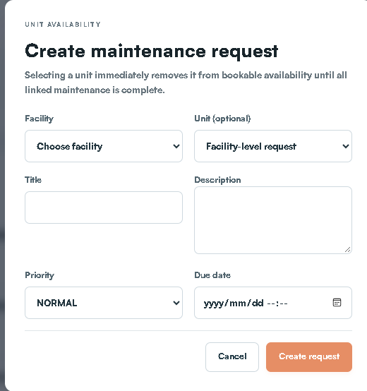
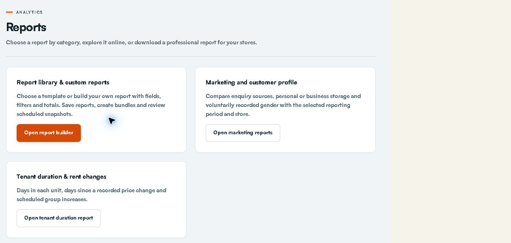

# STOR24 Facilities Manager Operator Manual

A practical beginner's guide | 21 October 2026 | Edition 4

Staff portal: https://portal.stor24.co.za

Read the first five sections before doing live work. Then open the workflow you need from the clickable contents.

> STOP: Use your own account and assigned store. Never create live practice payments, agreements or access commands.

Internal staff training copy. Keep customer records and downloaded files private.

## Contents

## 1. What this manual is for

For the facilities manager and authorised site cover. Use this guide to record real site work, manage maintenance and prepare safe, accurate arrival handovers.

### Who this is for

Site readiness, maintenance, arrivals and reliable cover

### How to use the visual cues

### What a successful step looks like

A success banner means the request received a response. Reopen or reload the exact saved record to check the intended result. Check the customer, store, status and relevant amount/date.

> TIP: Diagrams explain the route. Screenshots show where controls were positioned on the capture date. Your account may show fewer actions.

### Screenshots and this edition

Screenshots are retained captures from 15-17 October 2026. Captions distinguish live empty forms from actual-component examples with fictitious data. They are not fresh production screenshots. Sign-in now requires an authenticator, and later layouts may differ. Never copy example customer details into live records.

## 2. Your role and approval limits

This manual describes facilities duties. The standard Facility manager role has broad store, operations, inventory, daily-close and access-management capabilities. A specific named manager assignment has not been verified for this edition. Use only your actual store and approved duties; a technical grant is not a provider or policy approval.

### Work within your role

Review site tasks; record maintenance; check units and maps; prepare arrivals; acknowledge cover; handle permitted stock work; review permitted operational reports.

### Who to ask

Faeez for booking and customer changes; finance for payments and charges; the designated access operator for door actions; owner for permissions, provider configuration and staff onboarding.

> WAIT: Provider setup, real delivery, financial/source acceptance, physical devices and staff training remain separate. This manual does not close those gates.

## 3. Plain-English glossary

## 4. Getting started and signing in

You need an active staff account, the correct store assignment, a connected device and your own authenticator app. MFA means the second sign-in check from that app.

1. Open https://portal.stor24.co.za.

2. Sign in using your own work account.

3. Complete the authenticator check requested by the screen.

4. If prompted to enrol, choose Set up authenticator.

5. Scan the setup QR code using your own authenticator app.

6. Enter its verification code into the enrolment screen.

7. Save your recovery codes in your approved secure location.

8. Confirm the screen says Two-step verification is on.

9. Continue to STOR24.

10. Choose the assigned store before opening customer work.

> STOP: Authenticator setup QR codes, sign-in codes and recovery codes are private. Never send them in a support message or screenshot. A deal-specific manager authorisation code is a different process.

### If you cannot sign in

Use the normal password recovery route for a forgotten password. Use your own recovery code if the sign-in screen offers it and your authenticator is unavailable. Ask the owner to use the approved recovery process if you cannot continue. Do not create another account.

## 5. Start the day and find your workspace

1. Open Operations or the permitted dashboard.

2. Check the selected Store.

3. Review your assigned tasks and current appointments.

4. Open the source queue for the work you will do.

5. Check the source queue filters and update time.

6. Resolve urgent blockers through the right colleague.

Use Menu or Find a workspace. On Operations, Start here lets you choose a work category and workflow. Open workspace takes you to the real screen; reading the guide does not complete the task.

> CHECK: Queue counts can overlap. Do not add them together as a total. Unavailable is not zero. Refresh the actual queue before acting.

## 6. The customer journey at a glance

Enquiry records the need. Reservation holds the unit. Agreement records the customer's acceptance. Payment needs eligible confirmed funds. Handover needs the current date, identity, physical readiness and actual key release.

> STOP: A booking is not occupancy. A signature or debit mandate is not payment. A paid account is not proof the gate has been configured or tested.

Your main contribution is the physical unit and site handover. Pass customer, commercial and financial changes to the authorised operator.

## Workflow 01: Create and finish a site task

Goal: Give one real site action a clear owner and completion check.

Start: Operations > New task

### Before you start

Confirm the correct store, source record and permission for this action. Have the agreed instruction and any required approval ready.

### Do the work

1. Choose Facility.

2. Enter an action-based Title.

3. Describe the actual location and required work.

4. Choose Priority.

5. Enter the agreed Due date if needed.

6. Select Create task once.

7. Find the saved task in Assigned operational tasks.

8. Complete the actual work.

9. Select Complete and verify the task after reload.

> CHECK: The saved task identifies the correct store and due date. Completion reflects actual work.

> STOP: A system task does not call a contractor or emergency service. Use the approved site response procedure for immediate danger. Do not put private customer documents into a general task.

### Fields and choices explained

Facility: Choose the store where the work must happen.
Title: Use an action and location, for example Inspect corridor lighting.
Description: State what happened, the exact location, required action and who should receive the outcome. Keep customer identity/bank data out.
Priority: Choose LOW, NORMAL, HIGH or URGENT according to the actual operational urgency.
Due date: Enter the agreed date/time if needed. Check the local date and time before saving.

## Screen guide: Create and finish a site task

> TIP: Read the field labels on your own screen. If a control is missing, check your role and store with the owner. Do not switch to another person's account.

## Workflow 02: Report and resolve a maintenance fault

Goal: Record the fault and its effect on unit availability.

Start: Operations > Maintenance queue > New request

### Before you start

Confirm the correct store, source record and permission for this action. Have the agreed instruction and any required approval ready.

### Do the work

1. Choose Facility.

2. Choose the affected Unit or Facility-level request.

3. Enter the fault Title.

4. Describe the observed condition.

5. Set Priority and the response target.

6. Select Create request.

7. Select Start when work actually starts.

8. Select Complete after the real repair.

9. Reload to check the request and unit availability.

> CHECK: The request reflects the actual repair state. Other open requests may still keep the unit unavailable.

> STOP: Selecting a unit can remove it from bookable availability while maintenance is open. Do not choose a random unit for a shared-area fault. Escalate unsafe conditions through the site procedure immediately.

### Fields and choices explained

Facility: Select the correct store first.
Unit (optional): Choose the affected unit, or Facility-level request for a shared-area fault. Selecting the unit changes bookable availability.
Title: Name the specific fault and location.
Description: Record the observed condition, impact and required remedy. Use factual wording.
Priority and Due date: Set the actual urgency and agreed response target.

## Screen guide: Report and resolve a maintenance fault

> TIP: Read the field labels on your own screen. If a control is missing, check your role and store with the owner. Do not switch to another person's account.

## Workflow 03: Check a unit and the facility map

Goal: Compare the recorded unit with the physical site.

Start: Facility map / permitted Units & rates workspace

### Before you start

Confirm the correct store, source record and permission for this action. Have the agreed instruction and any required approval ready.

### Do the work

1. Choose the assigned Store.

2. Choose the relevant floor.

3. Locate the exact unit number.

4. Compare its recorded size and status with the physical unit.

5. Record any mismatch as a factual site task.

6. Ask the authorised inventory or owner colleague to correct the source.

7. Recheck the corrected record.

> CHECK: The source record and actual site are reconciled, or the discrepancy has a named owner.

> STOP: Viewing a map is not permission to delete units, change rates or modify walls. Printed architectural labels are not authority for signage or booking numbers.

## Workflow 04: Prepare the physical unit for arrival

Goal: Make the exact booked space ready without bypassing customer checks.

Start: Operations > Expected arrivals + physical site

### Before you start

Confirm the correct store, source record and permission for this action. Have the agreed instruction and any required approval ready.

### Do the work

1. Find the exact expected booking.

2. Confirm its unit and arrival date with the customer operator.

3. Inspect the physical unit.

4. Record any unresolved maintenance.

5. Agree who will meet the customer.

6. Read the current booking readiness blockers.

7. Pass commercial or payment blockers to the authorised colleague.

8. Release keys only under the authorised handover procedure.

> CHECK: The site is ready or its blocker is recorded. The actual handover is recorded by an authorised operator.

> STOP: Facilities duties do not grant receipt posting, price approval or identity-review access. A site-ready unit alone does not permit move-in.

## Screen guide: Prepare the physical unit for arrival

> TIP: Read the field labels on your own screen. If a control is missing, check your role and store with the owner. Do not switch to another person's account.

## Workflow 05: Prepare arrivals and weekend handover

Goal: Make the site and covering colleague ready for the actual booking.

Start: Operations > Expected arrivals

### Before you start

Confirm the correct store, source record and permission for this action. Have the agreed instruction and any required approval ready.

### Do the work

1. Choose the assigned Store.

2. Set the arrival date range.

3. Open the exact booking card.

4. Read its current readiness blockers.

5. Assign the responsible colleague and cover as permitted.

6. Record the factual site instructions.

7. Have the named cover acknowledge their own handover.

8. Recheck readiness when the customer arrives.

> CHECK: The booking has a named owner, current instructions and a genuine cover acknowledgement.

> STOP: Acknowledging cover does not clear payment, signature, identity or door-access blockers. Do not tick a physical handover before keys are released.

### Fields and choices explained

Date range: Use the intended arrival dates, not the hold-expiry date.
Undated count: Investigate bookings with no arrival date.
Readiness: Use the current source record; do not rely on an old screenshot.

## Screen guide: Prepare arrivals and weekend handover

> TIP: Read the field labels on your own screen. If a control is missing, check your role and store with the owner. Do not switch to another person's account.

## Workflow 06: Schedule an agreed follow-up and cover

Goal: Retain a customer-agreed appointment with a responsible person.

Start: Operations > Open customer follow-ups, or Customers & tenants > customer > Follow-ups

### Before you start

Obtain the customer's agreement to the appointment, its time and action. An internal desire to chase debt is not an agreed appointment.

### Do the work

1. Open the exact customer from the Operations overview.

2. Open Follow-ups if it is not already selected.

3. Confirm the fixed customer and choose Store.

4. Select Responsible staff.

5. Select Covering staff if cover is needed.

6. Enter Agreed date and time (SAST).

7. Choose Appointment title, or describe Other.

8. Enter Agreed action and handover details.

9. Select Save agreed appointment.

10. Reload the queue to verify the appointment.

> CHECK: The appointment retains its customer, title, date/time and staff. The covering person must use their own login to Acknowledge cover.

> STOP: A note is not an appointment. An appointment is not an automatic customer reminder or permission to ignore a collections promise. Operations is the overview; use Open customer follow-ups to work inside the selected customer. If customer-profile access is restricted, use your permitted shared queue or ask the customer coordinator.

### Fields and choices explained

Customer: The customer profile fixes the selected customer. In the standalone Operations form, search and select the exact customer first.
Store: Choose the customer's operational store.
Responsible staff and Covering staff: Choose the actual accountable person and optional cover with store access. Assigning cover is not their acknowledgement.
Agreed date and time (SAST): Enter the customer-agreed local time. This is separate from a promise-to-pay date.
Appointment title: Use a clear task such as Agreed advance call, not an unexplained reminder.
Agreed action and handover details: Record what the customer agreed, what cover must do and any existing promise/hold that must remain in place.

## Screen guide: Schedule an agreed follow-up and cover

> TIP: Read the field labels on your own screen. If a control is missing, check your role and store with the owner. Do not switch to another person's account.

## Workflow 07: Reschedule, acknowledge or finish a follow-up

Goal: Keep the appointment queue accurate when plans change.

Start: Selected customer > Follow-ups, or permitted Operations > Follow-ups & handovers

### Before you start

Confirm the correct store, source record and permission for this action. Have the agreed instruction and any required approval ready.

### Do the work

1. Find the existing appointment using the queue filters.

2. Open its current details.

3. Edit the agreed date, owner or handover details when plans change.

4. Save the change once.

5. Ask the actual covering person to Acknowledge cover from their account.

6. Complete or cancel the existing appointment when justified.

7. Reload the queue to verify the saved state.

> CHECK: A finished appointment leaves the open queue. Changed handover details may need a fresh cover acknowledgement.

> STOP: Do not create a second appointment to hide an uncertain save. Check completed or cancelled filters when a record appears to have disappeared.

### Fields and choices explained

Assigned to me: Shows your assigned work.
Due / upcoming: Check both queues and their dates.
Completed / cancelled: Use these states to find closed work.

## Workflow 08: Review booking and move-in events

Goal: Understand which stage actually occurred.

Start: Operations > booking and move-in events

### Before you start

Confirm the correct store, source record and permission for this action. Have the agreed instruction and any required approval ready.

### Do the work

1. Select the assigned Store.

2. Apply the required event filters.

3. Read the event type and time.

4. Open the related booking or customer.

5. Check the underlying record.

6. Mark read after reviewing the event.

7. Reload to confirm your read state.

> CHECK: Your read status is retained after reload and the underlying booking remains unchanged.

> STOP: An event is evidence of its stated stage only. It is not proof of payment, active door access, another employee's acknowledgement or a delivered manager alert.

### Fields and choices explained

Event stage: Distinguish booking created, recorded signed agreement, move-in started and actual key-handover audit event.
Customer history: Open the exact customer history to understand the next action.
Mark read: Mark read only after reviewing the event. This acknowledges your inbox; it does not send a staff/customer message.

## Workflow 09: Prepare and clear shared devices

Goal: Protect customer privacy between visits.

Start: Counter device and authorised staff device

### Before you start

Confirm the correct store, source record and permission for this action. Have the agreed instruction and any required approval ready.

### Do the work

1. Check which device is assigned for customer use.

2. Check its network connection.

3. Open the approved customer journey.

4. Confirm no previous customer details remain.

5. Keep the staff session on the staff device.

6. End or clear the visit after the customer finishes.

7. Check the next visitor sees a fresh entry screen.

> CHECK: No previous customer visit or staff session remains exposed on the customer device.

> STOP: Actual tablet procurement/setup and camera/offline/reconnect acceptance remain open. Private Counter transactions need connectivity. Do not claim offline payment, signing or access enrolment.

## Workflow 10: Handle stock and customer collections

Goal: Supply only the correct goods against the retained order.

Start: Operations > permitted stock / fulfilment workspace

### Before you start

Confirm the correct store, source record and permission for this action. Have the agreed instruction and any required approval ready.

### Do the work

1. Find the actual order or stock request.

2. Check its Store and customer reference.

3. Check the authorised paid/collection status.

4. Pick the exact item and quantity.

5. Record the physical issue through the supported fulfilment action.

6. Check the retained order and stock result.

7. Hand a discrepancy or return to the authorised stock colleague.

> CHECK: Recorded fulfilment matches the goods actually supplied.

> STOP: Do not mark a collection complete before handover or use stock adjustments to hide a missing item. Payment and refund decisions belong to authorised finance staff.

## Workflow 11: Plan the day and hand over a shift

Goal: Leave the next person a current, usable work plan.

Start: Calendar + Operations source queues

### Before you start

Choose the actual date range and store for the work you are planning.

### Do the work

1. Choose the Store and date range.

2. Review assigned tasks and arrivals.

3. Open the source record for each action that needs a change.

4. Update the permitted owner or next action.

5. Record unresolved blockers in the appropriate handover.

6. Ask actual cover to acknowledge their assigned work.

7. Confirm the incoming colleague can find the source records.

> CHECK: Every open item has a source reference, next action and responsible person.

> STOP: A calendar entry is an overview, not proof of completion or customer attendance. Do not paste sensitive identity or bank data into a shift handover.

## Workflow 12: Choose and verify a report

Goal: Answer a defined question using the right data and period.

Start: Reports

### Before you start

Know the business question, reporting period, store and required data basis.

### Do the work

1. Choose the report matching the business question.

2. Select Store.

3. Set the required date range.

4. Read the report data definition.

5. Apply the filters.

6. Review missing-source warnings and totals.

7. Export only the permitted result.

8. Open the file to check its period and scope.

> CHECK: The on-screen/downloaded result matches the question, date basis, store, row grain and data completeness. A report is not independently reconciled finance evidence merely because it downloaded.

> STOP: If the report is blocked, use the safe reason/request reference. Do not remove filters or export through another screen to bypass the restriction.

### Fields and choices explained

Find a report and Category: Choose a relevant template. Use View online or Use template as offered.
Dates and store: Apply the report's stated date basis. Current balances, activity during a period and whole-period occupancy answer different questions.
Data definition: Read record grain and requirements. Imported history or missing definitions must not be treated as zeros.
Export: Export only the permitted result. Check totals and record count before sharing; sensitive personal fields have additional authority checks.

## Screen guide: Choose and verify a report

> TIP: Read the field labels on your own screen. If a control is missing, check your role and store with the owner. Do not switch to another person's account.

## When something goes wrong

First stop the uncertain action. Keep the source reference and read the exact error. Check the saved record before trying again.

### What to include in an escalation

Your name; Store; customer/booking/task reference; screen; SAST time; exact safe error; intended result; observed saved status; and whether you retried. Exclude passwords, codes, identity images and bank details.

## Escalation map

Start at the top. Follow the branch matching the problem. These role names identify responsibility; they do not assume a named account has been appointed.

> STOP: For immediate danger, use the organisation's approved emergency/site procedure. This manual does not invent emergency numbers, safety instructions or a contractor call-out policy.

## Outage, recovery and end of shift

### When the connection drops

1. Stop private customer transactions that need the server.

2. Keep a safe reference to the last action attempted.

3. Reconnect using the approved network.

4. Sign in again if the session expired.

5. Reload the source record.

6. Check whether the original action was saved.

7. Resume only after resolving any conflict or uncertain result.

Use offline capture only where your actual approved device and screen support it. Snapshot expiry, queued changes and synchronisation conflicts must be reviewed. Do not perform offline payment, signing, identity submission or Counter transactions from this guide.

### Before leaving

1. Check each open item has a next action and owner.

2. Record unresolved source or approval blockers.

3. Ask the covering colleague to acknowledge their work.

4. Close private downloaded files.

5. Sign out of STOR24.

6. Check shared devices contain no previous customer visit.

> WAIT: The Android installation/sign-in evidence does not prove every laptop, camera, tablet or offline/reconnect workflow. Physical-device acceptance is still required.

## Safe practice and trainer check

Read the workflow first. A trainer must approve any test identity, store and action. Do not use an ordinary customer to experiment.

Trainer record: trainee name; actual role; Store; SAST date/time; workflow; expected result; observed result; evidence reference; remaining action; trainer. This page is a checklist, not a pre-filled sign-off.

## Edition notes and current limits

Edition 4, prepared 21 October 2026. Based on the fetched STOR24 portal main source f4cd3f16, the canonical release context, role definitions, original Faeez register and previously verified illustrated manuals. Source and screenshot provenance are retained with this pack.

Faeez's latest documented access is 30 Midpoint-scoped permissions on 20 October, superseding the earlier 27/29 counts. A fresh permission audit was not performed for this edition. Standard role definitions describe the shipped role; an individual may have custom grants.

Mandatory authenticator setup/sign-in was deployed and owner-tested in the 20 October release record. Staff must enrol and validate their own device. The newer CS-operator booking-price access repair is merged in the reviewed source; fresh production operator verification was not performed for this manual.

The customer-profile Follow-ups tab is normally deployed and has documented real CS-operator navigation/readback evidence from 20 October. Use Operations as the overall work overview, then Open customer follow-ups for the selected customer. Shared Operations appointment work remains available within your permissions. Actual live edits/completion and wider cover acceptance remain separate. Manager WhatsApp authorisation is conditional on owner registration, approved template/configuration and actual delivery.

> WAIT: Open boundaries include actual tablet setup, complete walk-in/customer and physical-access journeys, legal/provider/fee approvals, authoritative debit-failure ingestion, original-source reconciliation, recipient delivery, incoming-manager onboarding and outstanding staff/device training. Released software does not close these checks.

The three role manuals are training documents. They do not change software, permissions, policy, provider flags, financial records or physical access. The separate in-app handbook is unchanged.

## Quick-reference card

Facilities Manager Operator Manual | Keep this page beside your screen.

### Before every save

Correct customer + correct Store + correct reference + correct amount/date + required authority.

> STOP: Uncertain result? Reload and inspect the original. Never repeat a payment, create another booking or resend blindly.

Escalate: customer/booking -> coordinator; money -> finance; site -> facilities; doors -> designated access operator; login/permissions -> owner.

End shift: name the next owner, retain the source reference, clear shared devices, close private files and sign out.
